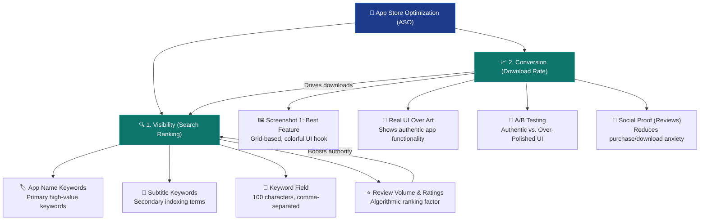

# App Store Optimization (ASO) Playbook: Keyword Strategy, Visual Optimization, and Review Loops

This research document analyzes the key concepts and actionable tactics of App Store Optimization (ASO) based on the "ASO Masterclass" featuring Sebastian, the creator of Habit Kit. It outlines how mobile app developers can drive thousands of organic downloads without paid marketing by optimizing keywords, screenshots, and review loops.

> [!NOTE]
> For detailed companion analyses on onboarding conversion and long-term user retention, see:
> * **Onboarding UX Patterns** (Value Delivery, Personalization, and Conversion): [onboarding_design_patterns.md](file:///c:/Users/Mitsos_PC/Desktop/The%20One%20Folder/Programming/Projects/product_management_development_wiki/docs/research/onboarding_design_patterns.md)
> * **Retention Architecture** (The Craving Machine, The Infinite Game, and The Invisible Scoreboard): [retention_architecture_psychology.md](file:///c:/Users/Mitsos_PC/Desktop/The%20One%20Folder/Programming/Projects/product_management_development_wiki/docs/research/retention_architecture_psychology.md)
> * **Gamification Design Patterns** (Sustainable Retention vs. Intrinsic Motivation): [gamification_design_patterns.md](file:///c:/Users/Mitsos_PC/Desktop/The%20One%20Folder/Programming/Projects/product_management_development_wiki/docs/research/gamification_design_patterns.md)

---

## Executive Summary

Most indie developers and "vibe coders" make the mistake of shipping an app and simply hoping people will find it. In highly crowded app stores, a poor store listing guarantees invisibility (ranking at position 34 or below, where traffic drops to zero). 

To achieve sustainable organic growth, developers must master **App Store Optimization (ASO)**—the strategic process of optimizing an app's metadata and store listing to rank high in search results and maximize visitor-to-download conversion rates.

By implementing this playbook, Sebastian grew his apps (including *Habit Kit* and *Focus Kit*) from obscurity to:
* Over **$50,000 per month** in average recurring revenue ($100,000+ in January 2025 alone).
* Over **$500,000 in total revenue** by 2025.
* **98% organic acquisition**, with almost all users finding the apps directly through App Store search.
* **$0 spent on paid ads** (no Twitter/X ads, Instagram ads, or TikTok marketing).

---

## The ASO Framework

ASO is driven by two main funnels: **Visibility** (getting indexed and ranking high in search results) and **Conversion** (convincing users who view your page to download). 

ASO operates as a virtuous cycle: ranking high drives downloads, which increases conversion metrics, which sends positive data back to the platform algorithms (Apple & Google), further solidifying and boosting search rankings.

---

## The Three Foundations of ASO

### 1. Metadata and Keyword Optimization
ASO relies heavily on the placement of keywords within your app's metadata. Apple and Google use this metadata to index your app and decide which queries it matches.

* **App Name and Subtitle**: These are the **most important factors** in ASO. No other metadata fields have a comparable impact on search indexation.
* **Keyword Research & Validation**:
  * *Brainstorming*: Large Language Models (ChatGPT, Claude) are highly effective tools to brainstorm secondary search terms and target vocabulary.
  * *Validation*: Use tools like **Astro** to track and validate search terms. Focus on two metrics:
    1. **Popularity Score**: How frequently users search for the keyword.
    2. **Difficulty**: How hard it is to rank based on current competitor strength.
  * *Strategic Play*: Target the "sweet spot" (high popularity, low difficulty). However, for your primary keyword, **it is better to compete for a high-value, highly competitive keyword** than to dominate a low-volume keyword that no one searches for.
* **The App Name Rule**: Place your primary keyword directly in your app name.
  * *Example*: Sebastian named his app **Habit Tracker - Habit Kit**. While "Habit Kit" is the brand, "Habit Tracker" is the high-value keyword that drives discovery. 
  * *Contrast*: Popular apps (e.g., *Duolingo*) can afford to put their brand name first because of existing brand equity. Indie developers must prioritize the search term.
* **The Subtitle Rule**: The subtitle provides another 30 characters. Use this for secondary, descriptive keywords.
  * *Example*: Habit Kit uses **"streaks and accountability"**.
  * *Avoid Redundancy*: Do NOT repeat keywords between your app name and subtitle. Apple indexes them as a single combined string; repeating words wastes valuable character real estate.
* **The Keyword Field (App Store Connect)**: A hidden 100-character field. Users cannot see it, but Apple indexes it for search.
  * *Rules of the Field*:
    * Separate keywords with commas; **do not use spaces** (e.g., `habit,routine,tracker` instead of `habit, routine, tracker`).
    * Do not repeat words that are already in your name or subtitle.
    * Use singular forms; do not waste characters on plurals if singular is already indexed.
    * Do not include competitor brand names (violating this can lead to app rejection by Apple).
    * Maximize all 100 characters.

### 2. Screenshot Optimization & Visual Hooks
Once your app is visible, screenshots are the single most influential factor affecting conversion rate (CVR). In a fast-scrolling store, you have only **3 to 5 seconds** to convince a user to install.

* **The First Screenshot is Everything**: Always put your **best, most visually impressive, and unique feature** on the first screenshot. 
  * *Example*: Habit Kit places its grid-based, colorful habit view first. It instantly differentiates the app from generic lists and hooks the user visually.
  * *Anti-Pattern*: Never use a generic welcome screen, sign-up page, or onboarding illustration as your first screenshot.
* **Show Real User Interfaces**: Avoid abstract lifestyle graphics, conceptual illustrations, or marketing copy that doesn't show the app. Users want to see exactly what they are getting. Show high-fidelity mockups of the actual UI.
* **A/B Test and Challenge Assumptions**: Use Apple's *Product Page Optimization* feature to run A/B tests on your screenshots.
  * *Case Study*: Sebastian hired a designer to create sleek, highly polished, professional screenshots for Habit Kit. He was confident they would outperform his original, self-made screenshots. However, an A/B test proved that the **original, less polished, authentic screenshots converted significantly better**.
  * *Lesson*: Authentic, clear screenshots often beat over-designed, corporate-looking ones. Never assume; always test.

### 3. Review and Rating Loop Architecture
Ratings and reviews provide social proof, increase visitor conversion rates, and are heavily factored into the search algorithms of Apple and Google. High rankings with poor reviews will tank downloads.

* **The Timing Prompt (Happy Moments)**: Never prompt for a review during onboarding, immediately after sign-up, or when a user encounters an error. Trigger the system prompt at a moment of high accomplishment or delight.
  * *Example*: Habit Kit triggers the review prompt **immediately after a user completes their first habit**. They feel a sense of accomplishment, which dramatically increases their likelihood of leaving a 5-star review.
* **Respect User Agency**: Do not spam or annoy users. If a user dismisses the review prompt, do not show it again for a long period. Respecting the user preserves their goodwill.
* **Reply to Every Review**: Respond to all feedback. Thank positive reviewers, and offer detailed troubleshooting help to negative ones.
  * *Impact*: Engaging with negative reviews builds trust. It is common for users to update their 1-star reviews to 5-star ratings once their issue has been addressed by an active, caring developer.
* **The Email Signature Trick**: Support emails are direct touchpoints with highly engaged (or frustrated) users. When replying to support emails, include a gentle, personal call-to-action in your signature:
  > *"Hey, if you're enjoying the app, I'd be grateful for a review."*
  * *Why it Works*: If a user receives quick, personal help from an indie developer, they are highly motivated to return the favor by leaving a positive review.
* **Reviews as Product Insights**: Treat reviews as an active user feedback channel. If multiple reviews request a specific feature or report the same bug, prioritize it on the roadmap.

---

## ASO Case Studies: Good vs. Bad Examples

| App / Experiment | ASO Strategy / Element | Classification | Impact & Metrics | Why it Works / Fails |
| :--- | :--- | :--- | :--- | :--- |
| **Habit Kit** | App Name Keyword Structure | 🟢 **Good (Search Hook)** | Ranked #2/3 for "habit tracker" in US | Named `Habit Tracker - Habit Kit`, putting the high-volume primary keyword first. |
| **Duolingo** | App Name Brand Leverage | 🟢 **Good (Brand Leader)** | Elite brand recognition | Named `Duolingo - Language Lessons`. Can afford to place brand name first because of massive external search volume. |
| **Habit Kit (Designer Test)** | Over-Polished Screenshots | 🔴 **Bad (Over-Designed)** | Lower conversion rate in A/B test | Beautiful, slick graphics felt less authentic to users. Authentic, real UI screenshots won. |
| **Habit Kit (Review Trigger)** | Accomplishment-Based Prompt | 🟢 **Good (Delight Loop)** | 7,400+ iOS reviews (4.8★), 10,000+ Android reviews (4.6★) | Triggers review prompt immediately after a user logs their first habit completion. |
| **Support Email Signature** | Personal Ask Trick | 🟢 **Good (Relationship-First)** | High volume of 5★ ratings | Asking for a review immediately after resolving a support issue taps into user gratitude. |
| **Typical Indie App** | "Ship and Hope" / Brand-Only Name | 🔴 **Bad (Invisibility)** | 0 organic downloads | Naming an app `MyUniqueName` without including search keywords in the name or subtitle. |

---

## Actionable Guidelines for App Developers

### 1. Perform a Metadata Audit
* Audit your App Name and Subtitle. Ensure your primary keyword is at the very beginning of your App Name.
* Ensure you utilize the full 30 characters for the subtitle with secondary keywords.
* Do not repeat keywords. Remove plural forms and spaces from your hidden 100-character keyword field.

### 2. Design and Test Real-UI Screenshots
* Place your most attractive, colorful, and unique feature on Screenshot #1.
* Replace lifestyle illustrations or abstract screenshots with real, high-fidelity UI mockups.
* Set up a Product Page Optimization A/B test to validate any screenshot design changes before rolling them out permanently.

### 3. Implement Happy-Moment Review Prompts
* Identify "moments of triumph" in your user journey (e.g., first workout completed, first task checked off, first project exported).
* Program your native review prompt (using `SKStoreReviewController` on iOS) to trigger exclusively at these moments.
* Set up a feedback flag to prevent prompting a user again for at least 3 to 6 months if they dismiss the prompt.

### 4. Respond to Support Inquiries with Gratitude
* Respond to support emails quickly and professionally.
* Add a gentle, personal request for a review to your support reply templates/signatures.

---

## Sources & Context
* **Video Title**: *My App Makes $50K/Month: This Is My ASO Playbook*
* **Host**: Starter Story Build
* **Featured Guest**: Sebastian (Creator of Habit Kit & Focus Kit)
* **URL**: [YouTube Video Link](https://www.youtube.com/watch?v=I2GG0lyb_RI)
* **Date of Analysis**: June 16, 2026
