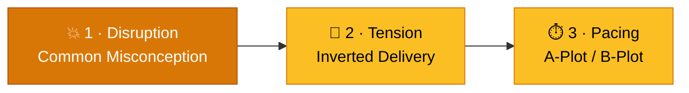
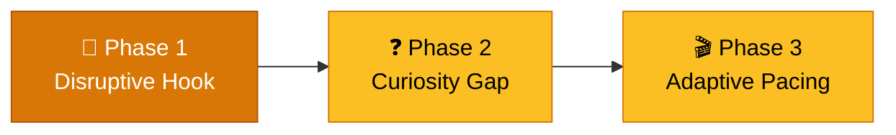

# Content Engagement & Retention Formula

> **Clarity without tension causes audience apathy. Shatter assumptions first — then deliver value.**

---

## Table of Contents

- [The Illusion of Knowledge Paradox](#the-illusion-of-knowledge-paradox)
- [The 3-Part Engagement Mechanics](#the-3-part-engagement-mechanics)
- [Company-Wide Content Framework](#company-wide-content-framework)
- [Implementation Matrix Across Formats](#implementation-matrix-across-formats)
- [Quality Review Checklist](#quality-review-checklist)

---

## The Illusion of Knowledge Paradox

Traditional educational and marketing content focuses on being **clear, concise, and easy to understand**. Derek Muller's (Veritasium) early experiment revealed a counterintuitive flaw in that assumption — one that explains why so much "well-crafted" content fails to move audiences.

| Video Type | Viewer Feedback | Post-Test Score (out of 26) |
|:---|:---|:---|
| **Clear explainer** | Rated highly, "easy to follow" | 6.0 → 6.3 *(barely moved)* |
| **Misconception-driven** | Challenging, confusing, uncomfortable | → 11 *(nearly doubled)* |

*Source: [Veritasium — why he still gets views](https://youtu.be/QHhJ8_TJeNo), The Internet Stamp.*

- **Clear explainer videos** fail because audiences passively agree — they *think* they already understand the topic, so the content produces **zero cognitive engagement**.
- **Misconception-driven videos** succeed because they force viewers to notice the mismatch between their mental model and reality, creating a state of genuine curiosity.

> [!IMPORTANT]
> **The key PM takeaway:** Clarity without tension causes audience apathy. Content must first create **cognitive dissonance** — shattering existing assumptions — before it can deliver value that actually sticks.

---

## The 3-Part Engagement Mechanics

Veritasium's viral formula decomposes into three sequential mechanics that turn a passive viewer into an engaged learner.

### Element 1: Target Common Misconceptions (The Hook)

* **Mechanism:** People build mental models of the world that are often wrong. If you tell them what they already believe, they tune out. If you show them they were wrong, they *have* to pay attention.
* **Action:** Open by pointing out a widespread flaw or myth — e.g., *"Most people tie shoelaces wrong"* or *"LEDs don't get their color from their plastic cover."* This forces the audience to realize they don't actually know the answer and opens a high-retention **curiosity gap**.
* **Packaging Rule:** Titles and thumbnails shouldn't just name the topic; they must highlight the **friction or mystery** behind it. (A single thumbnail change moved one of Veritasium's worst-performing videos to his best.)

### Element 2: Invert Delivery Structure (Question First, Explanation Second)

* **Traditional Approach (school):** Concept/formula first → then test with questions. *Result: high drop-off and passive "agreement."*
* **Veritasium Approach:** Raise an intriguing paradox or question first → make the viewer *hungry* for the answer → then deliver the explanation.
* **Pattern:** *"So, why is the LA Reservoir covered in 96 million shade balls?"* — the question opens the tension that the explanation then resolves.

### Element 3: A-Plot / B-Plot Interweaving (Cognitive Load Management)

Borrowed from filmmaking, this technique alternates between two parallel tracks to prevent cognitive fatigue:

| Plot | Role | Example |
|:---|:---|:---|
| **A-Plot** | Narrative / experiential / real-world action | Floating on a boat in a reservoir of 96M shade balls |
| **B-Plot** | Technical / educational / data explanation | The physics of evaporation and shade balls |

* **Action:** When the B-Plot gets too dense or technical, cut to the A-Plot. When the A-Plot slows down, cut back to the B-Plot. This alternation keeps momentum and holds retention through long, complex explanations.

> [!TIP]
> Higher retention doesn't just mean a better viewer experience — it signals YouTube (and other algorithms) to recommend the content more broadly. **Retention is the distribution multiplier.**

---

## Company-Wide Content Framework

The formula generalizes beyond video into product demos, blog posts, sales decks, customer success stories, and social media campaigns.

### The 4-Step Operational Formula

| Stage | Objective | Execution Guidelines | Company Example (B2B / Tech) |
|:---|:---|:---|:---|
| **1. Misconception Hook** | Shatter existing assumptions | Identify the #1 wrong assumption your target audience holds about the problem. Lead with it directly. | *"Most engineering teams think adding microservices speeds up delivery. In reality, 70% suffer latency spikes."* |
| **2. Curiosity Gap (Question)** | Make the audience hungry for your solution | Pose the mystery or underlying paradox *before* showing feature screenshots or specs. | *"How did Company X scale to 10M users without increasing infrastructure spend by a single dollar?"* |
| **3. A/B-Plot Interweaving** | Balance story and technical detail | Alternate between human narrative/real-world context (**A-Plot**) and technical architecture/data (**B-Plot**). | **A-Plot:** On-call engineer resolving an incident live. **B-Plot:** Diagram of query optimization & database indexing. |
| **4. Resolution & Takeaway** | Deliver satisfying clarity | Resolve the initial question and tie it directly to your core value proposition. | *"By refactoring query paths at the edge, latency dropped 80% while retaining full data compliance."* |

> [!WARNING]
> Never show a feature **without first showing the failure condition of the status quo**. A feature introduced in a vacuum has no tension and no reason to be remembered.

---

## Implementation Matrix Across Formats

### 1. Short-Form Content & Social (LinkedIn / X / TikTok)

* **A-Plot (Visual/Story):** Founder talking head, live UI demo screen recording.
* **B-Plot (Substance):** Key metric graphs, code snippet overlay, concrete strategy points.
* **Pattern:** Cut every 3–5 seconds between narrative punchlines and visual proof.

### 2. Long-Form Content (Blogs / Whitepapers / Case Studies)

* **Hook:** Avoid generic intros (*"In today's fast-paced digital landscape..."*). Start with a counter-intuitive stat or a broken status quo.
* **Structure:** Use subheadings posed as open questions rather than topic names — *"Why traditional caching fails at scale"* vs. *"Caching Strategies."*
* **Pacing:** Alternate paragraphs between customer quotes/scenarios and architecture diagrams/metrics.

### 3. Product Demos & Keynotes

* **A-Plot:** A user persona facing an operational roadblock (the human struggle).
* **B-Plot:** The product feature solving that bottleneck behind the scenes (the engine).
* **Rule:** Never show a feature without first showing the failure condition of the status quo.

---

## Quality Review Checklist

Before publishing any piece of company content, content leads should grade it against this rubric:

- [ ] **The Misconception Test:** Does the first 10% of the content challenge a common belief or highlight an unrecognized problem?
- [ ] **The Inversion Test:** Does the content pose a compelling question *before* revealing the feature/answer?
- [ ] **The Narrative Friction Test:** Is the content alternating between story/context (A-Plot) and deep technical value (B-Plot) to prevent fatigue?
- [ ] **The Title/Thumbnail Test:** Does the title spark curiosity about an outcome rather than just describing the topic?

---

## Related Pages

- ← [Go-to-Market](go-to-market.md) — Content as a core discovery and messaging channel
- ← [Search Engine Optimization](search-engine-optimization.md) — Standout content earns mentions and AI visibility
- → [Success Metrics](../06-metrics/success-metrics.md) — Measure engagement across the AARRR funnel
- → [Retention Psychology](../06-metrics/retention-psychology.md) — Curiosity and craving states behind engagement
- → [App Launch Checklist](app-launch-checklist.md) — Launch-day content and messaging tasks
- → [User Research](../02-discovery/user-research.md) — Audience mental models and misconceptions to target

---

## Sources & References

- The Internet Stamp, *"Veritasium - why he still gets views"* — [YouTube](https://youtu.be/QHhJ8_TJeNo)
- Derek Muller (Veritasium), original channel: [@veritasium](https://www.youtube.com/@veritasium)

---

*[← Back to Section Index](index.md) · [← Back to Wiki Home](../index.md)*
