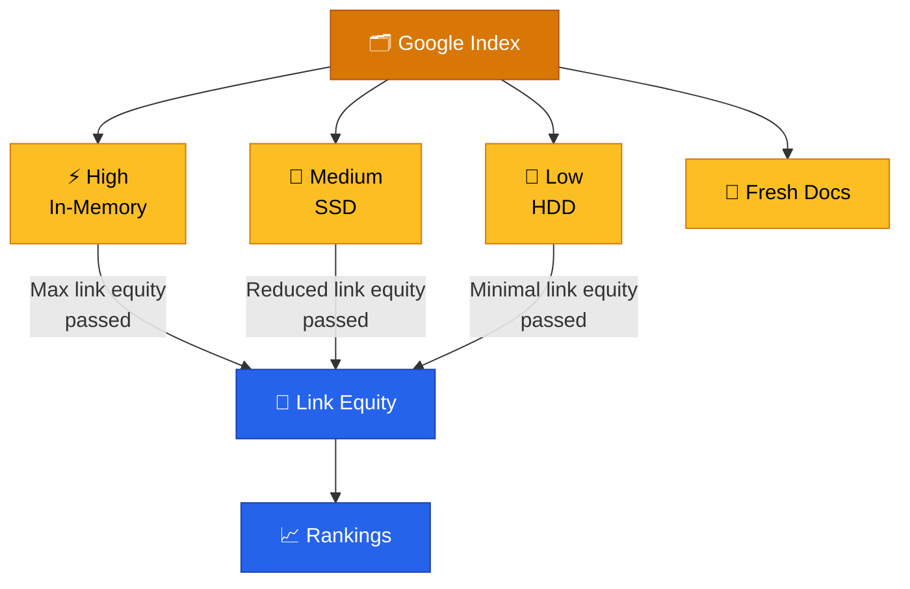
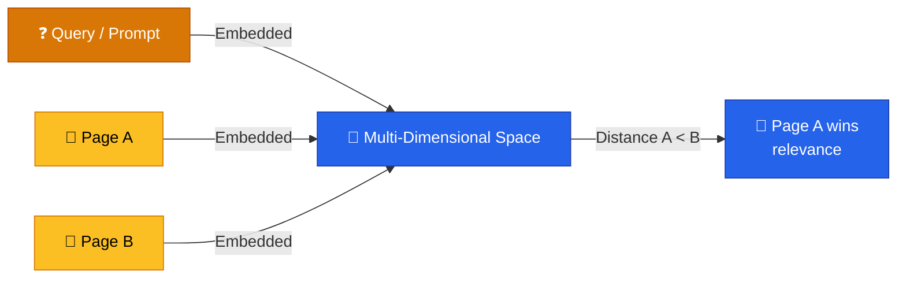
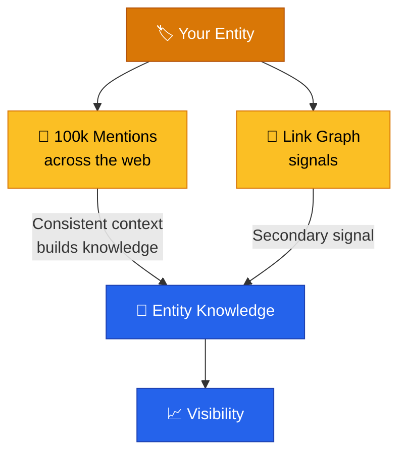
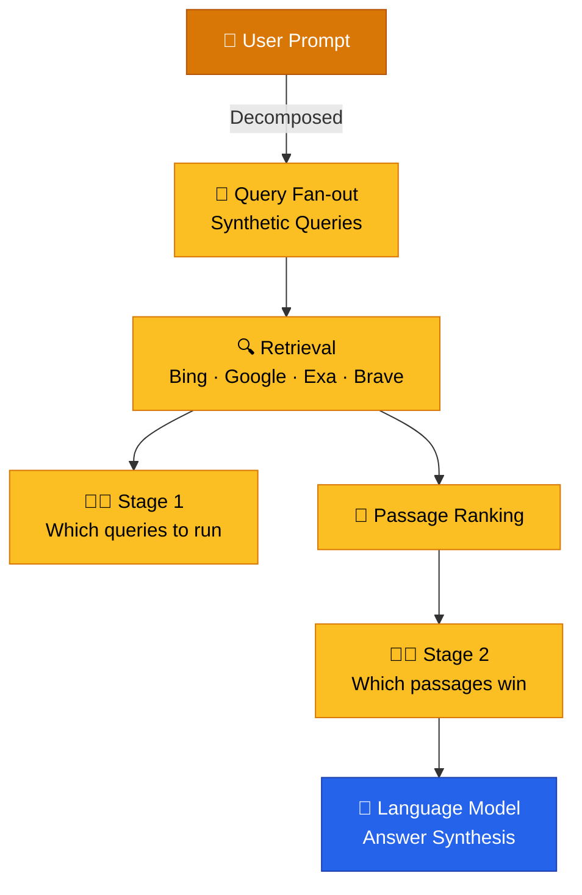

# Search Engine Optimization & AI Search

> **Modern SEO is no longer about chasing static metrics — it is about engineering relevance for both human searchers and AI agents across a stratified, embedding-driven index.**

---

## Table of Contents

- [How Google Ranks Today](#how-google-ranks-today)
- [Vector Embeddings & Entities](#vector-embeddings--entities)
- [Mentions vs. Links](#mentions-vs-links)
- [AI Search & Query Fan-outs](#ai-search--query-fan-outs)
- [Optimizations That Work Now](#optimizations-that-work-now)
- [Relevance Engineering](#relevance-engineering)
- [Measurement](#measurement)

---

## How Google Ranks Today

The Google index is **not one giant database**. It is stratified into four buckets, each stored on hardware that matches how quickly Google needs to retrieve it:

| Bucket | Storage | Description |
|:-------|:--------|:------------|
| **High** | In-memory | Fastest access; results that must be served instantly |
| **Medium** | Solid-state drives | Fast, but not instant |
| **Low** | Standard hard drives | Slowest; **most of the web** lives here |
| **Fresh Docs** | — | Recently discovered/updated content with separate handling |

> [!WARNING]
> **Link equity is not static.** A page's position in the index caps the *maximum* value it can pass through links. A low-quality page ranking on page 52 cannot pass the same equity as a first-page result — regardless of how many links it holds.

### Proxies for Your Bucket

There is no public API revealing your bucket, but strong proxies exist:

- **Does the page rank on page 1?** High-value content must be instantly accessible → likely in-memory.
- **Does it get traffic?** Pages receiving consistent traffic are promoted in the index.
- **Is it an editorial/news site?** Historically assumed valuable due to crawl frequency, but the *bucket* itself is the real driver.

> [!NOTE]
> Google denies the existence of "domain authority," yet the leak reveals **site authority** is a real internal concept. Tools like Domain Rating are entertainment metrics — proxy signals that don't directly match Google's reality.

---

## Vector Embeddings & Entities

Google converts pages, passages, sections, whole websites, authors, and entities into **coordinates in multi-dimensional space**. Relevance is measured by **physical distance** between a query and content: the closer the embedding, the more relevant the result.

> [!TIP]
> Because embeddings are used "for everything," the **link graph is less important than historically believed**. The competitive advantage lies in building an *index of embeddings* — understanding how Google models the relationships between entities, websites, and content at scale.

---

## Mentions vs. Links

**Mentions matter more than links.** Google aggregates what is said about you across the web to build entity knowledge. Consistent context from many sources is treated as a stronger, more believable signal than the link graph.

- **Links still matter** — a niche group of dinosaur-expert sites linking to a sneaker brand *can* teach Google a new entity association.
- **But mention volume usually overpowers the link graph** because consistency is observed across far more locations.
- **Weights are dynamic** — there is no single algorithm, but a series of microservices scoring documents and entities, adjusted per query space.

### How to Earn Mentions

> [!TIP]
> **Make friends or make news.** Anything else is manipulation of the web.

| Tactic | Why It Works |
|:-------|:-------------|
| **Linkable assets** | Content so compelling others share and reference it — the highest-leverage outcome |
| **Sponsored events** | Cheap to sponsor; events get press, newsletters, social mentions, and referral traffic |
| **Viral stunts** | Journalists *want* to write about you (e.g., Red Bull's model) |
| **Consistent standout content** | Marketing is standing out and resonating — start there, not with do-follow hacks |

---

## AI Search & Query Fan-outs

AI platforms do **not** use a single index. ChatGPT queries Bing, Google, Exa, SER APIs, and more (Claude relies on Brave). Prompts are broken into a **query fan-out** — a series of synthetic queries — and content is retrieved, ranked, and synthesized through an **agentic RAG pipeline**.

> [!WARNING]
> At each stage an **agentic critic** makes judgments you have no visibility into and no control over. Content that is discarded early never reaches the language model — you simply don't rank in the answer.

### Strategy for AI Search

- **Optimize for the query fan-outs, not the prompt.** Users don't search the prompt; the system does.
- **Be comprehensive.** Fan-outs shift slightly between runs, but they don't introduce dramatically new ideas. Ultimate-guide-level comprehensiveness covers the variations.
- **Let your audience drive research.** These systems are reactive to audiences — keyword and prompt research should be audience-driven.
- **Map content to format expectations.** Each synthetic query can expect a specific format (e.g., video). If you provide the expected format, the system pulls you over generic alternatives.
- **Maximize surface area.** Spread content across your ecosystem — website, YouTube, LinkedIn, earned media, owned communities — so it performs across every engine.

> [!TIP]
> **Inspect AI responses directly:** right-click → Inspect → Network tab → `conversation` endpoint to see the live query fan-out — the terms, sources, and query types used. Tools like Profound capture how fan-outs change across multiple runs per day.

---

## Optimizations That Work Now

### 1. Fix Page Speed & the 499 Response Code

**499** is an nginx-invented status code (now adopted by most CDNs) meaning *"the client gave up because the request took too long."* AI bots fetch pages **in real time** — they don't use a cached index — so a slow site silently loses AI visibility.

| Signal | Impact |
|:-------|:-------|
| **Time to First Bite (TTFB)** | Primary lever for bot access — the page must respond before the bot times out |
| **Edge caching** | Eliminates 499s; CDN serves cached content instantly |
| **Bot vs. user speed** | Single-page apps feel fast to humans (progressive rendering) but are slow for bots that don't render JS |

> [!TIP]
> **Audit your log files for 499s right now.** Fixing 499s + page speed drove a **+300% visibility increase in 3 months** for one client. This is the single fastest SEO/GEO win.

### 2. Get Into AI Training Data

Assess your presence in **Common Crawl** (a primary training-data source):

1. Measure how many of your pages are in Common Crawl and how often they're crawled.
2. If coverage is low, create **crawl paths** from pages already in the crawl — Wikipedia link drops, links from CC-listed domains.
3. Treat training-data presence as a strategic play, not a spam tactic.

> [!WARNING]
> Spammy "millions of AI mentions" and cloaking micro-sites are returning — but there are no rules yet on AI platforms. Relying on manipulation is a dead end once enforcement and detection mature.

### 3. Produce Content With Format Expectations

Reddit, YouTube, and LinkedIn posts are the most-cited sources in AI answers. Tactics:

- **Reddit:** Run your **own subreddit** (populate it first, be responsive, cross-link from other subreddits' discussions) instead of astroturfing — moderators aggressively police gaming attempts.
- **YouTube/LinkedIn:** Create the expected format for high-value synthetic queries; systems prefer dedicated formats over text-only fallbacks.
- **AMAs:** Grow your subreddit with guest AMAs, syndicated to newsletter and social.

### 4. Use AI With a Human-in-the-Loop

The biggest content mistake is one-prompt generation without source data. Instead:

- Map content to a **content model** with individual prompts per component.
- Build a **custom RAG index** of your content (or best-in-class assets, white papers, PDFs) the model can retrieve from.
- Use **subject-matter experts** to write outlines and review output.

> [!NOTE]
> Google **cannot reliably detect AI content** — that's why it pushes watermarking and instead judges content through **human signals**: time-on-site, bounce rate, and success rate of visits. AI content at scale is not inherently abuse; it's a **UX problem**. Good UX → good human signals → sustainable performance.

---

## Relevance Engineering

SEO, Answer Engine Optimization, and GEO are misnomers — you don't optimize those engines; their engineers do. What you actually do is **feature engineering** for those systems. **Relevance Engineering** is the evolution of SEO:

> **The confluence of AI, information retrieval, content strategy, UX, and digital PR — applicable to any search surface, existing or yet to exist.**

| Component | Role |
|:----------|:-----|
| **AI** | Leverage models and distilled replications of retrieval pipelines to understand systems |
| **Information Retrieval** | The computer science behind search — generative AI technology comes from search |
| **Content Strategy** | Build systems that produce performance content consistently at scale |
| **UX** | Serve the end user — who is increasingly an **agent**, not just a human |
| **Digital PR** | Spread messages and create surface area so both humans and agents recognize you as the source |

> [!NOTE]
> We are entering **"machine media"** — where the bot is a first-class citizen. Bot activity already exceeds human activity, and that gap will only widen.

---

## Measurement

Visibility alone is an incomplete KPI. Measure **three buckets**:

| Bucket | Metrics |
|:-------|:--------|
| **Performance** | Referral traffic, behavior once landing, conversion |
| **Brand Visibility** | Visibility, citation rate, **citation accuracy** |
| **Input Metrics** | Bot activity, rankings for synthetic queries, passage relevance scores, entity salience |

> [!TIP]
> Input metrics are the actionable levers — they're what you can actually change to move performance. Single-bucket measurement misses the picture, and this typically spans a **tiger team** (PR, content, marketing) rather than SEO alone.

---

## Related Pages

- ← [Go-to-Market](go-to-market.md) — SEO as an organic discovery channel in GTM
- ← [App Store Optimization](app-store-optimization.md) — Organic search in app stores vs. web
- → [Success Metrics](../06-metrics/success-metrics.md) — Measuring acquisition and conversion outcomes
- → [App Launch Checklist](app-launch-checklist.md) — Launch-day organic visibility tasks
- → [User Research](../02-discovery/user-research.md) — Audience-driven keyword and prompt research

---

## Sources & References

- Podcast interview: Mike King, "Google Leak Takeaways" (iPullRank), chapters 2–30
- Google API content leak analysis and DOJ antitrust trial testimony
- Yandex source-code leak (cross-verified concepts: boosts, Twiddlers, index stratification)
- Related external course: Software Product Management Specialization (Coursera)
- Original file reference: `docs/research/` (SEO/AI-search research notes)

---

*[← Back to Section Index](index.md) · [← Back to Wiki Home](../index.md)*
