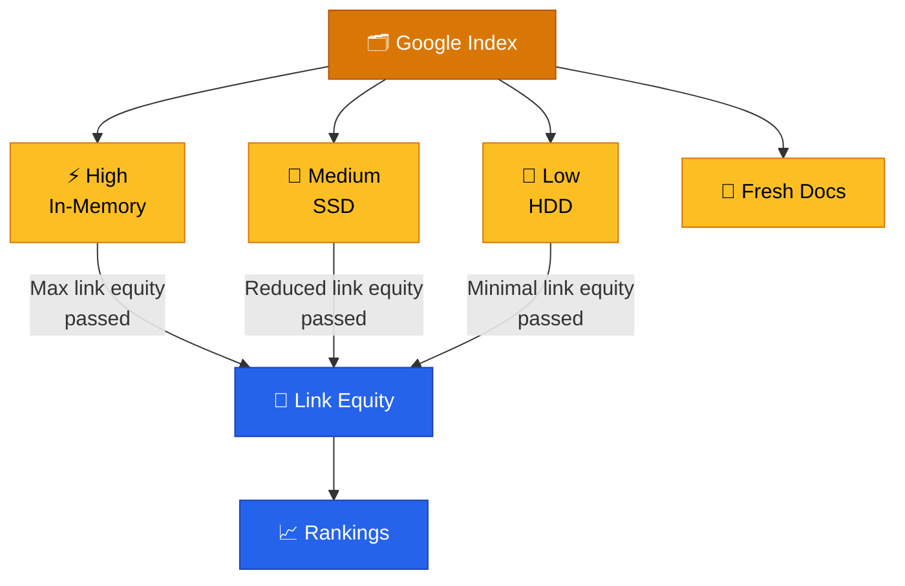
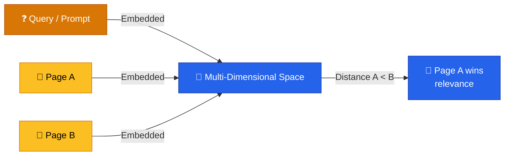
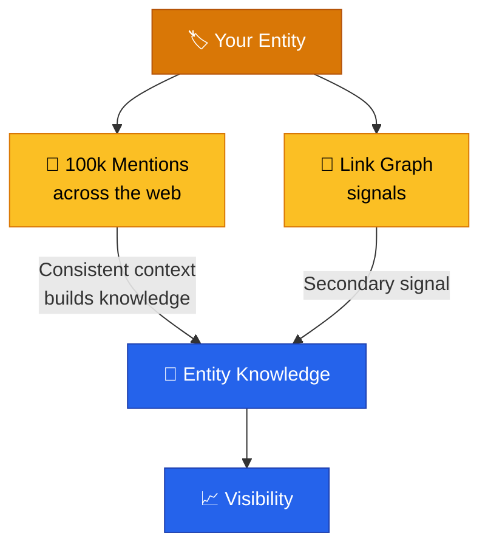
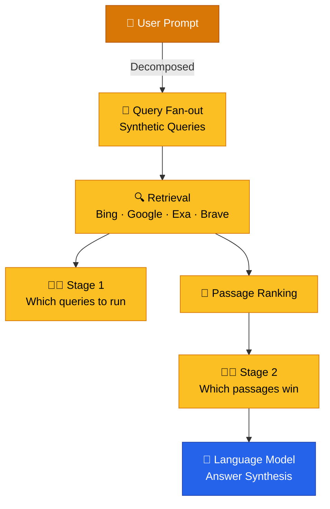
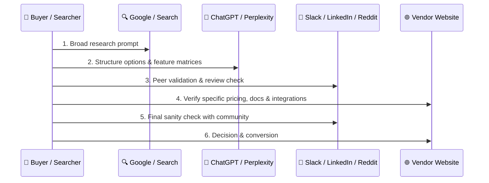
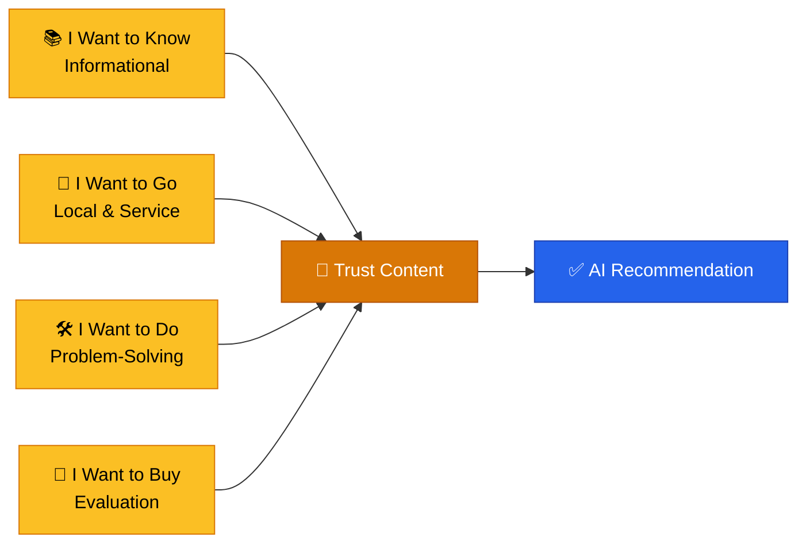
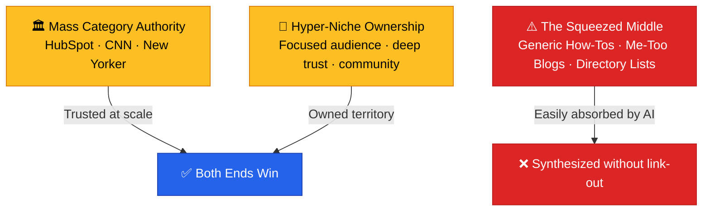
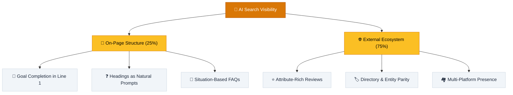
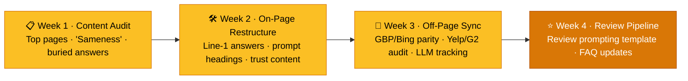

# Search Engine Optimization & AI Search

> **Modern SEO is no longer about chasing static metrics — it is about engineering relevance for both human searchers and AI agents across a stratified, embedding-driven index.**

---

## Table of Contents

- [How Google Ranks Today](#how-google-ranks-today)
- [Vector Embeddings & Entities](#vector-embeddings--entities)
- [Mentions vs. Links](#mentions-vs-links)
- [AI Search, Query Fan-outs & Platform Sourcing](#ai-search-query-fan-outs--platform-sourcing)
- [The B2B Validation Loop](#the-b2b-validation-loop)
- [Situation & Attribute Matching](#situation--attribute-matching)
- [The 4 Micro-Moments & Trust Content](#the-4-micro-moments--trust-content)
- [The Barbell Model & Brand Fingerprinting](#the-barbell-model--brand-fingerprinting)
- [On-Page vs Off-Page: The 25/75 Split](#on-page-vs-off-page-the-2575-split)
- [Princeton GEO Writing Rules](#princeton-geo-writing-rules)
- [Optimizations That Work Now](#optimizations-that-work-now)
- [Relevance Engineering](#relevance-engineering)
- [Measurement](#measurement)
- [30-Day Execution Roadmap](#30-day-execution-roadmap)

---

## How Google Ranks Today

The Google index is **not one giant database**. It is stratified into four buckets, each stored on hardware that matches how quickly Google needs to retrieve it:

| Bucket | Storage | Description |
|:-------|:--------|:------------|
| **High** | In-memory | Fastest access; results that must be served instantly |
| **Medium** | Solid-state drives | Fast, but not instant |
| **Low** | Standard hard drives | Slowest; **most of the web** lives here |
| **Fresh Docs** | — | Recently discovered/updated content with separate handling |

> [!WARNING]
> **Link equity is not static.** A page's position in the index caps the *maximum* value it can pass through links. A low-quality page ranking on page 52 cannot pass the same equity as a first-page result — regardless of how many links it holds.

### Proxies for Your Bucket

There is no public API revealing your bucket, but strong proxies exist:

- **Does the page rank on page 1?** High-value content must be instantly accessible → likely in-memory.
- **Does it get traffic?** Pages receiving consistent traffic are promoted in the index.
- **Is it an editorial/news site?** Historically assumed valuable due to crawl frequency, but the *bucket* itself is the real driver.

> [!NOTE]
> Google denies the existence of "domain authority," yet the leak reveals **site authority** is a real internal concept. Tools like Domain Rating are entertainment metrics — proxy signals that don't directly match Google's reality.

---

## Vector Embeddings & Entities

Google converts pages, passages, sections, whole websites, authors, and entities into **coordinates in multi-dimensional space**. Relevance is measured by **physical distance** between a query and content: the closer the embedding, the more relevant the result.

> [!TIP]
> Because embeddings are used "for everything," the **link graph is less important than historically believed**. The competitive advantage lies in building an *index of embeddings* — understanding how Google models the relationships between entities, websites, and content at scale.

---

## Mentions vs. Links

**Mentions matter more than links.** Google aggregates what is said about you across the web to build entity knowledge. Consistent context from many sources is treated as a stronger, more believable signal than the link graph.

- **Links still matter** — a niche group of dinosaur-expert sites linking to a sneaker brand *can* teach Google a new entity association.
- **But mention volume usually overpowers the link graph** because consistency is observed across far more locations.
- **Weights are dynamic** — there is no single algorithm, but a series of microservices scoring documents and entities, adjusted per query space.

### How to Earn Mentions

> [!TIP]
> **Make friends or make news.** Anything else is manipulation of the web.

| Tactic | Why It Works |
|:-------|:-------------|
| **Linkable assets** | Content so compelling others share and reference it — the highest-leverage outcome |
| **Sponsored events** | Cheap to sponsor; events get press, newsletters, social mentions, and referral traffic |
| **Viral stunts** | Journalists *want* to write about you (e.g., Red Bull's model) |
| **Consistent standout content** | Marketing is standing out and resonating — start there, not with do-follow hacks |

---

## AI Search, Query Fan-outs & Platform Sourcing

AI platforms do **not** use a single index. ChatGPT queries Bing, Google, Exa, SER APIs, and more (Claude relies on Brave). Prompts are broken into a **query fan-out** — a series of synthetic queries — and content is retrieved, ranked, and synthesized through an **agentic RAG pipeline**.

> [!WARNING]
> At each stage an **agentic critic** makes judgments you have no visibility into and no control over. Content that is discarded early never reaches the language model — you simply don't rank in the answer.

### Platform-Aware AI Sourcing

Different AI platforms rely on distinct index sources and evaluation criteria:

| AI Platform | Sourcing Bias & Primary Citation Outlets | Key Optimization Focus |
|:------------|:----------------------------------------|:-----------------------|
| **Google AI Overviews (AIO)** | **YouTube** (transcripts & tutorials) and **Reddit** | High-velocity video transcripts, structured how-tos, community discussion |
| **ChatGPT (OpenAI)** | Tier-1 news publishers (**Reuters, AP**), Wikipedia, high-authority web indexes | Fresh press releases, entity authority, high Common Crawl presence |
| **Perplexity AI** | **Niche specialist sites**, deep technical research, fresh feeds | Real-time citations, expert blogs, numerical claims & verifiable statistics |

---

## The B2B Validation Loop

In conversational search, buyers do not follow a simple linear funnel (`Search → Click → Convert`). Instead, they navigate an iterative **validation loop**:

> [!NOTE]
> AI search gets a brand into the **initial consideration set**, but off-site peer trust and clear **pricing/integration transparency** on your own website are what close the transaction.

---

## Situation & Attribute Matching

Traditional keyword-based SEO is being replaced by **Attribute & Situation Matching**. Users no longer search with short, 1–3 word terms; AI models process long-tail, conversational queries that describe complete scenarios, then match content against the *situation* and *attributes* embedded in the query.

| Dimension | Old Model: Keyword Matching | New Model: Situation & Attribute Matching |
|:----------|:----------------------------|:------------------------------------------|
| **Query shape** | 1–3 word terms (*"running shoes"*, *"plumber near me"*) | Full-context scenarios (*"My 7-year-old gets headaches every afternoon after using her tablet"*) |
| **Matching basis** | Exact/close keyword overlap | Entity, attribute, and intent distance in embedding space |
| **Intent source** | Assumed from keyword | Inferred from the complete user situation |
| **Content strategy** | Keyword repetition | Complete situations, objections, and exact attributes |

> [!WARNING]
> Search intent can no longer be "faked" with keyword repetition. Content must be designed around complete customer situations, objections, and exact attributes — or AI will never retrieve it.

### The Data Behind the Shift

| Metric / Finding | Data Point | Strategic Implication |
|:-----------------|:-----------|:----------------------|
| **Zero-Click Searches** | **57%+ → 68%** of searches end without a website click | Informational queries yield fewer clicks as Google and AI summaries answer directly on the SERP |
| **CTR Collapse at Rank #1** | Rank #1 CTR dropped from **1.76% → 0.61%** on AI Overview SERPs (~60% drop) | Holding Rank #1 on a standard SERP no longer guarantees click volume |
| **Rank vs. AI Citation Disconnect** | Rank #1 gives only **31.4%** chance of AI citation; **90%** of AI-cited pages rank **#21 or lower** | Traditional SERP rank and AI visibility are two distinct, decoupled scores |
| **Citation Source Shift** | Only **38%** of AI citations come from Google's Top 10 (down from 76%) | ~75% of AI visibility depends on external web mentions, not your own site |
| **Branded Search Benchmark** | Top performers drive **~10%** of search traffic via brand name (vs. 2.4% average) | Defensibility relies on searchers explicitly querying your brand |

---

## The 4 Micro-Moments & Trust Content

Google's original **4 Micro-Moments** remain the foundation, but AI search changes how each moment must be served. Each maps to a distinct content type that must be engineered deliberately.

| Micro-Moment | Intent | Example Query |
|:-------------|:-------|:--------------|
| **I Want to Know** | Informational research | "How does a tankless water heater work?" |
| **I Want to Go** | Local & service discovery (high-revenue moment) | "Plumber in Minneapolis" |
| **I Want to Do** | Problem-solving / troubleshooting | "How to fix knee pain when running" |
| **I Want to Buy** | Transactional / evaluation | "Best running shoes for flat feet under $100" |

### Product Directive: Build "Trust Content"

AI search engines prioritize content that directly addresses user doubts and friction points before conversion:

1. **Pricing Transparency:** Detailed breakdowns of costs and the factors that influence price.
2. **Fit / Disqualification:** Clear explanations of who the product/service is **NOT** a good fit for.
3. **Decision Frameworks:** "Repair vs. Replace" or "Option A vs. Option B" comparison guides.
4. **Localized Edge Cases:** Context specific to geographic regions, climates, or niches.

> [!TIP]
> Trust content is the differentiator AI cannot synthesize from generic sources. A page that answers doubts honestly and specifically is far more likely to be cited than a page that merely repeats what 100 others say.

---

## The Barbell Model & Brand Fingerprinting

As search engines absorb generic informational content, market positioning collapses in the middle.

- **The Danger Zone (The Middle):** Brands that are not authoritative enough to be trusted category leaders, yet not specialized enough to own a tight niche community.
- **The "Sameness" Elimination Rule:** If 100 websites answer a question identically, AI condenses all 100 into a single paragraph without linking out.
- **Brand Fingerprinting:** Pages must contain proprietary data, original testing, distinct opinions, or verified local case studies that AI cannot synthesize from open training data.

> [!WARNING]
> Generic Q&A pages, basic how-tos, and synthesized reviews are the most vulnerable — they are easily absorbed into a single AI summary paragraph with no citation at all.

---

## On-Page vs Off-Page: The 25/75 Split

AI search visibility is driven roughly **25% by on-page structure** and **75% by your external ecosystem**. Both must be engineered deliberately — this split is the operational backbone of AI search strategy.

### On-Page Structure (25% Weight)

1. **Lead with Goal Completion:** AI models chunk content and scan for immediate, confident answers. Put the direct answer in **line 1** of the page or section — never bury it under introductory history or boilerplate.
2. **Headings as Natural Language Prompts:** Write `H2` and `H3` headers as full, conversational questions matching exact user prompts (e.g., `### What is the best moisturizer for acne-prone skin under $100?`).
3. **Situation-Based FAQs:** Extract top question clusters (Reddit, People Also Ask, Answer the Public) and convert them into structured FAQ sections at the bottom of core pages.

### Off-Page Ecosystem (75% Weight)

1. **Attribute-Rich Reviews:** AI engines (e.g., Gemini's Ask Maps) parse customer review *text* to match query attributes — not just star counts.
2. **Review Prompting:** Shift review requests from generic "leave us 5 stars" to context-driven prompts: *"Would you mind sharing what specific issue you had and how we resolved it?"*
3. **Directory Synchronization:** Mirror Google Business Profile data across Bing for Business, Yelp, Angi, G2, Trustpilot, and niche industry platforms.
4. **Local SEO Paradigm Shift:** In map packs and local AI search, **relevance & attribute matching** are replacing geographic **proximity** as the primary ranking signal.

---

## Princeton GEO Writing Rules

Research from Princeton Generative Engine Optimization (GEO) identifies **4 writing patterns** that maximize the probability of an LLM citing your content in an answer synthesis:

| GEO Writing Pattern | Description & Implementation | Impact |
|:-------------------|:-----------------------------|:-------|
| **1. Front-Load Answers** | Place the direct, complete core answer in the **first 40–60 words** of each section. | Immediate passage relevance match during chunking |
| **2. Self-Contained Paragraphs** | Ensure each paragraph stands alone as an independent unit of information without requiring prior context. | Higher passage retrieval score during RAG ranking |
| **3. Inline Third-Party Citations** | Attribute facts and data to credible third-party institutions directly in the text. | **+30% to +40%** increase in citation probability |
| **4. Specific Statistics over Claims** | Replace qualitative descriptions with named subjects, numerical claims, timeframes, and verifiable sources. | Enables precise entity-attribute extraction |

> [!EXAMPLE]
> **Weak (Qualitative):** *"Our software significantly improves team productivity and reduces costs."*  
> **Strong (GEO-Optimized):** *"In a 2025 benchmark study by Gartner, enterprises implementing agentic RAG workflows reduced operational spending by 24% over 12 months."*

---

## Optimizations That Work Now

### 1. Fix Page Speed & the 499 Response Code

**499** is an nginx-invented status code (now adopted by most CDNs) meaning *"the client gave up because the request took too long."* AI bots fetch pages **in real time** — they don't use a cached index — so a slow site silently loses AI visibility.

| Signal | Impact |
|:-------|:-------|
| **Time to First Bite (TTFB)** | Primary lever for bot access — the page must respond before the bot times out |
| **Edge caching** | Eliminates 499s; CDN serves cached content instantly |
| **Bot vs. user speed** | Single-page apps feel fast to humans (progressive rendering) but are slow for bots that don't render JS |

> [!TIP]
> **Audit your log files for 499s right now.** Fixing 499s + page speed drove a **+300% visibility increase in 3 months** for one client. This is the single fastest SEO/GEO win.

### 2. Get Into AI Training Data

Assess your presence in **Common Crawl** (a primary training-data source):

1. Measure how many of your pages are in Common Crawl and how often they're crawled.
2. If coverage is low, create **crawl paths** from pages already in the crawl — Wikipedia link drops, links from CC-listed domains.
3. Treat training-data presence as a strategic play, not a spam tactic.

> [!WARNING]
> Spammy "millions of AI mentions" and cloaking micro-sites are returning — but there are no rules yet on AI platforms. Relying on manipulation is a dead end once enforcement and detection mature.

### 3. Produce Content With Format Expectations

Reddit, YouTube, and LinkedIn posts are the most-cited sources in AI answers. Tactics:

- **Reddit:** Run your **own subreddit** (populate it first, be responsive, cross-link from other subreddits' discussions) instead of astroturfing — moderators aggressively police gaming attempts.
- **YouTube/LinkedIn:** Create the expected format for high-value synthetic queries; systems prefer dedicated formats over text-only fallbacks.
- **AMAs:** Grow your subreddit with guest AMAs, syndicated to newsletter and social.

### 4. Use AI With a Human-in-the-Loop

The biggest content mistake is one-prompt generation without source data. Instead:

- Map content to a **content model** with individual prompts per component.
- Build a **custom RAG index** of your content (or best-in-class assets, white papers, PDFs) the model can retrieve from.
- Use **subject-matter experts** to write outlines and review output.

> [!NOTE]
> Google **cannot reliably detect AI content** — that's why it pushes watermarking and instead judges content through **human signals**: time-on-site, bounce rate, and success rate of visits. AI content at scale is not inherently abuse; it's a **UX problem**. Good UX → good human signals → sustainable performance.

---

## Relevance Engineering

SEO, Answer Engine Optimization, and GEO are misnomers — you don't optimize those engines; their engineers do. What you actually do is **feature engineering** for those systems. **Relevance Engineering** is the evolution of SEO:

> **The confluence of AI, information retrieval, content strategy, UX, and digital PR — applicable to any search surface, existing or yet to exist.**

| Component | Role |
|:----------|:-----|
| **AI** | Leverage models and distilled replications of retrieval pipelines to understand systems |
| **Information Retrieval** | The computer science behind search — generative AI technology comes from search |
| **Content Strategy** | Build systems that produce performance content consistently at scale |
| **UX** | Serve the end user — who is increasingly an **agent**, not just a human |
| **Digital PR** | Spread messages and create surface area so both humans and agents recognize you as the source |

> [!NOTE]
> We are entering **"machine media"** — where the bot is a first-class citizen. Bot activity already exceeds human activity, and that gap will only widen.

---

## Measurement

Visibility alone is an incomplete KPI. Measure **three buckets**:

| Bucket | Metrics |
|:-------|:--------|
| **Performance** | Referral traffic, behavior once landing, conversion |
| **Brand Visibility** | Visibility, citation rate, **citation accuracy** |
| **Input Metrics** | Bot activity, rankings for synthetic queries, passage relevance scores, entity salience |

> [!TIP]
> Input metrics are the actionable levers — they're what you can actually change to move performance. Single-bucket measurement misses the picture, and this typically spans a **tiger team** (PR, content, marketing) rather than SEO alone.

### AI Search Measurement Cautions

- **Avoid early "AI Rank Tracking" SaaS tools:** AI recommendations are non-deterministic, highly customized to user chat histories, and yield **zero prompt-to-prompt overlap**. Rank scores from these tools are noise, not signal.
- **Primary Metric:** Monitor **AI referral traffic** in Google Analytics (ChatGPT, Gemini, Claude, Perplexity), alongside brand search volume and attribute-rich review velocity.

### AI Search Visibility KPIs

| Metric Category | Primary KPI | Purpose / Evaluation Method |
|:----------------|:------------|:----------------------------|
| **Brand Equity** | **Branded Search Share %** | Share of search traffic from brand-name terms (target **8–10%**) |
| **AI Visibility** | **LLM Citation Rate & Sentiment** | Frequency and sentiment of brand mentions across ChatGPT, Gemini, and Claude |
| **Business Impact** | **Direct Channel Revenue** | Revenue conversion relative to organic traffic volume to monitor demand health |
| **Customer Validation** | **Attribute Review Velocity** | Monthly count of reviews mentioning specific features, services, or technical resolutions |

> [!NOTE]
> Traditional SERP rank trackers are insufficient for non-deterministic AI recommendations. See [Success Metrics → AI Search Visibility KPIs](../06-metrics/success-metrics.md) for the full metric framework.

---

## 30-Day Execution Roadmap

1. **Week 1 (Content Audit):** Audit the top 10 traffic pages for "sameness". Flag buried answers and ensure every page carries a distinct brand fingerprint or proprietary data point.
2. **Week 2 (On-Page Execution):** Refactor headers into conversational prompts; place direct answers in the opening sentence of each section; add Trust Content (pricing transparency, disqualification).
3. **Week 3 (Entity Parity):** Synchronize Google Business Profile attributes across Bing for Business and third-party review networks; set up LLM citation tracking.
4. **Week 4 (Review Strategy):** Update post-purchase automated communications to solicit attribute-rich customer feedback; ship FAQ updates.

---

## Related Pages

- ← [Go-to-Market](go-to-market.md) — SEO as an organic discovery channel in GTM
- ← [App Store Optimization](app-store-optimization.md) — Organic search in app stores vs. web
- → [Agentic RAG & Data Architecture](../04-development/agentic-rag-data-architecture.md) — Technical architecture for enterprise RAG, agentic data layers, and Knowledge Runtimes
- → [Success Metrics](../06-metrics/success-metrics.md) — Measuring acquisition and conversion outcomes
- → [App Launch Checklist](app-launch-checklist.md) — Launch-day organic visibility tasks
- → [User Research](../02-discovery/user-research.md) — Audience-driven keyword and prompt research
- → [Content Engagement](content-engagement-strategy.md) — Standout content that earns mentions and holds attention

---

## Sources & References

- Research Blueprint: `docs/research/Agentic-First Blueprint for Online.md` — Princeton GEO principles, LLM sourcing metrics, Agentic RAG, and zero-click impact
- Podcast interview: Mike King, "Google Leak Takeaways" (iPullRank), chapters 2–30
- Google API content leak analysis and DOJ antitrust trial testimony
- Yandex source-code leak (cross-verified concepts: boosts, Twiddlers, index stratification)
- Caleb Ulku, ["Keywords Are Dead, Do THIS Instead"](https://youtu.be/WZrSlgdm5GQ) — situation & attribute matching, 4 micro-moments, trust content, 25/75 split
- Neil Patel, ["The New Rules of Google (Most Businesses Won't Survive)"](https://youtu.be/KeT5oSgo-Ko) — barbell model, branded search benchmark, Search Everywhere Optimization
- Related external course: Software Product Management Specialization (Coursera)
- Original file reference: `docs/research/ai-search-strategy.md` (SEO/AI-search research notes)

---

*[← Back to Section Index](index.md) · [← Back to Wiki Home](../index.md)*

