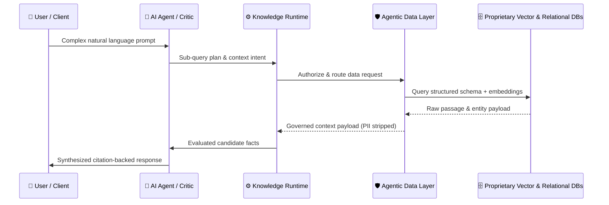
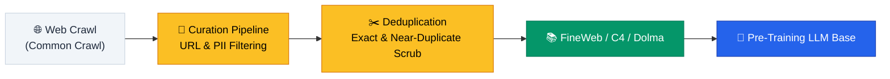

# Agentic RAG & Data Architecture

> **In the GenAI era, content is no longer a static collection of web pages — it is a governed, retrievable knowledge asset engineered for autonomous AI agents and language models.**

---

## Table of Contents

- [Architectural Paradigm Shift](#architectural-paradigm-shift)
- [Naive RAG vs. Agentic RAG](#naive-rag-vs-agentic-rag)
- [The Agentic Data Layer & Knowledge Runtime](#the-agentic-data-layer--knowledge-runtime)
- [Pre-Training Corpora & Data Ingestion](#pre-training-corpora--data-ingestion)
- [Technical Bot Access & Web Vitals](#technical-bot-access--web-vitals)
- [CMS Selection Framework for RAG](#cms-selection-framework-for-rag)
- [Related Pages](#related-pages)
- [Sources & References](#sources--references)

---

## Architectural Paradigm Shift

Traditional web architectures were engineered for human users navigating via browsers and traditional keyword search indexes. In an **agentic-first** paradigm, web platforms must serve dual consumers: human searchers and **autonomous AI agents** performing retrieval, reasoning, and task execution on behalf of users.

| Architectural Dimension | Legacy Web Architecture | Agentic-First Architecture |
|:------------------------|:------------------------|:---------------------------|
| **Primary Consumer** | Human web browser | Autonomous AI agents & RAG pipelines |
| **Data Delivery** | HTML DOM presentation | Structured semantic passages & JSON/RAG endpoints |
| **Retrieval Mechanism** | Single-shot keyword match | Multi-step agentic planning, routing, & self-verification |
| **Content Asset View** | Page-level articles | Modular, independently citatable Knowledge Graph |
| **Bot Policy** | Crawl control via generic SEO rules | Governed agentic data layer with explicit bot permissions |

---

## Naive RAG vs. Agentic RAG

Early AI retrieval systems relied on **Naive (Single-Shot) RAG**, where a user query triggers a simple similarity lookup against a vector store and passes top chunks directly to an LLM. This leads to high hallucination rates, missing context, and failures on multi-part inquiries.

Enterprise systems require an **Agentic RAG** architecture, which introduces an orchestration loop where an AI agent acts as a planner, router, and critic to refine search queries and verify facts before final synthesis.

```mermaid
graph TD
    subgraph "Naive RAG (Single-Shot)"
        Q1["💬 User Prompt"] --> V1["🔍 Vector Store Lookup"]
        V1 --> L1["🧠 LLM Generation"]
        L1 --> Out1["❌ Hallucinations / Buried Context"]
    end

    subgraph "Agentic RAG (Iterative Execution)"
        Q2["💬 User Prompt"] --> AGENT["🤖 Agentic Orchestrator"]
        AGENT --> PLAN["📋 Query Decomposer / Planner"]
        PLAN --> FO["🔀 Multi-Step Retrieval (Fan-out)"]
        FO --> CRIT["🧑‍⚖️ Critic & Verification Loop"]
        CRIT -->|"Insufficient context"| RE["🔄 Reformulate Query"]
        RE --> FO
        CRIT -->|"Verified facts"| LLM2["🧠 Final LLM Synthesis"]
        LLM2 --> Out2["✅ Citable, Precise Answer"]
    end

    style Q1 fill:#f1f5f9,stroke:#cbd5e1,color:#1e293b
    style Q2 fill:#d97706,stroke:#b45309,color:#fff
    style AGENT fill:#7c3aed,stroke:#6d28d9,color:#fff
    style PLAN fill:#fbbf24,stroke:#d97706,color:#000
    style FO fill:#fbbf24,stroke:#d97706,color:#000
    style CRIT fill:#dc2626,stroke:#b91c1c,color:#fff
    style LLM2 fill:#2563eb,stroke:#1e40af,color:#fff
```



> [!WARNING]
> **Naive RAG is insufficient for complex enterprise queries.** Single-shot vector retrieval frequently returns truncated context or misses critical dependencies. Agentic loops ensure validation prior to response generation.

---

## The Agentic Data Layer & Knowledge Runtime

The **Agentic Data Layer** is a governed, business-context-aware infrastructure layer that connects proprietary data stores with enterprise AI agents.



### Core Responsibilities of the Knowledge Runtime

1. **Query Planning & Routing:** Translating user prompts into specialized sub-queries routed to specific indexes (vector stores, relational databases, or live web APIs).
2. **Context Governance:** Enforcing access controls, removing personally identifiable information (PII), and ensuring data freshness.
3. **Fact Verification:** Evaluating retrieved passages against third-party trust sources to eliminate hallucinations.

---

## Pre-Training Corpora & Data Ingestion

To ensure content is included in foundational LLM training datasets, product systems must understand the data pipeline that builds pre-training corpora (e.g., Common Crawl, C4, FineWeb, Dolma).



### Surviving Data Curation Filters

- **Clean Structural Markup:** High-noise HTML boilerplate (ad scripts, non-semantic inline styles) is aggressively stripped during pre-training dataset generation.
- **Topical Expertise & Length Checks:** Low-depth or duplicated text is filtered out during deduplication.
- **Bot Accessibility:** Web crawlers like `ccbot` must have uninhibited access to public documentation.

---

## Technical Bot Access & Web Vitals

AI agents fetch live web content in **real-time** during RAG operations. Unfavorable server latency or misconfigured crawler blocklists silently eliminate a platform from AI citations.

### 1. Bot Access Configuration (`robots.txt`)

Ensure major LLM pre-training and real-time retrieval bots are explicitly permitted in `robots.txt`:

```txt
User-agent: GPTBot
Allow: /

User-agent: ClaudeBot
Allow: /

User-agent: PerplexityBot
Allow: /

User-agent: ccbot
Allow: /
```

> [!CAUTION]
> Blocking `ccbot` prevents inclusion in future foundational model pre-training sets (Common Crawl derivatives like FineWeb). Blocking `GPTBot` or `PerplexityBot` renders your site invisible to real-time AI retrieval.

### 2. Strict Core Web Vitals Targets

Google and AI agent gateways enforce strict latency thresholds for document fetching:

| Metric | Target Threshold | Impact on AI Search |
|:-------|:-----------------|:--------------------|
| **Time to First Byte (TTFB)** | `< 800ms` | Prevents 499 client timeout errors during live RAG fetches |
| **Largest Contentful Paint (LCP)** | `< 2.5s` | Direct organic ranking and index bucket prioritization factor |
| **Interaction to Next Paint (INP)** | `< 200ms` | Ensures responsiveness for hybrid web application interactions |
| **Cumulative Layout Shift (CLS)** | `< 0.1` | Maintains layout stability during bot DOM rendering |

---

## CMS Selection Framework for RAG

Choosing a Content Management System for agentic-first visibility requires evaluating features beyond visual page editing:

| Requirement | Traditional CMS | RAG-Optimized Enterprise CMS |
|:------------|:----------------|:-----------------------------|
| **Data Output** | Monolithic HTML / CSS | Headless JSON-LD, Markdown, & API endpoints |
| **Semantic Structure** | Basic `<h1>`-`<h6>` headers | Granular passage chunking & schema markup |
| **Real-Time Sync** | Batch indexing | Webhook triggers for vector store re-indexing |
| **Agentic Access** | Restricted by session cookies | Governed API token access for AI agents |

> [!TIP]
> **Architectural Recommendation:** Adopt a headless or hybrid CMS that automatically generates clean Markdown variants of documentation alongside standard web pages, reducing token overhead during AI agent retrieval.

---

## Related Pages

- ← [Requirements & User Stories](requirements-user-stories.md) — Defining functional specifications for AI integrations
- ← [Acceptance Criteria](acceptance-criteria.md) — Verification checklists for software deliverables
- → [Search Engine Optimization](../03-strategy/search-engine-optimization.md) — Generative Engine Optimization (GEO) and citation strategies
- → [Success Metrics](../06-metrics/success-metrics.md) — Tracking AI referral traffic and citation rate metrics

---

## Sources & References

- Research Blueprint: `docs/research/Agentic-First Blueprint for Online.md` — Agentic Data Layers, Agentic RAG patterns, and pre-training corpora ingestion
- Princeton GEO Research Paper — Sourcing probability and structured passage optimization
- Enterprise RAG Patterns Guide — Multi-step retrieval and Knowledge Runtime architecture
- Google Core Update Specifications — Core Web Vitals thresholds and E-E-A-T updates

---

*[← Back to Section Index](index.md) · [← Back to Wiki Home](../index.md)*
