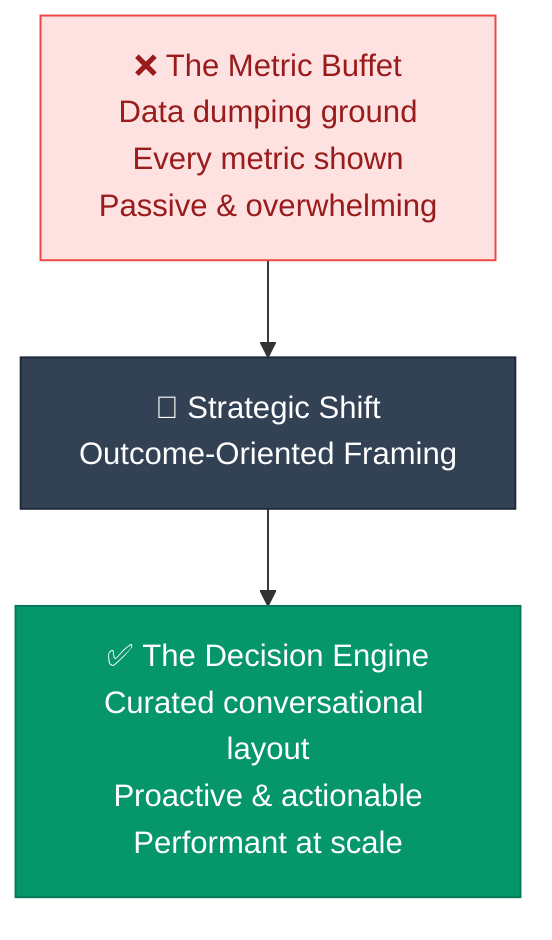
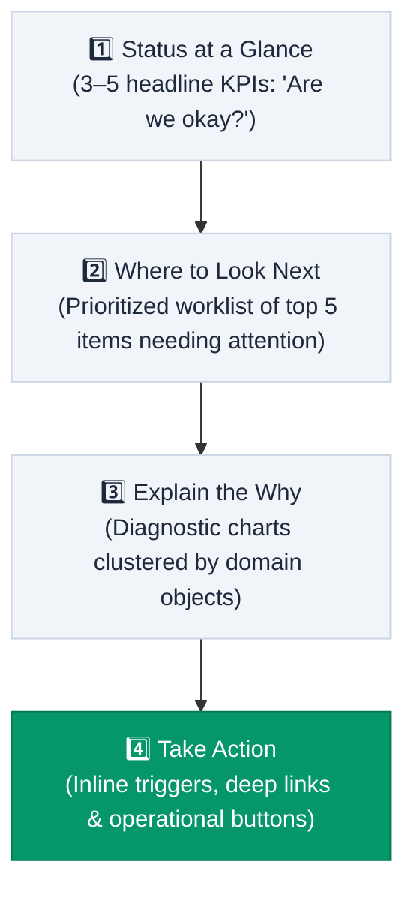
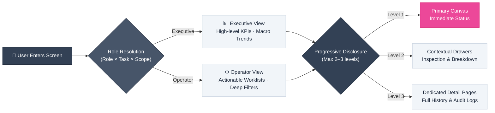
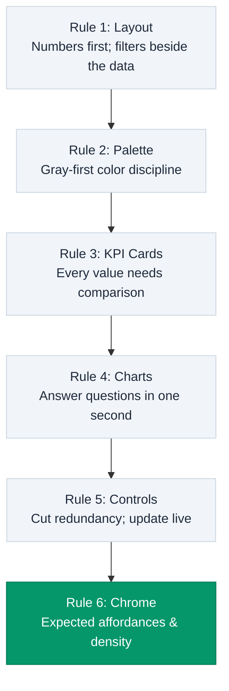
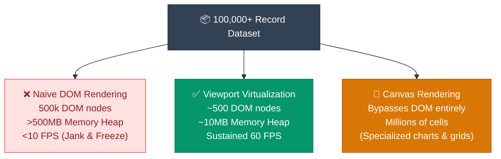
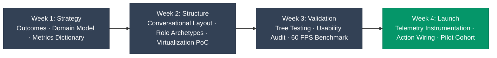

# Dashboard Design Playbook

> **"A data-heavy interface is 80% information architecture and performance engineering, and 20% visual polish. Building a dashboard users trust means solving their operational problems one at a time."**

---

## Table of Contents

- [The Core Philosophy: Beyond the Metric Buffet](#the-core-philosophy-beyond-the-metric-buffet)
- [Strategic Information Architecture: The 4-Stage Flow](#strategic-information-architecture-the-4-stage-flow)
- [Managing Scale: Progressive Disclosure & Role-Based Systems](#managing-scale-progressive-disclosure--role-based-systems)
- [Visual Ergonomics & Control Hygiene](#visual-ergonomics--control-hygiene)
- [Frontend Performance Architecture for Data UIs](#frontend-performance-architecture-for-data-uis)
- [Real-Time Streams & Client-Side Computation](#real-time-streams--client-side-computation)
- [The TPM Decision Framework & Trade-Off Matrix](#the-tpm-decision-framework--trade-off-matrix)
- [The 4-Week Dashboard Rollout Blueprint](#the-4-week-dashboard-rollout-blueprint)
- [Data-Heavy Anti-Pattern Checklist](#data-heavy-anti-pattern-checklist)
- [Related Pages](#related-pages)
- [Sources & References](#sources--references)

---

## The Core Philosophy: Beyond the Metric Buffet

The most pervasive failure mode in data-heavy product development is **treating comprehensiveness as value**. Product teams frequently fall into the "metric buffet" trap: aggregating dozens of disconnected numbers, charts, and filter bars onto a single screen in an attempt to serve every possible question. The result is an overwhelming data dumping ground that obscures true signal and drains user trust.

For a Product Manager or Technical Product Manager (TPM), mature information architecture (IA) and performance engineering account for approximately **80% of the user experience**, while visual styling contributes the remaining **20%**. 

### Outcome-Oriented Metric Framing
Instead of asking *"What data do we have available?"*, start with decision mechanics:
* **The Decision Test**: *"If this number increases or decreases by 15% today, what operational decision changes?"* If the answer is "nothing," the metric does not belong on the primary view.
* **The Morning Question**: *"Who needs to see this number first thing in the morning, and what is their immediate next action?"*
* **Descriptive vs. Prescriptive**: Descriptive charts explain what happened; prescriptive interfaces guide what the user should do next.

> [!IMPORTANT]
> Distrust in a dashboard's numbers is rarely caused by database inaccuracies. It is the **halo effect** applied to data products: when an interface lags, misaligns borders, or presents chaotic filters, the brain unconsciously re-attributes visual and performance flaws to the integrity of the data itself (see [Design Psychology](design-psychology.md#the-first-vote-first-impressions-and-the-halo-effect)).

---

## Strategic Information Architecture: The 4-Stage Flow

A high-performing dashboard is not a static canvas; it is structured as a **guided conversation** that takes the user from high-level awareness down to operational execution.

### 1. Status at a Glance (Top Row)
* **Goal**: Answer *"Are we okay?"* within 3 seconds.
* **Composition**: 3 to 5 critical Key Performance Indicators (KPIs).
* **Requirements**: Every metric must display its current value, delta relative to a meaningful baseline (e.g., vs. last week), and a trend sparkline. Bare numbers without comparison are meaningless.

### 2. Where to Look Next (Prioritized Worklist)
* **Goal**: Direct the user's finite attention to emerging risks or anomalies.
* **Composition**: A dynamic, ranked panel of 5 items requiring immediate intervention.
* **Contextual Copy**: Never display generic warnings. Couple the anomaly with the prescribed action:
  * *Poor*: `"Warning: Churn anomaly detected."`
  * *Actionable*: `"Renewal Risk: Acme Corp usage down 42% — Assign CSM."`

### 3. Explain the Why (Diagnostic Middle)
* **Goal**: Provide the diagnostic evidence behind the numbers.
* **Composition**: Deep-dive charts, segment breakdowns, and cohort analyses.
* **Domain Clustering**: Organize panels strictly by core domain objects (e.g., Accounts, Workspaces, Pipelines) rather than charting types.

### 4. Take Action (Operational Execution)
* **Goal**: Eliminate the "dead-end dashboard" anti-pattern where users observe numbers but cannot act on them.
* **Composition**: Direct inline actions (e.g., reassign, snooze, trigger sync, export) or deep links to dedicated entity detail pages.

### Global Filter Governance & Metrics Dictionary
* **Kill Filter Sprawl**: Avoid placing 10+ dropdown filters above the header. Promote **1–2 global, task-led filters** (e.g., Date Horizon, Organization/Environment) that persist system-wide.
* **Smart Filter Defaults**: Align default time ranges to the user's role (e.g., 24 hours for DevOps; 30–90 days for Growth). Allow users to save named filter configurations.
* **Centralized Metrics Dictionary**: Maintain a living internal standard enforcing consistent metric definitions, units, time windows, and question-style headings (e.g., *"How many active seats are unassigned?"* vs. *"Seat Allocation"*).

---

## Managing Scale: Progressive Disclosure & Role-Based Systems

As applications scale, human working memory remains capped at **roughly 3 to 4 items at once**. Managing cognitive load requires two structural techniques: progressive disclosure and role-based views.

### Progressive Disclosure Rules
Progressive disclosure defers secondary information until explicitly requested, lowering extraneous cognitive load:
1. **Conditional Disclosure**: Reveals inputs or options only when relevant (e.g., selecting "Custom Range" opens the date-picker calendar).
2. **Contextual Disclosure**: Surfaces granular metadata via tooltips, flyout drawers, or expandable table rows without forcing a full page transition.
3. **Staged Disclosure**: Guides complex multi-step configurations through sequential views.

> [!WARNING]
> **The Depth Ceiling (Max 2–3 Levels)**: Never bury information under more than 3 levels of disclosure (e.g., Card ➔ Modal ➔ Nested Tab ➔ Dropdown). If a primary task takes more than 2 clicks to reach, the feature is functionally invisible. When a flow exceeds 3 levels, the underlying information architecture is flawed.

### Role-Based Component Systems
In multi-tenant B2B platforms, a single static dashboard fails across roles:
* **The 78% Inertia Law**: Research shows up to **78% of users never change default settings**. If the default dashboard does not match the user's role on day one, they will not customize it—they will simply abandon it.
* **Component Token Resolution**: Construct base UI elements that resolve visibility, density, and action depth at render time based on three parameters:
  $$\text{Resolved View} = f(\text{Role Archetype}, \text{Task Frequency}, \text{Permission Scope})$$
* **The >7 Action Audit**: Audit every view for action density. If a single user is presented with **more than 7 primary buttons or actions** simultaneously, split the interface into role-tailored views.

---

## Visual Ergonomics & Control Hygiene

Once the information architecture and role structures are established, apply disciplined visual rules to minimize cognitive friction.

### Rule 1 — Fix Layout Before Styling (Data Beside Controls)
* Avoid massive top filter banners that push the data below the fold.
* Place secondary filters in a **collapsible right column beside the charts they modify**—visual cause and effect must be adjacent.

### Rule 2 — Design in Gray First; Color Has a Job
* Build the entire dashboard in tinted grays first (e.g., slate grays with a subtle blue tint).
* **Color gets a functional job**: Reserve accent colors strictly for active data points, sparklines, and active toggle states. If buttons, tabs, borders, and charts all share the same bright blue, color ceases to communicate priority.
* **Elevation over Shadows in Dark Mode**: Dark backgrounds render shadows invisible. Create depth by making cards one shade lighter than the page background.

### Rule 3 — Contextual KPI Cards & Comparison Encoding
* A raw number (`"24.8k"`) is meaningless. Every KPI card must feature:
  1. *Metric Label* (compact, uppercase, muted).
  2. *Primary Value* (largest typographical anchor).
  3. *Delta Percentage & Directional Arrow* ($\blacktriangle$ / $\blacktriangledown$).
  4. *Trend Sparkline* (muted 7-to-30 day baseline curve).
* **Valence Encoding Without Ambiguous Red/Green**:
  * An upward arrow ($\blacktriangle$) indicates direction, not valence. For *Visitors*, up is good; for *Server Error Rate*, up is bad.
  * Use **shade/brightness** for valence: render positive trends in bright/clear contrast, and negative anomalies in muted contrast or dedicated alert states. This eliminates ambiguity and supports color-blind accessibility.

### Rule 4 — Rapid-Answer Charts
* Replace bulky, un-scaled bar charts with clean line or area charts.
* Charts must incorporate:
  * Soft horizontal gridlines to provide an instant sense of scale.
  * Exact-value tooltips on hover (e.g., `"4,960 visitors on Sunday"`).
  * A dashed, muted gray line displaying the previous period's performance for instant benchmark comparison.

### Rule 5 — Control Hygiene & Live Reactivity
* **Eliminate Duplicate Controls**: If a sidebar tab already filters by device, delete the standalone device filter dropdown.
* **Semantic Control Types**: Use toggles for binary states, checkboxes for multi-select, and labeled sliders for trade-offs (e.g., `"Faster ↔ More Accurate"`).
* **Kill the "Apply" Button**: Modern dashboards must be reactive; changing a filter should update the view live without requiring an extra confirmation click.

### Rule 6 — Professional App Chrome & Density
* **Right-Align Numeric Columns**: In data tables, numbers must be right-aligned so decimal points align vertically, enabling rapid scanning.
* **Command Bar Navigation**: Support keyboard power-users with a quick-switcher palette (`⌘K` / `Ctrl+K`).
* **Theme Parity**: Ensure color scales are calibrated for both light and dark modes (e.g., high-contrast warm yellow lines on dark backgrounds shift to deep blue on light surfaces).

---

## Frontend Performance Architecture for Data UIs

Performance is a non-negotiable UX requirement. Latency studies demonstrate that **every 1-second delay in dashboard load time decreases user engagement by 7%**, and delays exceeding 3 seconds lead to over 50% abandonment.

### The Client-Side Memory Bloat Anti-Pattern
A frequent architectural trap is loading monolithic JSON payloads (e.g., 50MB of nested objects) directly into the browser's active JavaScript heap. Maintaining an in-memory replica of an entire database table clogs the browser's garbage collection, spikes tab crashes, and causes severe scrolling jank.

### DOM Virtualization (Windowing)
Virtualization renders **only the items currently visible inside the user's viewport**, plus a tiny buffer above and below to prevent visual tearing during scrolling. As the user scrolls, off-screen DOM nodes are recycled and repopulated with incoming data.

| Virtualization Metric | Naive Full Rendering (100k Rows) | Virtualized Rendering (100k Rows) |
| :--- | :--- | :--- |
| **Active DOM Nodes** | ~500,000 nodes | **~400–600 nodes** |
| **Client Memory Usage** | >500 MB (High crash risk) | **~10–15 MB** |
| **Initial Render Time** | >12,000 ms | **<50 ms** |
| **Scroll Frame Rate** | <10 FPS (Severe stutter) | **Sustained 60 FPS** |

#### Library Selection Guide
* **`react-window`** (~4 KB): Ultra-lightweight; ideal for uniform grids and fixed-row-height tables.
* **`React Virtuoso`**: Full-featured; supports variable-height rows, dynamic sticky headers, and server-side rendering (SSR).
* **`TanStack Virtual`**: Headless, framework-agnostic virtualizer; optimal when pairing with `TanStack Table` for 2D (row + column) windowing on massive matrices.

> [!TIP]
> **Virtualization Best Practices**: Always provide stable, unique database IDs as keys (never use array indices `i`). Wrap row renderers in `React.memo` to eliminate unnecessary re-renders when parent states change.

### When to Drop the DOM: Canvas Rendering
When rendering data grids exceeding **1,000,000 active cells** or ultra-dense heatmaps, even DOM virtualization encounters browser compositing limits. In these extreme scenarios, bypass the DOM entirely by rendering onto an HTML `<canvas>`.
* *Advantage*: Zero DOM overhead; instantaneous rendering of millions of data points.
* *Trade-Off*: Loss of native browser accessibility, text selection, screen-reader support, and standard DOM event bubbling. Must be reserved for specialized visualizations.

### Atomic State Management vs. Cascading Re-Renders
In complex dashboards with multiple widgets, placing global dashboard state into a single monolithic store (like standard Redux or top-level React state) causes a **cascading re-render anti-pattern**: updating a single filter causes every chart on the canvas to re-evaluate and re-render.
* **The Solution**: Adopt **Atomic State Management (e.g., Jotai)**. Decompose state into small, isolated atoms (e.g., `dateRangeAtom`, `activeKPIAtom`). Components subscribe only to the specific atoms they depend on, isolating re-renders strictly to the affected widget.

---

## Real-Time Streams & Client-Side Computation

Analytical dashboards increasingly ingest live event streams and execute complex client-side calculations. Without deliberate architecture, high-frequency updates lock the main browser thread.

### Eliminating the "Render Storm" Anti-Pattern
A disastrous mistake in real-time engineering is calling state updates (e.g., `setState(msg)`) directly inside a WebSocket or Server-Sent Events (SSE) `onmessage` callback. When receiving 30 messages per second, React schedules 30 separate reconciliation cycles, completely locking the main thread.

#### The Decoupled Buffer-and-Flush Pattern
1. **Transport Layer**: Establish connection via SSE (preferred for unidirectional dashboard telemetry due to native HTTP auto-reconnection) or WebSockets. Use cursor-based resumption IDs so reconnections resume without data loss.
2. **Mutable Buffering**: Push incoming messages into a mutable JavaScript array held in a `useRef`. Because refs live outside React's render pipeline, writes incur **zero component re-renders**.
3. **Flushing Loop**: Synchronize updates with the browser's display refresh using `requestAnimationFrame`. Once every frame (~16ms at 60Hz), drain the buffer, batch the updates, and execute a single state update. This naturally provides backpressure—if the client is busy, flushing frequency gracefully adapts.

### Offloading Heavy Computation: Web Workers & DuckDB-Wasm
Any synchronous JavaScript operation lasting longer than **50 milliseconds** blocks the main thread, resulting in frozen buttons and stuttering animations.

| Technology | Optimal Use Case | Primary Benefit | Core Constraint |
| :--- | :--- | :--- | :--- |
| **Web Workers** | Sorting, filtering, or transforming arrays with >50k records | Runs in a background thread; main UI thread stays 100% responsive | Serialization overhead during message passing; memory consumption |
| **DuckDB-Wasm** | Complex SQL aggregations, multi-table joins, and Parquet analytics | Runs an in-browser vectorized SQL engine via WebAssembly; byte-range Parquet queries | Capped by browser WebAssembly memory sandbox (typically 4 GB) |

---

## The TPM Decision Framework & Trade-Off Matrix

When leading the design and development of a data-heavy tool, use this matrix to balance user goals, information architecture, engineering execution, and cognitive load limits:

| User Goal | Optimal Product & IA Strategy | Required Technical Implementation | Cognitive Load Limit |
| :--- | :--- | :--- | :--- |
| **High-Level Executive Status** | 3–5 headline KPIs; clear baseline comparison deltas; minimal layout | Small static dataset; Server-Side Rendering (SSR) or edge-cached Jamstack | **Low Intrinsic Load**: Comparing against baselines offloads mental math |
| **Drill-Down Diagnostics** | Progressive disclosure (tabs, contextual drawers, deep links); max 2–3 levels | DOM Virtualization (`react-window`); backend pagination & aggregation | **Gradual Complexity**: Revealing detail in measured doses controls intake pace |
| **Real-Time Live Telemetry** | Aggregated/sampled display (e.g., 1-second rolling windows); last-updated badge | Decoupled buffer & flush via `requestAnimationFrame`; SSE transport | **Controlled Stimulus**: Aggregation prevents visual chaos and flickering |
| **Massive Exploration (>100k Rows)** | Upfront scoped search/filter; role-based column hiding; saved views | Multi-tier: API pagination → TanStack Table state → TanStack Virtual; Web Workers / DuckDB-Wasm | **Mitigates Hick's Law**: Scoped filtering prevents option paralysis |

---

## The 4-Week Dashboard Rollout Blueprint

A systematic roadmap for product teams building a new data-heavy interface or rescuing a legacy dashboard:

* **Week 1 · Strategic IA & Alignment**:
  * Inventory all proposed metrics and test each against the Decision Test (*"What decision changes?"*).
  * Build the Domain Model (Core objects, states, time horizons).
  * Draft the Centralized Metrics Dictionary.
* **Week 2 · IA Architecture & Performance Proof-of-Concept**:
  * Design the 4-stage conversational layout (Status ➔ Look Next ➔ Explain Why ➔ Take Action).
  * Map role-based token variants for the primary archetypes.
  * Validate frontend virtualization library on maximum expected dataset sizes.
* **Week 3 · Usability & Performance Validation**:
  * Conduct tree testing and card sorting on navigation structures.
  * Run the **>7 Action Audit** and verify disclosure depth does not exceed 3 levels.
  * Audit client performance: confirm 60 FPS scrolling and <50ms main-thread compute times.
* **Week 4 · Operational Execution & Pilot Rollout**:
  * Wire up inline operational actions and deep links.
  * Instrument tracking on filter usage, widget engagement, and load times.
  * Deploy to an initial pilot cohort; measure task completion time and error rates.

---

## Data-Heavy Anti-Pattern Checklist

Audit your product against these common architectural and design pitfalls:

| Anti-Pattern | Root Cause | Impact | The Fix |
| :--- | :--- | :--- | :--- |
| **The Metric Buffet** | Treating data volume as product value | User cognitive overload; decision paralysis | Curate down to 3–5 headline KPIs; enforce the Decision Test |
| **Client Memory Bloat** | Loading entire raw datasets into the browser heap | Browser tab crashes; sluggish scrolling | Server-side pagination; DOM virtualization; DuckDB-Wasm |
| **The UI Freeze / Render Storm** | Triggering `setState` on every streaming event | Main thread locked; stuttering animations | Decouple ingestion from rendering via `useRef` + `requestAnimationFrame` |
| **The Feature Hiding Trap** | Misapplying progressive disclosure beyond 3 levels | High-frequency actions become undiscoverable | Surface primary actions on the top level; reserve disclosure for advanced filters |
| **The Static Default** | Assuming a single layout satisfies all user types | 78% of users never change defaults; alienation | Implement role-based view resolution `(Role × Frequency × Scope)` |
| **Ambiguous Red/Green Deltas** | Fixed color mapping ignoring metric valence | Direction confused with good/bad; inaccessible | Use arrows for direction, brightness/shade for valence |
| **Filter Sprawl** | Uncontrolled filter proliferation across the canvas | High DOM complexity; fragmented workflows | Consolidate into 1–2 global task filters + contextual right-hand column |
| **Dead-End Dashboards** | Providing diagnostic data without operational actions | Users must leave app to execute decisions | Embed direct inline action triggers and deep links |

---

## Related Pages

- ← [UI Design Foundations](ui-design-foundations.md) — Affordances, hierarchy, typography, and the 5-Step Information Refactoring Protocol
- ← [Design Psychology](design-psychology.md) — The data-product halo effect and working memory limitations
- ← [Platform-Native Elements](platform-native-elements.md) — High-performance native HTML tables vs. custom component overhead
- → [Success Metrics](../06-metrics/success-metrics.md) — Defining the KPI trees that populate dashboard reporting
- → [Anti-Patterns](../07-risk-management/anti-patterns.md) — General product and UX failure modes

---

## Sources & References

- Research Synthesis: `docs/research/The Data-Heavy UI Playbook.md` (2026) — Comprehensive guide to balancing information architecture, progressive disclosure, virtualization, and streaming backends
- Video Analysis: *The Easy Way to Design UIs* — Sajid ([YouTube](https://www.youtube.com/watch?v=H0hhK4wP7pU), 2026) — Live redesign of an analytics dashboard in six problem-driven steps
- Research Paper: *Cognitive Load Theory in Interface Design* — John Sweller (Educational Psychology Review)
- Framework Documentation: *Progressive Disclosure Principles* — Jakob Nielsen (Nielsen Norman Group, nngroup.com)
- Industry Benchmark: *Virtualization & Streaming Architecture in Modern Web UIs* — LogRocket & SitePoint Engineering (2024–2026)

---

*[← Back to Section Index](index.md) · [← Back to Wiki Home](../index.md)*
