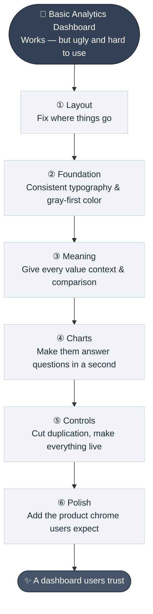
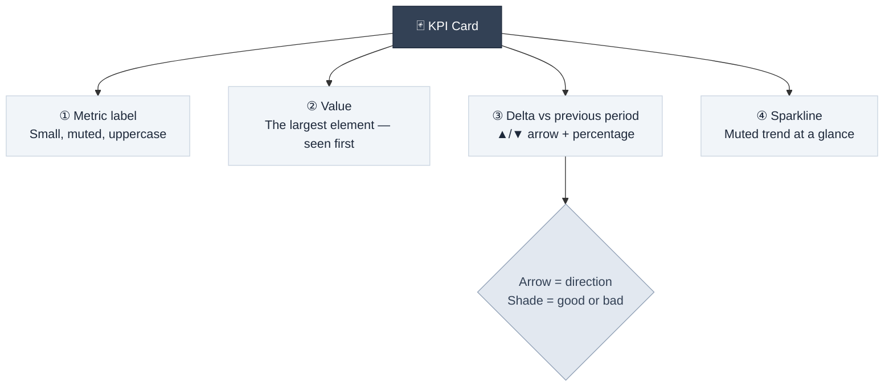
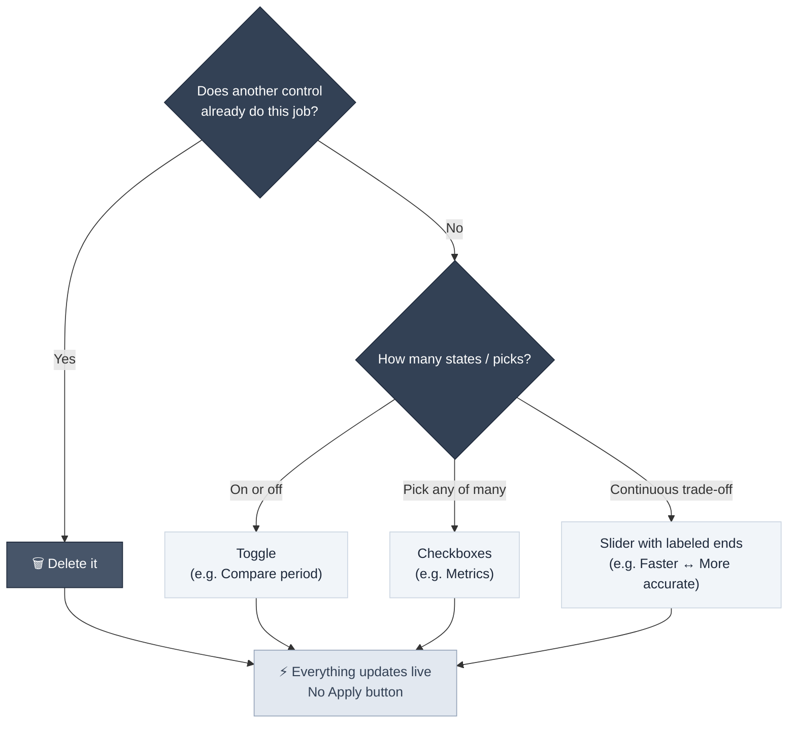

# Dashboard Design Playbook

> **"Designing top-tier UIs is just solving your users' problems, one at a time. Start with whatever gets in their way the most, fix it, then move on to the next one."**

---

## Table of Contents

- [The Method: One Problem at a Time](#the-method-one-problem-at-a-time)
- [Rule 1 — Fix Where Things Go Before How They Look](#rule-1--fix-where-things-go-before-how-they-look)
- [Rule 2 — Design in Gray First, Then Add Color With a Job](#rule-2--design-in-gray-first-then-add-color-with-a-job)
- [Rule 3 — Every Value Needs Something to Compare To](#rule-3--every-value-needs-something-to-compare-to)
- [Rule 4 — Charts Must Answer Questions in a Second](#rule-4--charts-must-answer-questions-in-a-second)
- [Rule 5 — Every Control Must Earn Its Place](#rule-5--every-control-must-earn-its-place)
- [Rule 6 — Add the Boring Stuff Users Expect](#rule-6--add-the-boring-stuff-users-expect)
- [Before / After Summary](#before--after-summary)
- [Anti-Pattern Checklist](#anti-pattern-checklist)

---

## The Method: One Problem at a Time

A basic analytics dashboard "works" — but it is ugly and hard to use, which makes users distrust the numbers on it. The easy way to level it up is **not** a big-bang visual overhaul. It is a disciplined loop:

1. **Identify** the problem that hurts the user experience the most *right now*.
2. **Fix only that problem.**
3. **Move to the next one.**

Because each fix is scoped to a single problem, every change has a clear reason — and the reason is always the user, never taste or trends.

The six rules below are the six problems of this loop, in the order they were solved.

---

## Rule 1 — Fix Where Things Go Before How They Look

### The Problem

Users open the page to check their numbers — how many visitors this week. But before any of that, they are greeted by a full-width filter box: **nine filters and two buttons**, with the information they came for pushed far below the fold.

### The Fix

Move the filters into a **column on the right, beside the data**:

- The numbers become the **first thing you see**.
- Each filter sits **right next to the chart it changes** — cause and effect are visually adjacent.

| Considered Option | Verdict | Reason |
| :--- | :---: | :--- |
| Keep filters at the top | ❌ | Data — the reason users visit — is pushed below the fold |
| Push filters to the bottom | ❌ | You would scroll down to change a filter, then scroll back up to see what happened |
| Right column beside the data | ✅ | Numbers first; each filter next to the chart it affects |

> [!TIP]
> **Fix where things go before you fix how they look.** Layout and structure problems cause more user pain than styling problems. A beautiful page with the wrong layout is still unusable.

---

## Rule 2 — Design in Gray First, Then Add Color With a Job

### The Problem

The page looks unfinished, and users don't trust numbers on an unfinished page:

- Dropdown and button text use a **different font and size** from the rest of the page.
- Dropdowns are **still browser-default white on a dark page** — the browser styles its own controls.
- One blue is used for everything: the export button, the active tab, the page numbers, and the bars — so it **means nothing**.
- Every box has a **thick border** with corners that don't match.

### The Fix

- **One consistent typography system** — the whole page reads like one product.
- A set of **grays, all tinted slightly blue**.
- **Spacing instead of thick borders** to separate elements; only a thin line where a border is truly needed.
- **Depth via a lighter shade**: cards are one step lighter than the page background. In dark mode, shadows are not powerful — a lighter shade is what creates a sense of elevation.
- **Consistent border radius**: one value for all controls, a bigger one for cards.
- **Color gets a job**: the data and anything switched *on*. Bars and checkboxes can be the accent color; buttons, tabs, and page numbers stay gray.

> [!NOTE]
> Native browser controls (dropdowns, checkboxes, date pickers) keep their own styling until you explicitly restyle them. Unstyled controls visually break the product and undermine trust in every number on the page.

> [!TIP]
> **Before: too much color, so color meant nothing. After: color is used for a job.** Design everything in gray first, then add color — or a bigger font — only where it means something.

---

## Rule 3 — Every Value Needs Something to Compare To

### The Problem

"24.8k visitors. Is that good or bad? We don't know — because these are just numbers." The KPIs are the main reason users open the page, and they are meaningless without context.

### The Fix

Turn raw numbers into **KPI cards** with context. The number stays the biggest element (it is what you should see first), surrounded by quiet supporting information:

### Encoding Good vs. Bad Without Red and Green

Use **one color and shades of gray** — no red/green pairs:

- The **arrow** already shows the *direction* (up or down).
- The **shade** shows whether that direction is *good or bad*.
- Example: *average duration is down* — visitors spend less time on the site, that's **bad** → the delta is rendered dimmer. *Bounce rate is also down* — fewer people leave immediately, that's **good** → rendered brighter.

The same metric moving in the same direction can be good or bad depending on what it measures — a fixed red/green mapping cannot express that, but brightness can.

> [!WARNING]
> **Red/green encoding is ambiguous.** The same arrow direction means opposite things for different metrics (visitors up = good; bounce rate up = bad), and red/green fails for color-blind users. Prefer: **arrow for direction, brightness/shade for valence**, and keep deltas quiet — the number is the hero, everything around it is de-emphasized.

---

## Rule 4 — Charts Must Answer Questions in a Second

### The Problem

A big, bulky bar chart with no axis, no numbers, and no comparison. "How many visitors did we get on Sunday?" — you can't tell. A chart exists to answer questions like that, and this one isn't doing its job. It also looks ugly.

### The Fix

Replace it with a **line chart** and add three things:

| Addition | What It Answers |
| :--- | :--- |
| **Axis with soft gridlines** | Gives you a scale to read values against |
| **Tooltip with the real number** | "4,960 visitors" on Sunday — the exact value on hover |
| **Dashed gray line for last week** | A comparison — "this week did better every single day" |

### Color Choices for the Lines

- The primary line is a **bright, warm color (yellow) in dark mode** — a thin blue line doesn't have good contrast on a dark background. The primary line carries the most useful information, so it gets the most visible treatment.
- **Last week is gray** — it is only there to compare against, so it must never compete with the current data.

> [!TIP]
> **A chart should answer questions in a second — and be nice to look at.** If a user cannot extract the answer to an obvious question ("how are we doing vs. last week?") without studying the chart, the chart is decoration, not a tool.

---

## Rule 5 — Every Control Must Earn Its Place

### The Problem

Way too many filters, several of them doing jobs that other controls already do:

- A **device filter** sitting right next to a **Devices tab** that does the same thing.
- **Three different ways to pick a date**.
- A **chart-type picker** — when the right move is to just pick the right chart for the user.
- An **Apply button** — nothing changes until you click it.
- Checkboxes and sliders that still look like browser defaults.

Every extra control is one more thing to read before you get your answer.

### The Fix

| Removed | Why |
| :--- | :--- |
| Device filter | The Devices tab already does that job |
| Extra date inputs (2 of 3) | Collapsed into a single date-range button in the header |
| Chart-type picker | Pick the right chart for the data — don't ask the user |
| Apply / Reset | Everything now **updates live** — no confirm step |

### Choosing the Right Kind of Control

For the controls that remain, use the control type that matches the semantics — restyled to match the design system:

> [!TIP]
> **Cut any control that does the same job as another one — and keep the rest reactive and consistent.** A labeled slider ("Faster ↔ More accurate") tells users what they are trading; a toggle says binary; checkboxes say multi-select. Using the wrong control type forces users to guess.

---

## Rule 6 — Add the Boring Stuff Users Expect

### The Problem

It works now and looks decent, but it doesn't feel like a real product: hovering a row or a button does nothing, the nav is just words, and there is no light mode. It lacks the "pro feel" — the layer of expected affordances every serious app has.

### The Fix

**Interaction feedback**

- **Hover state on everything you can click** — it tells you something is clickable *before* you click it. Same for table rows, so you don't lose your place.
- **Right-align the numbers in tables** so they are easy to compare down the column.
- **Icons in the nav links** — faster scanning, clearer identity.

**Product chrome** (the furniture of a real app)

- A **workspace switcher** next to the logo.
- **Search** with a keyboard shortcut (⌘K / Ctrl+K).
- **Breadcrumbs** so you always know where you are.
- A **notifications** entry point.
- A **real profile** (name, photo) grouped with **Settings at the bottom of the sidebar** — the most common place users look for them.

**Content-level polish**

- **Site logos next to each referrer** — you spot Google by its logo faster than by its text.
- **Top Pages and Top Referrers side by side**, so almost the whole dashboard fits on one screen.

**Theme parity**

- Give users a **light mode** option — or at least follow their system theme. Most users are not on dark mode.
- Re-tune colors per theme: **yellow → blue in light mode**, because yellow is hard to see on white.

> [!NOTE]
> **Add all the stuff users expect from any top-tier app.** These details look individually trivial, but together they are exactly what separates "a page with charts" from "a product." Their absence is felt as an unplaceable feeling of fakeness.

---

## Before / After Summary

| Area | Before (Beginner) | After (Top-Tier) |
| :--- | :--- | :--- |
| **Layout** | 9 filters + 2 buttons block the data | Numbers first; filters in a right column next to the charts they change |
| **Typography** | Mixed fonts/sizes; browser-default controls | One type system; all controls restyled |
| **Color** | One blue for everything | Gray-first; accent color only for data & active states |
| **Depth** | Thick borders on every box | Spacing + one-step-lighter cards; thin borders; consistent radii |
| **KPIs** | Bare numbers, no meaning | Cards: value + ▲/▼ delta vs last week + sparkline; shade encodes good/bad |
| **Chart** | Bulky bars, no scale, no comparison | Line chart + gridlines + tooltip + dashed last-week line |
| **Controls** | 9 filters, 3 date pickers, Apply button | Few, purposeful, live-updating, semantically correct control types |
| **Feedback** | No hover states | Hover on all clickables; right-aligned numbers |
| **Chrome** | Logo + links only | Workspace switcher, search, breadcrumbs, notifications, profile, settings |
| **Themes** | Dark only | Light + dark (or system theme), with per-theme color retuning |

---

## Anti-Pattern Checklist

| Anti-Pattern | Why It Hurts | Do Instead |
| :--- | :--- | :--- |
| Filters above the data | Pushes the reason users visit below the fold | Filters beside the data they affect |
| Unstyled native controls | Page looks unfinished; numbers lose trust | Restyle every control to the design system |
| Accent color on buttons, tabs, *and* data | Color means nothing | Reserve accent for data and switched-on states |
| Red = bad, green = good for all metrics | Same direction can be good or bad; color-blind users | Arrow for direction, shade for valence |
| Bare KPI numbers | "Is 24.8k good?" is unanswerable | Value + delta vs previous period + trend |
| Chart without axis or comparison | Cannot answer the obvious question | Gridlines + tooltip + previous-period line |
| Duplicate controls (filter + tab) | More to read before any answer | One control per job; delete the rest |
| Apply button on filters | Extra click; state invisible until applied | Live updates |
| No hover states | Clickability is invisible | Hover feedback on every interactive element |
| Left-aligned number columns | Hard to compare down the column | Right-align numeric columns |
| Dark mode only | Fails the majority of users | Light mode or system theme, with retuned colors |

---

## Related Pages

- ← [UI Design Foundations](ui-design-foundations.md) — Affordances, hierarchy, typography, color, dark-mode depth, and states
- ← [Mobile UI Design Foundations](mobile-ui-design-foundations.md) — Layout and navigation constraints on smaller screens
- → [User Interaction & Design](user-interaction-design.md) — Use cases and wireframing before visual design
- → [Success Metrics](../06-metrics/success-metrics.md) — The KPIs these dashboards are built to communicate

---

## Sources & References

- Video Source: *The Easy Way to Design UIs* — Sajid ([YouTube](https://www.youtube.com/watch?v=H0hhK4wP7pU), 2026) — live redesign of an analytics dashboard in six problem-driven steps
- Related: [UI Design Foundations Research](../../docs/research/ui_design_foundations.md)

---

* [← Back to Section Index](index.md) · [← Back to Wiki Home](../index.md) *
