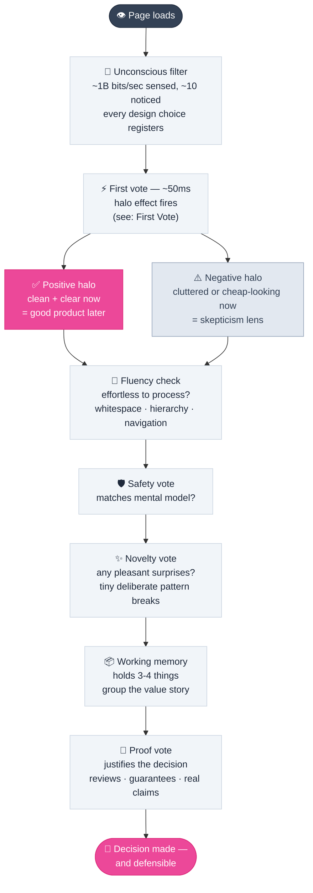
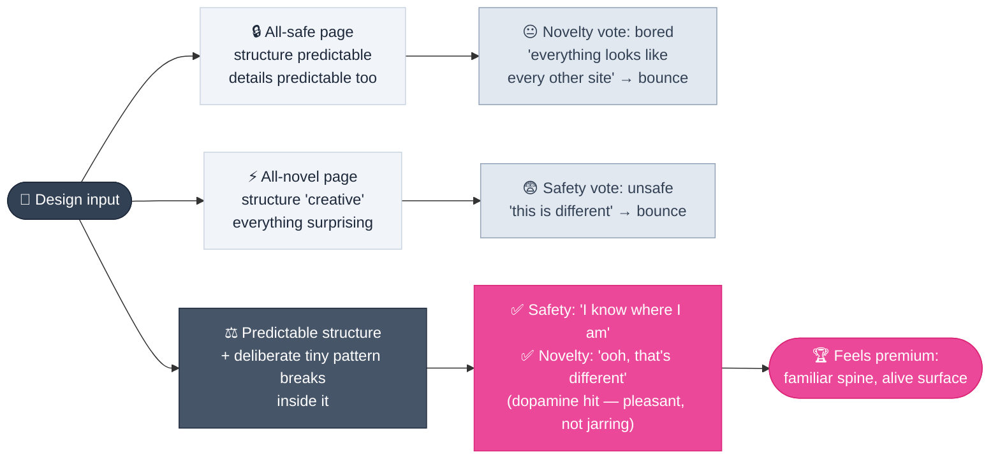
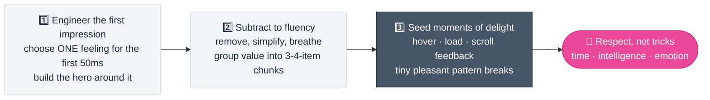

# Design Psychology

> **A page is never neutral: every element is a psychological statement, whether or not anyone chose to make it.**

---

## Table of Contents

- [Why Design Is Psychology First](#why-design-is-psychology-first)
- [The Visitor's Judgment Pipeline](#the-visitors-judgment-pipeline)
- [Unconscious Processing: Decisions Below Awareness](#unconscious-processing-decisions-below-awareness)
- [The First Vote: First Impressions and the Halo Effect](#the-first-vote-first-impressions-and-the-halo-effect)
- [Cognitive Fluency: Easy-to-Process Reads as Premium](#cognitive-fluency-easy-to-process-reads-as-premium)
- [Working Memory: Three or Four Things at Once](#working-memory-three-or-four-things-at-once)
- [One Visitor, Three Judgment Systems](#one-visitor-three-judgment-systems)
- [Mental Models: The Visitor's Layout Blueprint](#mental-models-the-visitors-layout-blueprint)
- [Balancing Safety and Novelty](#balancing-safety-and-novelty)
- [Moments That Stick: Micro-Interactions and the Peak-End Rule](#moments-that-stick-micro-interactions-and-the-peak-end-rule)
- [How Leading Brands Apply the Psychology](#how-leading-brands-apply-the-psychology)
- [The Premium-Perception Framework](#the-premium-perception-framework)
- [A PM Audit for Psychology Gaps](#a-pm-audit-for-psychology-gaps)
- [Related Pages](#related-pages)
- [Sources & References](#sources--references)

---

## Why Design Is Psychology First

Two independent practitioners reached the same conclusion after a decade each of building and auditing websites: the decisions that separate a credible product page from a forgettable one start with **how brains work**, not with fonts or colors. One of them learned it the hard way — a visually beautiful client site completely tanked the client's sales, and years of investigation into why traced the failure back to psychology, not aesthetics. The other distilled "premium-feeling" sites into a set of predictable psychological principles that any team can apply deliberately.

For product managers this reframes the charter of design work. "Make it feel premium" is not a vague request for decoration behind a paid designer's judgment — it is a describable, testable system:

1. Visitors process a tiny sliver of what the page sends, mostly **unconsciously**
2. Their baseline is set in **milliseconds**, before any content is read
3. **Easy-to-process** elements are judged as higher quality — fluency *is* credibility
4. Every visitor runs **several competing judgment systems**, and they fire in a fixed order

The business meaning is direct: the "premium feel" that buys trust, authority, and conversions is the compound interest of small psychological effects — each one small, their sum decisive.

> [!IMPORTANT]
> The ethical core of this page: none of these mechanisms are tricks. The distillation that survived both practitioners is **respect** — for the visitor's *time* (clear and simple), for their *intelligence* (carefully crafted experience), and for their *emotional response* (moments of delight). Psychology manipulated is psychology eventually detected.

---

## The Visitor's Judgment Pipeline

A visitor is not one evaluator but a sequence of fast, brutal filters that run before conscious reading even begins. Understanding where each filter sits is how a page gets engineered instead of merely decorated.

The sections below walk this pipeline in order, because the order is not negotiable — later filters can only judge what earlier filters allowed through.

---

## Unconscious Processing: Decisions Below Awareness

The sensory system takes in on the order of **a billion bits of information per second**, while conscious awareness handles about **ten**. Attention works like a spotlight on a pressure gauges nobody can see: the visitor isn't aware of the room's hum until someone names it, and similarly isn't aware of the spacing inconsistency that registers as "something feels off."

Every design decision lands on that unconscious stream. Spacing, contrast, motion, alignment — all processed before conscious attention arrives. There is no such thing as an invisible element: a default layout "says" just as loudly as a chosen one, it simply says *nobody decided anything* (see [The Anatomy of Generic](landing-page-design.md#the-anatomy-of-generic)).

> [!NOTE]
> PM takeaway: "users didn't mention it" and "users didn't notice it" are different claims. Research interviews capture the ten realized bits — the other billion still voted.

---

## The First Vote: First Impressions and the Halo Effect

Roughly **50 milliseconds** — a fraction of a second — is all it takes for a visitor to form an opinion of a website, and that opinion determines whether they stay.

The mechanism is the **halo effect**: the brain lets an initial impression of one thing color its judgment of everything that follows. If the first thing seen looks professional, clean, and high quality, the brain assumes the products, services, and company behind it are equally high quality. The reverse compounds just as fast.

This is why the top of the homepage — the part visible without scrolling — is the single most valuable real estate on any site:

- A cheap-looking header, a cluttered layout, or low-quality imagery in the first view creates a **negative halo**; even a brilliant page is then read *through a lens of skepticism*
- A confident, clear first view creates a **positive halo** that carries the visitor past sections they might otherwise bounce from

Premium brands do not "design homepages." They **engineer the first impression** — starting with one deliberate question: *what single feeling should a visitor have in the first 50 milliseconds?* Calm? Confidence? Excitement? The entire hero is then built to produce that feeling and nothing else.

> [!TIP]
> The first vote happens before a word is read. Judging a hero by its copy is judging too late — judge by what the section *makes someone feel* before reading.

---

## Cognitive Fluency: Easy-to-Process Reads as Premium

The brain is built to conserve energy. When it faces something confusing, it must work harder — that extra work is **cognitive load**, and a page that imposes a high one simply *feels stressful and unprofessional*.

The inverse is **cognitive fluency**: when something is simple, clear, and intuitive, the brain finds it easy to process — and interprets easy-to-process things as *better, more trustworthy, and higher quality*. Fluency is not just readability; it is a direct quality judgment.

Two experiences demonstrate the difference:

| | Cheap-feeling page | Premium-feeling page |
| :--- | :--- | :--- |
| **Element structure** | A chaotic mix of competing elements — the eye has nowhere to land | One clear path — the eye goes exactly where it is guided |
| **Whitespace** | Squeezed, cramped; content fights for room | Generous; content can breathe |
| **Hierarchy** | Implied at best | Explicit: the most important thing is unmistakably first |
| **Navigation** | Creative, unpredictable positions | Simple, predictable, conventional |
| **Resulting feeling** | Overwhelmed → skeptical | Calm, in control, confident in the brand's professionalism |

That last row is the business logic: brands that reduce the mental effort required to use their site make visitors *feel* a certain way — calm and in control — and that feeling is re-attributed as trust in the brand itself.

These mechanics have craft-level execution rules scattered through the wiki — hierarchy, whitespace quantities, navigation conventions in [UI Design Foundations](ui-design-foundations.md#visual-hierarchy), and the same discipline applied to data screens in [Dashboard Design Playbook](dashboard-design-playbook.md). This page is the *why* behind those rules: fluent pages read as premium because processing effort gets judged as product quality.

---

## Working Memory: Three or Four Things at Once

Conscious working memory holds roughly **three or four items at once**. A ten-digit phone number exceeds the limit — which is why it works only because it is remembered as three small chunks. Websites inherit the same ceiling.

A visitor scrolling a product page might see the product itself, free shipping, free returns, a warranty, and a loyalty program. By the bottom of the page, the brain has **already dropped half the reasons to buy** — not because they were unconvincing, but because they were stacked past the limit.

The fix is structural, not rhetorical — **group**:

- Cluster value points into a handful of coherent categories rather than one flat list
- Never repeat the same feature list across pricing tiers. State the *differences*: "the Pro tier is everything in Basic, plus…" — this spares the visitor from picking a needle out of a haystack to compare two options
- The grouped version is also the memorable one: chunks survive, flat lists don't

> [!IMPORTANT]
> This is the same physics behind the information-refactoring protocol in [UI Design Foundations](ui-design-foundations.md#information-refactoring-wall-of-text-protocol) and the "one problem at a time" rule in onboarding screens. Whether the surface is a paragraph, a signup flow, or a pricing table — three or four things at once, grouped.

---

## One Visitor, Three Judgment Systems

Common practice designs for "the user" as if users were a single mind. In practice, every visitor brings **three evaluation systems** to the page, each wanting something different — and none of them can be left out. Crucially, **they fire in a fixed order**: safety votes first, novelty votes second, and justification votes last.

| | 1 · The Safety Vote | 2 · The Novelty Vote | 3 · The Proof Vote |
| :--- | :--- | :--- | :--- |
| **Fires** | First — before anything else | Second — during interaction | Last — after the decision is already made |
| **Wants** | Familiar structure, zero surprise | Pleasant unpredictability, small dopamine hits | Reasons the decision feels smart |
| **Bounces when** | The page doesn't match expected patterns | Everything is so safe it's boring | Claims are unsupported or overwhelming |
| **What to supply** | Conventional layout, predictable navigation | Tiny deliberate pattern breaks | Reviews, guarantees, grouped value story |
| **Risk if ignored** | "This is different" → leaves immediately | Boredom → leaves anyway | Decision made but unjustifiable → hesitation |

Three consequences of the ordering deserve emphasis:

1. **Safety wins ties.** The first vote is over before the second one runs. A page that innovates on structure loses the safety vote before its cleverness ever gets seen.
2. **Proof arrives too late to decide, just in time to close.** Reviews and guarantees rarely make someone buy — they let the buyer *justify* the decision to themselves. Supplying proof is not about winning the argument at that moment; it is about handing the visitor every reason to feel good about the yes they already want to say.
3. **Designing for only one system is a failure either way.** All-safety produces a forgettable page nobody stays on; all-novelty produces an exciting page nobody trusts.

---

## Mental Models: The Visitor's Layout Blueprint

Visitors arrive carrying a **mental model** — a pre-built blueprint of where things belong on a website: logo top-left, navigation close to it, footer at the bottom. The model was built from every website they have ever seen — a million cumulative visits compressed into placement habits.

The first judgment system runs on this blueprint precisely *so it doesn't have to think*. When something isn't where the blueprint says it should be, that system doesn't go looking for it. It reads one sentence — *"this is different"* — and leaves.

A real product case shows what this costs: a gaming news site moved its mobile menu to the bottom corner, *objectively* better UX because that placement is closer to the thumb zone on touch devices. The change had to be reverted because users could not find the menu at all. **On paper, the redesign won. In the visitors' mental models, the menu had vanished.**

> [!WARNING]
> Convention beats theoretical optimality wherever the safety vote runs first. Movable things get moved only with compensation — visual weight, motion, onboarding — because a familiar pattern breaking *accidentally* reads as broken, not as innovation.

This principle has a constructive side: deliberate, *small* pattern breaks inside a predictable structure are exactly what keeps a page from reading as generic template work (compare [Real Axis Layout](landing-page-design.md#2--layout-break-the-dead-center)). The rule is not "never break the model" — it is *break knowingly and pay for the break*.

---

## Balancing Safety and Novelty

The two first judgment systems pull the page in opposite directions, and letting either one decide everything loses the other:

The reconciliation is precise: **keep the structure predictable; break tiny patterns on purpose, inside it.** When something small happens that the brain didn't predict — and it's *pleasant rather than jarring* — the novelty system gets its hit. Drastic deviations scare the safety system off; the dose makes the medicine.

Micro-interactions are the natural instrument for this: a button that reacts to hover in a way buttons don't normally react, an image that scales ever so slightly as the visitor scrolls past. Design teachers have long called this balancing act *most advanced, yet acceptable* — familiar enough to feel safe, inventive enough to feel alive.

> [!TIP]
> The pleasant-surprise test: would a visitor describe this detail as "ooh, nice touch," or "wait, what just happened"? One earns the vote; the other spends the safety budget.

---

## Moments That Stick: Micro-Interactions and the Peak-End Rule

People do not remember an experience as the average of every moment. They remember its **most intense points — the peaks — and the ending**. This is the **peak-end rule**, and it composes perfectly with micro-interactions: the small, subtle animations and feedback loops that respond to interaction.

A button that changes shade on hover, a form field that gently confirms correct input, a transition that glides as the page scrolls — each one seems insignificant, but together they manufacture small peaks of positive emotion. A satisfying click, a smooth reveal: these are the moments that spark the feeling a visitor walks away remembering.

Cheap-feeling pages are static and lifeless — they do the bare minimum to a page's interactivity, sometimes less. Premium-feeling pages are full of thoughtful little details that signal something specific: **the creator cared enough to obsess over the smallest moments.** Sprinkled throughout a site, those moments add up to an overall judgment of *quality and craftsmanship* — which loops straight back into the halo effect.

> [!NOTE]
> Because memory is made of peaks and endings, the last screen of a journey matters as much as the hero. A page that opens strong and ends weak gets remembered as a page that ended weak. This is also why craft must be carried all the way down (see [Lever 6 in Landing Page Design](landing-page-design.md#6--craft-carry-the-decisions-all-the-way-down)).

Execution-level guidance for building these moments safely lives in [Motion Design](motion-design.md) — purposeful movement with a job, state feedback, and easing that signals quality without demanding attention.

---

## How Leading Brands Apply the Psychology

The principles are direction-agnostic: brands with completely different visual styles run on the same three mechanisms.

| Brand example | What they do | Psychology at work | Nearest style family |
| :--- | :--- | :--- | :--- |
| **Apple** | Full-screen product shot, one bold headline; near-zero cognitive load; famously smooth scrolling and menus | Halo mastery + fluency: impossible to be confused, so the first feeling is pure confidence | Clean Minimalism |
| **Luxury fashion (e.g., Hermes, Bottega Veneta)** | Extreme whitespace, few elements | Whitespace as a cue: *"we are so confident, we don't need to shout"* — exclusivity and calm | High-Fashion Editorial |
| **Stripe, Figma** | Clear, logical layouts for genuinely complex products | Fluency for complexity: the site's simplicity makes the *product* feel simple; an innovation-and-trust halo | Structured Corporate |

Note what the luxury example really says: whitespace on these sites is not empty space, and not minimalism-for-its-own-sake — it is a **psychological signal of confidence** that lowers cognitive load to the absolute minimum and puts the visitor's attention exactly on the product.

> [!TIP]
> PM shortcut: when evaluating any page, ask which family it commits to (see [The Six Visual Styles](landing-page-design.md#the-six-visual-styles)), then ask whether it runs the same three mechanisms — a deliberate first feeling, effortless processing, and moments of polish. A page in *any* family fails premium-perception if any one of the three is missing.

---

## The Premium-Perception Framework

Applying all of this compresses into three sequential steps — in this order, because each step sets the ceiling for the next:

**Step 1 · Engineer the first impression.** Don't just design the homepage — obsess over the top half of it. Decide the single feeling the visitor should have within 50 milliseconds (calm, confidence, excitement), then build the entire hero section around producing that feeling, so the halo works in the product's favor.

**Step 2 · Subtract to fluency.** Walk every page and ask two questions: *what can I remove?* and *how can the navigation get simpler?* Increase whitespace. Give each section **one primary goal** and a hierarchy that points at it. Respect working memory by grouping the value story into three-or-four-item chunks. And remember the calibration trap: what feels simple to the builder may still confuse a first-time visitor.

**Step 3 · Seed moments of delight.** Hunt for every place a small moment of positive feedback can live: how buttons respond on hover, what happens when a page loads, how the site responds while scrolling. On their own these are trivia; stacked through a journey, they are the essence of the premium experience — and the visible proof that someone cared.

---

## A PM Audit for Psychology Gaps

When reviewing any page — competitor benchmark, AI-generated draft, or an agency deliverable — run these eight questions in pipeline order:

| # | Audit question | Mechanism | Fails when it surfaces |
| :-- | :--- | :--- | :--- |
| 1 | What single feeling does the hero produce in the first 50 ms — and is it deliberate? | Halo effect | "Whatever" — the vote happens without a choice |
| 2 | Which elements compete without hierarchy? | Cognitive fluency | Overwhelm re-attributed to the product |
| 3 | Where does the page break the visitor's mental model — and is each break deliberate? | Mental models | Accidental breaks read as broken |
| 4 | Is the value story grouped into 3–4 items — or stacked past memory? | Working memory | Half the reasons dropped before the fold |
| 5 | Is there proof for every claim someone might need to justify the decision later? | Proof vote | Decision made, but hesitation follows |
| 6 | Is the structure safe and the *surface* surprising — or wholly one or the other? | Safety/novelty balance | Boring or alarming — never premium |
| 7 | What will the visitor remember: peaks and endings, or a flat middle? | Peak-end rule | Effort concentrated in the hero only |
| 8 | Would moving a familiar control break discoverability — even if the new position is "better UX"? | Mental models (regression) | On-paper wins that users can't find |

> [!NOTE]
> Two of these audits connect directly to findings logged on other pages: item 2 is the reason unstyled native controls and mismatched polish make a dashboard's numbers feel untrustworthy (halo effect applied to data products — see the [Dashboard Design Playbook](dashboard-design-playbook.md#the-3-level-loop-level-up-a-dashboard-product-polish)), and items 1 and 7 are why a generic hero and a weak ending cost the same credibility a strong one could have earned.

---

## Related Pages

- ← [UI Design Foundations](ui-design-foundations.md) — the craft mechanics (hierarchy, whitespace, states) that execute every principle here
- ← [Landing Page Design](landing-page-design.md) — the directions and levers that operationalize premium perception
- ← [Dashboard Design Playbook](dashboard-design-playbook.md) — the halo effect applied to data products: polish builds trust in numbers
- → [Motion Design](motion-design.md) — the practice layer for micro-interactions and state feedback
- → [Onboarding Patterns](onboarding-patterns.md) — working-memory and momentum principles applied to first-run flows

---

## Sources & References

- Video: *The Psychology of Premium Websites* — Sam Crawford | Web Design Expert ([YouTube](https://www.youtube.com/watch?v=f2mGqlLLqok), 2026) — the halo effect and first impressions, cognitive load and fluency, micro-interactions and the peak-end rule, brand applications (Apple, luxury fashion, Stripe/Figma), and the three-step premium framework
- Video: *The Psychology of a PERFECT Website* — Self-Made Web Designer ([YouTube](https://www.youtube.com/watch?v=d-IaU9qcDGg), 2026) — unconscious processing, the three judgment systems, mental models and their real-world failure case, the safety/novelty balance, and chunking into working-memory limits
- Book: *100 Things Every Designer Should Know About People* — Susan Weinschenk (2011) — cited by the creator as source material
- Book: *Neuro Web Design: What Makes Them Click* — Susan Weinschenk (2009) — cited by the creator as source material

---

* [← Back to Section Index](index.md) · [← Back to Wiki Home](../index.md) *
