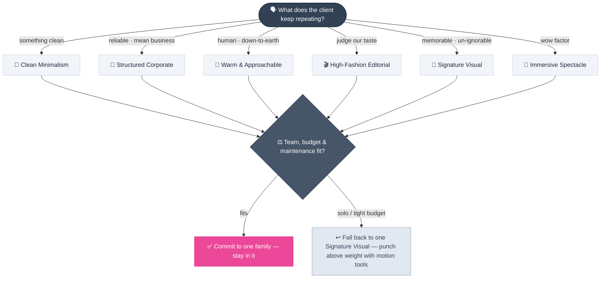
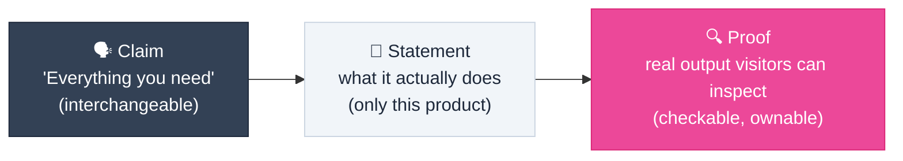

# Landing Page Design

> **A premium page has two layers: a chosen direction, and a decision behind every element.**

---

## Table of Contents

- [The Landing Page as a Product Surface](#the-landing-page-as-a-product-surface)
- [The Six Visual Styles](#the-six-visual-styles)
- [Choosing a Style: The Signal Decision Flow](#choosing-a-style-the-signal-decision-flow)
- [Style Trade-offs at a Glance](#style-trade-offs-at-a-glance)
- [The Anatomy of Generic](#the-anatomy-of-generic)
- [Decisions Over Defaults](#decisions-over-defaults)
- [The Six Design Levers](#the-six-design-levers)
- [The Specificity Ladder](#the-specificity-ladder)
- [Evaluating AI-Generated Pages](#evaluating-ai-generated-pages)
- [Same Method, Opposite Answers](#same-method-opposite-answers)
- [Before / After Summary](#before--after-summary)

---

## The Landing Page as a Product Surface

A landing page is not marketing collateral — it is the first product surface most prospects ever touch. It converts or loses visitors in seconds, and it shapes expectations for the product experience itself. Product managers routinely own, commission, or review these pages, often produced with AI assistance under tight deadlines.

That assistance raises the bar rather than lowering it: when anyone can generate a competent-looking page, *competent-looking* stops differentiating. What remains scarce is taste — the willingness to make a decision for this product, on this page, for these users.

Working on a page productively means answering two questions in order:

1. **Direction** — which of the six recurring visual styles is this page committing to?
2. **Execution** — how were its elements decided? (The decisions-over-defaults method.)

> [!NOTE]
> If a look is everywhere, it cannot be premium. The goal is not "beautiful" — it is a page where a visitor can point at any element and trace it back to a deliberate choice.

---

## The Six Visual Styles

Most sites that feel impossibly good are not exotic — they resolve to one of six recurring style families. Learning to see them turns "I could never build something like that" into a matter of pattern recognition. Nearly every client project asks for one of these, whether or not anyone names it.

Each family below lists its visual traits, the situations it fits, and the risk it carries. These are directions, not skill tiers: a modest page executed with discipline inside one family beats a page that half-commits to all six.

### Clean Minimalism

**Visual traits**

- Light, skinny sans-serif faces with generous letter spacing
- A visible type system — consistent sizes, weights, and spacing that follow an obvious order
- Whitespace treated as a design material, not leftover space
- Organization that feels effortless rather than stiff

**Philosophy**

> "Perfection is achieved not when there is nothing more to add, but when there is nothing left to take away." — Antoine de Saint-Exupéry

Removal is what makes a page feel advanced: the fewer knobs and handles, the more the thing reads as the future.

**When it fits** — brands whose promise is precision, calm, or quality: consumer tech, design and productivity tools. When the product's value is simplicity itself, the page demonstrates it by being simple.

**Client signal** — *"I just want something clean."*

> [!TIP]
> A section with little on it is not a failed section. Judge this style by its rhythm, not its density.

**Risk** — sparse can tip into unfinished if the underlying system is weak. The type system must be strong enough that whitespace reads as confidence, not absence. The psychology behind that confidence signal — and the 50-millisecond first impression everything rests on — is in [Design Psychology](design-psychology.md#the-first-vote-first-impressions-and-the-halo-effect).

### Structured Corporate

**Visual traits**

- Strict grid; sections stay within contained columns, no full-bleed edge-to-edge layouts
- Function over form; every design choice pulls attention back to the product
- One controlled touch of personality — a signature detail, a single color moment — that never becomes the story
- Overall message: stability, competence, *we mean business*

**When it fits** — B2B SaaS, AI and technology products, anything pitching investors or enterprise buyers. The audience expects reliability over flair; the brand communicates "building the future of technology" rather than "the best-looking brand."

**Client signal** — *"We need to look reliable. We're put together."*

**Risk** — interchangeability. The discipline is deliberately safe, so the page can blend in. It needs one memorable element (see [Signature Visual](#signature-visual)) or it will fail the swap test in the AI audit below.

### Warm & Approachable

**Visual traits**

- A candid feel — as if the visitor walked in on a private moment and was welcomed in
- Nothing super bold; a noticeable, friendly bounce in the animations
- Photography between highly produced and highly authentic — real people, real spaces
- Rounded corners on cards and images; warm tones and natural-feeling color palettes

**When it fits** — consumer fintech, health, education, and service products where trust is human rather than institutional. Representative reference: Fruitful, whose conversational copy and warm, un-staged imagery carry an automated money product.

**Client signal** — *"We want to feel approachable, down-to-earth."*

**Risk** — imagery dependency. Clients rarely supply the photography this style needs, so compensate rather than fake: round the corners, lean into warm natural tones, let motion carry the warmth.

> [!WARNING]
> Motion overuse tips warmth into unprofessional. Bounce belongs at moments of feedback (see [Motion Design](motion-design.md#why-motion-matters)), not on every element.

### High-Fashion Editorial

**Visual traits**

- Cinematic imagery — the feel of a fragrance or fashion-film advertisement
- Ultra-minimal, with unconventional modular layouts that don't follow common principles
- Deliberately scaled-down type; the eye bouncing between paragraphs is accepted
- Value communicated by showing taste, not by stating benefits

**When it fits** — agencies, fashion and luxury, and brand-led businesses whose audience judges them by what they make. What the visitor gets is understood innately from who they are; it does not need to be spelled out.

**Client signal** — *"Judge us by our taste."*

**Risk** — this family requires real fluency in Swiss and editorial design: modular grids, typographic hierarchy, composition. The readability trade-offs must be deliberate — breaking conventions knowingly reads as style; breaking them accidentally reads as broken.

### Signature Visual

**Visual traits**

- One element visitors can't stop thinking about: a display font that works like a graphic, a high-contrast palette, a 3D object, or imagery whose craft is obvious on first look
- The element repeats tastefully through the site instead of appearing once
- Contrast, not bigness — attention is drawn because it differs, not because it shouts

**When it fits** — creative products, games, and tools with a strong identity.

**Client signal** — *"Make it something people remember."*

**Risk** — dilution. More than one signature element competes with itself; restraint plus repetition is what keeps it striking rather than tacky.

> [!TIP]
> The element does not need to be an image. A super-large unique font that works more like a design element than readable text, or a small 3D object that stands out, both qualify. The point is contrast, not bigness.

### Immersive Spectacle

**Visual traits**

- A "wow factor" — something moves, morphs, or reacts within the first three seconds
- Unusual hero scroll behavior; sections react with the visitor as they scroll
- Interaction on nearly every inch of the page — not clean, not cool: impressive, and not subtle about it
- Skills stack in layers: design, UX, and serious engineering; typically a team effort

**When it fits** — digital studios, product launches, and award-target campaigns, where the page itself is proof of capability. Representative reference: Active Theory, whose site is a running demonstration of exactly this skill set.

**Client signal** — *"I want a wow factor."*

**Risk** — the highest of the six. Budget, timeline, performance, accessibility, and long-term maintenance all demand engineering attention. Motion and WebGL tools (for example Unicorn Studio or Spline) lower the bar and let small teams punch above their weight, but they do not remove the need for the layered skills.

> [!WARNING]
> A one-person show can pull this off, but only with patience and steady skill-building. If the timeline or budget is fixed, fall back to [Signature Visual](#signature-visual) — one strong element delivered well beats a half-finished spectacle.

---

## Choosing a Style: The Signal Decision Flow

Selection usually starts verbally. Clients repeat a phrase that names the style before they can name it themselves. Map the phrase first, then validate the choice against the non-verbal constraints — audience expectations, team size, budget, and maintenance appetite.

**When there is no verbal signal**, infer the direction from the audience:

| Audience | Reads as trustworthy | Reads as risky |
| :--- | :--- | :--- |
| Enterprise / B2B buyers | Contained, put-together (Structured Corporate) | Flashy spectacle — *what are they hiding?* |
| Consumers | Warm, human, un-staged (Warm & Approachable) | Cold, corporate rigidity |
| Taste-led industries (fashion, creative) | Strong point of view (Editorial / Signature) | Safe default sameness |

**Non-verbal validation criteria**

- **Audience expectations** — who sees the page, and what does *professional* mean to them?
- **Brand maturity** — a young brand can commit harder to a signature; a diversified one often needs the safer corporate grid
- **Team and budget** — Clean Minimalism and Structured Corporate are achievable solo; Immersive Spectacle typically is not
- **Maintenance appetite** — photography and motion need refreshes; minimal systems age slowly

---

## Style Trade-offs at a Glance

| Style | Build Cost | Accessibility Care | Maintenance Risk | Best Fit |
| :--- | :--- | :--- | :--- | :--- |
| Clean Minimalism | Low | Low | Low | Consumer tech, productivity tools |
| Structured Corporate | Low | Low | Low | B2B SaaS, investor-facing, enterprise |
| Warm & Approachable | Medium | Medium | Medium — photography and motion refreshes | Consumer fintech, health, services |
| High-Fashion Editorial | Medium | High — trade-offs must be deliberate | Medium | Agencies, luxury, taste-led brands |
| Signature Visual | Medium | Medium | Medium | Games, creative tools, strong-identity products |
| Immersive Spectacle | High | High | High | Studios, launches, award campaigns |

---

## The Anatomy of Generic

Generic output is easy to recognize because it is built entirely from defaults. Each of these elements was once a reasonable choice made by someone; when they appear together, they signal that **nobody chose anything**:

| Default Element | Why It Appears | What It Communicates |
| :--- | :--- | :--- |
| Purple/indigo gradient wash behind the hero | The most common "make it look designed" default | Template use; blends in with millions of pages |
| Headline dead-center, everything centered | The safest possible layout | No layout decision was risked |
| Three feature cards with emoji icons | Universal filler structure | Features listed, not demonstrated |
| Logos of recognizable-but-fake companies | Borrowed credibility | The claims are not real |
| Big invented stats ("10k+ users, 99.9% uptime") | Instant authority | Nobody checked the numbers |

> [!WARNING]
> Nothing on a generic page is obviously *wrong* — that is exactly why it fails. There is nothing to point at, so nobody remembers it. Blending in is the failure mode, not a bug.

Generic is also what happens when direction is skipped: a page that mixes all six style families resolves to none of them, and reads as noise rather than taste.

---

## Decisions Over Defaults

The fix is not more effort or more decoration — it is converting every default into a decision. This is the execution layer, and it operates within any of the six styles: the chosen family sets the destination, the levers below are the vehicle. Six levers cover nearly the entire transformation, and they are cheap to apply in order:

```mermaid
graph LR
    BASE["🧱 The Default Page\n(all defaults, no choices)"] --> L1["1 · Type\nfonts with a job"]
    L1 --> L2["2 · Layout\nreal axis, off-center"]
    L2 --> L3["3 · Color\ngrayscale + one accent"]
    L3 --> L4["4 · Content\nspecific and provable"]
    L4 --> L5["5 · Signature\ndemonstrate the product"]
    L5 --> L6["6 · Craft\ncarry it all the way down"]
    L6 --> PREMIUM["🏆 A Premium Page\nevery element decided"]

    style BASE fill:#334155,stroke:#1e293b,color:#fff
    style L1 fill:#f1f5f9,stroke:#cbd5e1,color:#1e293b
    style L2 fill:#f1f5f9,stroke:#cbd5e1,color:#1e293b
    style L3 fill:#f1f5f9,stroke:#cbd5e1,color:#1e293b
    style L4 fill:#f1f5f9,stroke:#cbd5e1,color:#1e293b
    style L5 fill:#475569,stroke:#1e293b,color:#fff
    style L6 fill:#475569,stroke:#1e293b,color:#fff
    style PREMIUM fill:#ec4899,stroke:#db2777,color:#fff
```

The first three levers are *cleanups* — they remove the generic feel. The last three are where a page becomes memorable.

---

## The Six Design Levers

### 1 · Typography With a Job

A single safe, neutral font renders every page silent. Premium pages give each font **a job**:

| Face | Job | Character It Carries |
| :--- | :--- | :--- |
| **Display face** (headlines) | Personality and voice | Choose the character the product should project: engineered, dramatic, editorial, playful |
| **Body face** (paragraphs) | All-day readability | Neutral, comfortable, unremarkable |
| **Utility face** (code, tokens, data) | Technical authenticity | Monospace signals "this is real" where it appears |

> [!TIP]
> A safe, widely-used body font is fine for product UI (see [UI Design Foundations](ui-design-foundations.md#typography-rules)). It is *marketing headlines* that must say something — pick the display face to match the product's truth, not the trend.

### 2 · Layout: Break the Dead Center

Center-stacked heroes are the safest possible arrangement, which is exactly why they read as nothing. Off-centering with a **real axis** does two jobs at once: it creates directional emphasis, and it *opens up usable space* on the opposite side of the hero — space the signature (Lever 5) will need.

### 3 · Color: Grayscale Plus One Accent

The rainbow gradient is the single most recognizable default. The disciplined version:

- Build the page in **grayscale** first — real contrast hierarchy, no decoration
- Add back **one accent**, used only where it *earns* its place (primary CTA, live data, the signature)
- One accent, at most two. The count matters more than the hue — and the hue should come from the product's own material (a genre's aesthetics, a data source, a brand object), not from a palette trend.

This is the same discipline as [Gray-First Design](dashboard-design-playbook.md#rule-2--design-in-gray-first-then-add-color-with-a-job) in dashboards: color is information, not wallpaper.

### 4 · Content: Specificity Is the Product

Content does more work than any other lever, and it is the one most teams skip. Generic copy ("Everything you need. Ship faster than ever.") could sit on any SaaS page on Earth — which means it says nothing. See [The Specificity Ladder](#the-specificity-ladder) below.

### 5 · The Signature: Demonstrate, Don't Illustrate

The hero centerpiece must **show the product doing the exact thing the visitor came to understand**:

- A scale tool shows its scale generating live — drag the base, every value recomputes, a sample card re-spaces itself in real time
- A music app shows its record player — tap an album, the whole interface takes on that record's color
- A demo region proves the claim a static illustration could only assert

A pretty illustration at the hero is decoration; a working slice of the product is proof. One honest test: add a toggle that shows the same content **without** the product's underlying system (random values, off-scale spacing). If the on/off flip makes users feel the difference they cannot name, the page is demonstrating the product's value rather than describing it.

### 6 · Craft: Carry the Decisions All the Way Down

Most pages concentrate their effort in the hero and go generic below the fold. Craft means the *same decision-making* — the type, the axis, the one accent, the specificity — is carried through every section:

- Replace the standard three-card row with a structure that shows the system working (varied-size tiles, live excerpts, real artifacts)
- Every motion and detail **shows something true about the product** (see [Motion Design](motion-design.md#why-motion-matters))
- End sections with the same specificity the page opened with, not boilerplate

> [!IMPORTANT]
> Craft is not polish added at the end. It is the hero's decision-making repeated everywhere — and it is what makes the before/after feel like two different companies.

---

## The Specificity Ladder

Specificity is the difference between a template (could be anyone) and a product (exactly what it does). Each sentence on the page should climb this ladder:

| Rung | Generic (template) | Specific (product) |
| :--- | :--- | :--- |
| **Headline** | "Ship your design system faster than ever" | "Spacing that never breaks. One scale behind everything you ship." |
| **Social proof** | Logos of famous-sounding companies | Logos of real integrations; exports users can actually verify |
| **Stats** | "10k+ users · 99.9% uptime · 4.9/5" | A real artifact the product emits — a token list, a live snippet, a downloadable sample |
| **Features** | "Consistent by default · Always in sync" | The mechanism: "Change the base, every token updates downstream" |

> [!TIP]
> When unsure what real content a page needs, study pages that already convert — not to copy their words, but to notice *how specific* their claims are. Then replace every interchangeable sentence with one only your product could print.

---

## Evaluating AI-Generated Pages

AI output is neither good nor bad — it is **made of defaults** unless directed otherwise. PMs reviewing AI-built landing pages can run a structured audit:

| Audit Question | What It Surfaces |
| :--- | :--- |
| Which visual style family does the page commit to — and does it stay in it? | Mixed signals read as noise; a committed direction reads as a brand |
| Which elements were *chosen* for this product, and which were *reached for*? | Defaults hiding as decisions |
| **The swap test**: could a competitor ship this page unchanged? | Copy and design that say nothing |
| Does every sentence state something only this product could state? | Specificity gaps (Lever 4) |
| Does the hero demonstrate the product, or merely illustrate it? | Missing signature (Lever 5) |
| Do the secondary sections carry the hero's decisions, or restart from defaults? | Missing craft (Lever 6) |
| Are the accent colors doing informational work, or decorating? | Color discipline (Lever 3) |

> [!WARNING]
> The dead giveaways — the gradient, the dead-center stack, the emoji-card trio, the fake logo row, the invented stats — are also the cheapest things to fix. An afternoon of directional prompts and content replacement usually outperforms a full visual redesign.

---

## Same Method, Opposite Answers

The strongest evidence that this is a *method* and not a style: two products can run the same six levers and produce **opposite** results, both correct.

| Lever | Precision Tool (light, technical) | Music App (dark, cinematic) |
| :--- | :--- | :--- |
| Type | Engineered grotesque + mono for tokens | High-contrast dramatic serif |
| Layout | Off-center axis, opens right hero space | Off-center axis, opens right hero space |
| Color | Grayscale + one technical accent | Grays + accent pulled from album art |
| Content | Mechanism statements ("one scale behind everything") | User-meaningful copy ("album covers") |
| Signature | Live scale generator re-spacing a sample card | Record player recoloring the site per album |
| Craft | Bento of moving system pieces | Record-shop wall, ticker, film grain, glow |

Viewed through the six style families, the precision tool sits in **Structured Corporate** territory while the music app leans **Signature Visual** — further proof that the method serves opposite directions, not one aesthetic.

Light and technical vs. dark and cinematic — yet the *decisions* rhyme: a font with a job, a real axis, grayscale plus one earned accent, specific content, a demonstrative signature, and craft carried everywhere.

---

## Before / After Summary

| | Before (Defaults) | After (Decisions) |
| :--- | :--- | :--- |
| **First impression** | Familiar, forgettable | Distinct, ownable |
| **Copy** | Interchangeable claims | Statements + proof only this product can make |
| **Hero** | Headline + button + illustration | Working demonstration of the core value |
| **Color** | Trend gradient + scattered accents | Grayscale + one earned accent |
| **Structure** | Centered stack, 3-card row | Real axis, varied structures showing the system |
| **Visitor takeaway** | "Looks like every other tool" | "This is doing something specific" |

---

## Related Pages

- ← [UI Design Foundations](ui-design-foundations.md) — The visual craft (hierarchy, typography, color) underlying every lever
- ← [Dashboard Design Playbook](dashboard-design-playbook.md) — Gray-first color discipline and product-polish rules, applied to data screens
- → [Design Psychology](design-psychology.md) — The psychological mechanisms (halo, fluency, peak-end) beneath premium perception
- → [Motion Design](motion-design.md) — Purposeful motion powering the signature and craft levers
- → [Platform-Native Elements](platform-native-elements.md) — Theming and asset decisions that keep pages fast and themeable

---

## Sources & References

- Video Source: *The ONLY 6 Web Design Styles that Matter (2026)* — Self-Made Web Designer ([YouTube](https://www.youtube.com/watch?v=N1Cl5cYmegE), 2026) — the six style families and how to match them to client signals
- Video Source: *The Easy Way to Design Premium Websites* — Sajid ([YouTube](https://www.youtube.com/watch?v=DBJoepxxQdg), 2026) — two full page redesigns through the six levers
- Video Source: *The Easy Way to Design Top Tier Websites* — Sajid ([YouTube](https://www.youtube.com/watch?v=qyomWr_C_jA), 2024) — design principles and the creative process

---

* [← Back to Section Index](index.md) · [← Back to Wiki Home](../index.md) *
