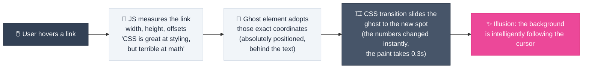
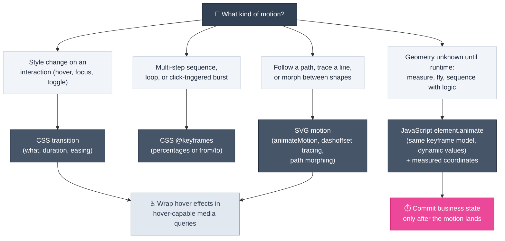

# Motion Design

> **Motion has a job: explain causality, confirm feedback, and guide attention. Animation without a job is decoration.**

---

## Table of Contents

- [Why Motion Matters](#why-motion-matters)
- [The Fundamentals](#the-fundamentals)
- [The Core Motion Vocabulary](#the-core-motion-vocabulary)
- [Timing Is the Design](#timing-is-the-design)
- [The Pattern Catalog](#the-pattern-catalog)
- [Depth and 3D](#depth-and-3d)
- [Choosing a Technique](#choosing-a-technique)
- [Accessibility and Performance](#accessibility-and-performance)

---

## Why Motion Matters

Every animated element should answer a user question. If you cannot name the question, the animation is decoration — and decoration competes with real signals for attention.

| Motion Job | The Question It Answers | Typical Pattern |
| :--- | :--- | :--- |
| **Feedback** | "Did the system register what I just did?" | Press pulse, hover lift, success check |
| **Causality** | "Where did my item go? What did my action affect?" | Item flies into the target it was added to |
| **Continuity** | "Is this the same element/idea I saw a moment ago?" | Active-state pill slides between nav items |
| **Progress** | "How far along is a long operation?" | Stepped progress, path-following indicators |
| **Attention** | "What should I look at now?" | Badge pulse after an async update completes |

> [!IMPORTANT]
> Motion is part of the state feedback contract: every user interaction must receive a system response (see [State Feedback & Micro-Interactions](ui-design-foundations.md#state-feedback--micro-interactions)). Motion is often *the* response.

---

## The Fundamentals

### The Two Native Mechanisms

All CSS motion comes from two mechanisms, each a shorthand for several properties:

- **`transition`** — animates a *style change from state X to state Y* (hover, focus, class toggle). Choose the property, duration, and timing function.
- **`animation` + `@keyframes`** — a *choreography script*: named keyframes define what happens at percentages of the timeline (0% → 50% → 100%, or `from`/`to`), with duration, timing function, and iteration count.

### Animatable Properties

The basic building blocks are transforms and visual filters — `translate`, `rotate`, `scale`, `skew`, `width`, `opacity`, `blur`, `drop-shadow`. An advanced effect is almost always a **combination of these basics**, not a new technique:

> [!TIP]
> Before reaching for a library, decompose the target effect into primitives: "button flies out" = translate + scale + glow; "card flips" = rotateY + perspective + backface control. Every animation, however complex, is built from this vocabulary.

### The Core Motion Vocabulary

| Principle | Effect |
| :--- | :--- |
| **Translation** | Moving from one place to another |
| **Rotation** | Turning around a point |
| **Scaling** | Growing or shrinking |
| **Skewing** | Changing the shape angle |
| **Morphing** | Changing shape from A to B |
| **Clarity / Opacity** | Fading elements in or out |
| **Blur** | Adding/removing blur for focus effects |
| **Glow** | Adding glow for emphasis |
| **Color** | Changing colors smoothly over time |
| **Clip / Mask** | Revealing or hiding parts of an element |

---

## Timing Is the Design

### Easing: The Physics of Interfaces

Easing curves decide whether motion feels mechanical or physical. The standard keywords map to intuitive physical models:

| Easing | Behavior | Physical Analogy |
| :--- | :--- | :--- |
| `linear` | Same speed throughout | A machine — fine for loops, rarely for UI |
| `ease` | Slows at start and end | Generic smoothness (the default) |
| `ease-in` | Starts slow, speeds up | A car pulling away from a red light |
| `ease-out` | Fast start, slows to stop | A car arriving at a stop |
| **Custom `cubic-bezier`** | Hand-tuned curve | Personality: overshoot past the target and settle back = weight and momentum |

> [!TIP]
> The single highest-leverage upgrade from default to premium feel is a **custom cubic-bezier with slight overshoot** on entrances and flips. The element swings slightly past its destination and settles — the way physical objects with mass behave. Play with a bezier editor rather than guessing values.

### State Updates Must Wait for the Motion

When motion represents causality, the *business state* must not update before the motion lands — otherwise the interface contradicts itself:

1. User clicks "add to cart" → the item visually travels to the cart icon
2. **Only when the travel completes** does the cart badge increment — then pulse once to confirm
3. Delays chain: a sequence (e.g., shine → reveal → doors open) schedules each step with `animation-delay` so no step starts before its predecessor finishes

> [!IMPORTANT]
> **Animation is timing.** If the number updates the instant you click, the flight feels pointless; if it waits until the item arrives, the system feels physically coherent. Match state-update timing to the motion timeline (e.g., a 700ms flight → update after 700ms), not to server latency guesses.

---

## The Pattern Catalog

Each pattern below maps to a motion job and names its core technique — implementation detail lives with the frontend team, the *mapping* is the PM-relevant knowledge:

| Pattern | Motion Job | Core Technique |
| :--- | :--- | :--- |
| **Hover / state transition** | Feedback | CSS `transition`; scope to pointer devices |
| **Sliding active state** | Continuity | One floating "ghost" background element repositioned on hover — JS measures, CSS animates |
| **Item-to-target confirmation** | Causality | Clone the element at fixed position, measure start/end, animate transform to the target, update state on landing |
| **Attention pulse** | Feedback after async | One-shot scale/glow keyframes on the completed target |
| **Shine sweep** | Personality | A skewed gradient pseudo-element sweeps `-100% → 100%` on hover |
| **Path following** | Progress / direction | `offset-path` defines the track; animate only `offset-distance` (0% → 100%) |
| **Drawing reveal** | Guided attention | SVG `stroke-dasharray` + `stroke-dashoffset` trace: the "ink" flows along the shape |
| **Gradient shimmer** | Personality / state | Animate the gradient's transform — spin the paint bucket, not the wall |
| **Shape morphing** | Continuity between forms | SVG path morphing with equal point counts; middle frames give organic feel |

### The Ghost Element Pattern (Sliding Active States)

The most reusable interaction pattern for menus and tabs — the active background should not appear/disappear, it should **slide and morph** to the hovered item:

> [!NOTE]
> The pattern is a **division of labor**: JavaScript does the math (measures elements, computes positions), CSS does the paint (animates whatever numbers it is given). Neither alone produces the effect — pure JS teleports, pure CSS cannot measure.

### Item-to-Target Confirmation (the "Fly-to-Cart" Family)

The most satisfying — and most causally honest — pattern in product UI. The abstract recipe:

1. **Clone, don't move** — moving the real element breaks the grid; a fixed-position clone is free to travel anywhere
2. **Measure both ends** — the start point (the item) and the destination (the target icon)
3. **Animate the clone** — move toward destination, shrink, fade: the item "physically" travels and dives in
4. **Land, then commit** — update the count/state *after* arrival, pulse the target once

---

## Depth and 3D

Web pages are flat by default (2D, x/y axes). 3D motion breaks that rule deliberately — a few properties govern the entire illusion:

| Property | Job | Intuition |
| :--- | :--- | :--- |
| **`perspective`** | The z-axis viewer distance | Distance between the viewer's eyes and the screen: a small value = holding a book against your nose (extreme distortion); a large value = holding a card at arm's length (natural) |
| **`transform-style: preserve-3d`** | Keeps the 3D space alive | Tells the browser *not* to flatten children — each child keeps its own 3D position |
| **`backface-visibility: hidden`** | Enables true flips | Two faces glued together (front at 0°, back pre-rotated 180°); when one faces away, it vanishes |

> [!TIP]
> A flip card is just two absolutely-positioned faces inside a rotating container: rotate the container 180°, the front rotates away and vanishes, the back rotates into view. Combine with an overshoot bezier and the card feels like it has physical weight.

---

## Choosing a Technique

| Situation | Reach For |
| :--- | :--- |
| Style changes on interaction (color, position, shadow) | **CSS `transition`** |
| Looping loaders, bursts, multi-step entrance choreography | **CSS `@keyframes`** |
| Values only known at runtime (measured positions, computed paths) | **JS `element.animate()` (WAAPI)** |
| Motion along a curve/track, line tracing, shape morphing | **SVG (paths, `animateMotion`, dash tricks)** |
| Complex sequenced scenes | Any of the above + chained delays |

---

## Accessibility and Performance

- **Trigger with real controls.** Anything clickable must be an actual button/interactive element — a transparent button layered over the animated region is the standard compromise. Motion that is only reachable by clicking a decorative shape is a keyboard trap.
- **Respect reduced motion.** Honor the user's reduced-motion preference: cap or replace non-essential movement. Feedback motion (state confirmations) can survive at reduced intensity; ambient loops should stop.
- **Hover needs a touch story.** Hover-only effects break on touch screens — gate hover styling behind hover-capable media queries and provide a tap/toggled equivalent (see [Platform-Native Elements](platform-native-elements.md#touch-and-pointer-safety)).
- **Animate cheap properties.** `transform` and `opacity` are compositor-friendly; animating layout properties (`width`, `top`, `left`) forces recalculation — acceptable for small, isolated elements, not for scroll-adjacent ones.
- **Error motion is feedback too.** A shake on invalid input, a border glow on success — motion reinforces the semantic color story (see [Semantic Color Mapping](ui-design-foundations.md#semantic-color-mapping)).

---

## Related Pages

- ← [UI Design Foundations](ui-design-foundations.md) — State feedback requirements and micro-interaction philosophy
- → [Landing Page Design](landing-page-design.md) — Motion powering the Signature and Craft levers
- → [Mobile UI Design Foundations](mobile-ui-design-foundations.md) — Gestural transitions on touch surfaces
- → [Platform-Native Elements](platform-native-elements.md) — Native primitives that carry motion (SVG, hover queries, media elements)

---

## Sources & References

- Video Source: *The Easy Way to Do Web Animations* — Sajid ([YouTube](https://www.youtube.com/watch?v=hZh-CiPt91w), 2025) — fundamentals through SVG morphing, with live code demos
- Video Source: *23 Hacks about Building Websites* — Sajid ([YouTube](https://www.youtube.com/watch?v=AmY3db_Qs94), 2024) — touch-safe hover and interaction primitives

---

* [← Back to Section Index](index.md) · [← Back to Wiki Home](../index.md) *
