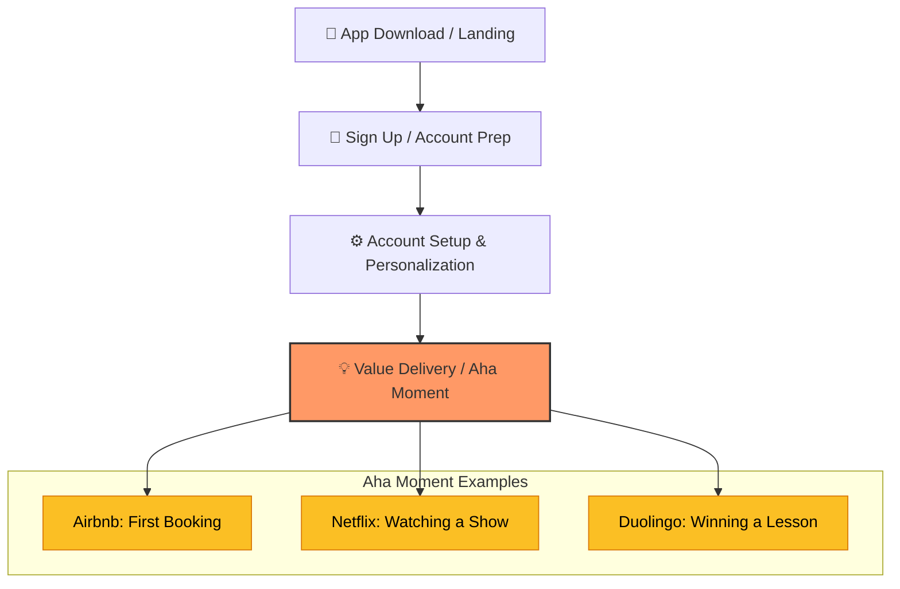
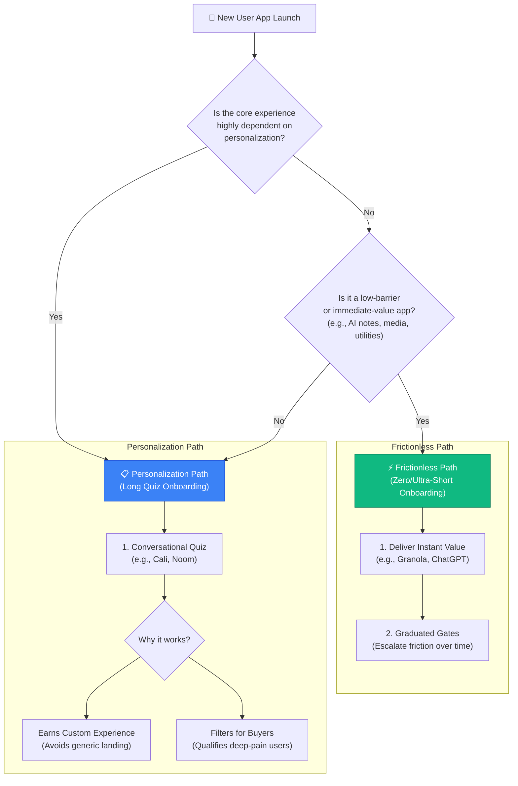

# Onboarding UX Patterns

> **The success of onboarding is not determined by its brevity, but by its ability to guide the user to the "Aha Moment."**

---

## Table of Contents

- [The Onboarding Framework](#the-onboarding-framework)
- [The 11 Onboarding UX Patterns](#the-11-onboarding-ux-patterns)
- [The Onboarding Paradox: Long vs. Short Flows](#the-onboarding-paradox-long-vs-short-flows)
- [Permissions & Flow Optimizations](#permissions--flow-optimizations)
- [Onboarding Case Studies: Good vs. Bad Examples](#onboarding-case-studies-good-vs-bad-examples)
- [Actionable Guidelines for App Developers](#actionable-guidelines-for-app-developers)

---

## The Onboarding Framework

Standard product advice suggests minimizing friction by making onboarding as short as possible. However, research and historical product data demonstrate that the average app has 25 onboarding screens. The success of an onboarding flow is not determined by its brevity, but by its ability to guide the user to the **"Aha Moment"**—the precise instant they experience the core value of the product.

Every onboarding journey follows this simple three-step progression:
1. **Sign Up**: The initial registration or access point.
2. **Account Setup / Personalization**: Collecting user preferences, goals, and context.
3. **The Aha Moment**: Delivering the core product value.

If the setup phase is dry, long, or confusing, users will churn before reaching step 3. The patterns below describe how top apps make the setup phase highly converting, interactive, and rewarding.

---

## The 11 Onboarding UX Patterns

### 1. Selling the Outcome (vs. Listing Features)
* **The Concept**: Pitching the final result or benefit the user will achieve, rather than listing features or describing technical implementation.
* **Why it Works**: Users are motivated by their own transformation or goals. Highlighting what they will *become* or *accomplish* builds emotional investment.
* **Case Studies**:
  * **Timo**: The welcome screen showcases the product in action on both mobile and desktop, immediately demonstrating the integrated workflow.
  * **Front / Bumps**: Uses high-fidelity animations upon opening. The user instantly understands the app's function without reading a single word.
  * **Superhuman**: Replaces a standard registration form with a persuasive pitch, placing recognizable partner logos on the side as social proof.

### 2. Try-Before-Buy (Pre-Registration Value Delivery)
* **The Concept**: Allowing the user to engage with the core product loop and experience value *before* asking them to create an account or sign up.
* **Why it Works**: By reducing friction to zero, you build trust and let the product speak for itself. The signup prompt becomes a logical step to save progress rather than a barrier to entry.
* **The Reciprocity Norm ("Menu Before Bill")**:
  * Demanding upfront registration before revealing any output resembles a restaurant demanding payment before letting patrons see a menu. It violates the universal norm of reciprocity (*Gouldner, 1960*; *Cialdini, 1984*).
  * **The Partial-Utility Rule**: Never gate results behind a pure blur or generic login wall. Deliver a genuine, standalone piece of insight (e.g., diagnostic score, top 3 flagged issues, interactive sandbox). Delivering value upfront triggers an intrinsic urge to reciprocate, making users dramatically more willing to register to claim the full breakdown.
* **Case Studies**:
  * **Alma**: Lets users try out the primary search and matching experience before creating an account.
  * **Duolingo**: Guides users through a complete interactive language lesson (taking them up to 60 screens deep) before prompting them to sign up. By the time they see the signup screen, they have already felt the satisfaction of winning a lesson.
  * **AI Products (ChatGPT, Claude)**: Use the first prompt as the onboarding. The user types a question and gets immediate value without signup or setup getting in the way.

### 3. Contextual Education & Guided Actions (vs. Pop-up Banners)
* **The Concept**: Guiding users through actions in real-time, in the flow of using the app, rather than showing static guided tours, tooltips, or pop-up banners.
* **Why it Works**: Pop-ups disrupt focus and are routinely dismissed without being read. Contextual nudges and interactive checklists reduce cognitive load and teach through action.
* **Case Studies**:
  * **Cake Equity**: Approaching dry, complex subjects like company equity by reassuring the user at each step, using real-time tooltips to explain the impact of decisions, and checking off password requirements dynamically as the user types.
  * **To-Do Apps**: Avoid empty dashboards by prepopulating the workspace with an interactive checklist of tasks (e.g., "Add your first task", "Complete this task"), teaching the interface through natural interaction.
  * **Mural**: Replaced standard pop-ups and welcome banners with a persistent 6-step checklist on the dashboard. This simple shift drove a **10% relative increase in one-week retention**.

### 4. Multi-Intent & Conversational Personalization
* **The Concept**: Asking questions conversational-style and allowing users to select multiple options/goals rather than forcing them into rigid, single-choice flows.
* **Why it Works**: Users often have complex, overlapping needs. Allowing multiple selections makes the onboarding feel tailored and prevents user frustration. Conversational copy reduces form fatigue.
* **Case Studies**:
  * **Headspace**: Discovered users came with multiple goals (e.g., sleep, anxiety, focus). By allowing users to select multiple pain points instead of a single goal, they saw a **10% increase in free trial conversions**.
  * **Focus Flight**: Lets users choose their preferred map style during onboarding, making the app feel customized to their taste before they start using it.
  * **Dollar Shave Club**: Rewrote their quiz copy to sound like a conversation with a human. This copy tweak alone led to a **5% increase in paid subscriptions**.
  * **E-commerce Quizzes**: Shopping apps use interactive style quizzes to understand user preferences and recommend products. This conversational engagement matches users with the right catalog items immediately, boosting conversions.

### 5. Visualizing Personalized Outcomes
* **The Concept**: Presenting the user with a customized plan, schedule, or projection based on their quiz answers prior to the paywall or home screen.
* **Why it Works**: Proves that the app actively listened to the user's input. It builds anticipation by showing a tangible roadmap to success and involves the user in the experience.
* **Case Studies**:
  * **Endel**: Gathers quiz answers and immediately renders a personalized soundscape graph. Even before playing the audio, the user feels the system is customized and ready to work.
  * **Bitepal**: Builds a personalized plan and highlights the exact date the user will hit their weight target, creating a concrete milestone.
  * **Speak**: Asks goals and language choice, then shows a screen stating: *"In 2 months, you'll be able to communicate while traveling in France,"* backed by a simple graph showing why speaking beats reading.
  * **Brilliant**: Populates the user's dashboard only with courses recommended from their quiz answers immediately upon completing onboarding.

### 6. Conversational & Tailored Paywalls
* **The Concept**: Aligning paywalls directly with the user's stated goals and personalizing the offer to match their profile.
* **Why it Works**: Shows the direct link between paying and achieving the personalized outcome. High-quality interactions and social proof at the paywall reduce purchase anxiety.
* **Case Studies**:
  * **Grammarly**: Recommends tailored pricing plans based on the user's specific writing goals (e.g., student vs. professional). This targeted pricing increased plan upgrades by **nearly 20%**.
  * **Focus Flight**: Integrates physical haptics and themed UI. The paywall is shaped like a flight ticket, and the phone vibrates as it "prints out," adding sensory delight to a transaction screen.
  * **Beside / Blinkist**: Pairs the personalized quiz results with a urgent, one-time offer to drive purchase momentum.
  * **Timo**: Inserts a full screen of structured customer reviews and social proof immediately before presenting the paywall.

### 7. Interactive Delighters for Long Flows
* **The Concept**: Incorporating rich animations, gamified loading sequences, and engaging characters to keep users entertained through long setup questionnaires.
* **Why it Works**: The psychological perception of time decreases when an experience is fun. Delightful animations transform a boring form into an interactive experience.
* **Case Studies**:
  * **Bitepal**: Guides users through 61 screens using a lovable pet raccoon character that users name during onboarding. The animations and pet progression keep the user engaged.
  * **Bumps**: Employs highly creative, smooth animations and transitions, particularly on dry screens like loading states and SMS verification code entry.

### 8. The Graduated Gates (Escalating Friction & Commitment)
* **The Concept**: Transitioning users from free to paid through soft, escalating commitment stages rather than a sudden binary paywall.
* **Why it Works**: Instead of forcing a hard decision on day one, graduated friction uses attention and effort to normalize the experience before asking for money. Each step acts as training, making the final paid step feel like a relief and a natural progression.
* **Case Studies**:
  * **Real Short**: Uses a 3-stage freemium transition:
    1. *Stage 1 (No Friction)*: Episodes 1–5 are completely free. No signup, email, or account creation is required; content plays instantly.
    2. *Stage 2 (Attention/Effort)*: Episodes 6–8 require watching a 30-second ad for 60 seconds of content. The tradeoff is deliberately annoying, training users to value skipping ads as a major upgrade.
    3. *Stage 3 (Money)*: From Episode 9 onwards, users hit a coin paywall right at the emotional cliffhanger (emotional peak pricing). Paying feels like a relief from the ads and resolved anticipation.
  * **B2B / SaaS Products**: Introduce trial users to features gradually. They start with free unlimited use of core features, then hit soft limits requiring simple tasks (e.g., inviting a teammate, completing a tutorial) before finally encountering a paid subscription tier.

### 9. The Zero-Decision Flow (Momentum through Choice Elimination)
* **The Concept**: Stripping away every unnecessary option, button, setting, or screen in the core flow to sustain user momentum.
* **Why it Works**: Every decision or choice is an exit ramp where the user might choose to close the app. By removing progress bars, rotation controls, and complex browse menus, the user is carried forward by momentum.
* **Case Studies**:
  * **Real Short**: When the app is opened, content immediately plays. The player eliminates the progress bar (watch linearly), rotates vertical-only (shot vertical), and has no visible episode list. Swipe up means "next episode," which is the only navigation.
  * **TikTok / YouTube Autoplay**: Remove the decision of "what to watch next" by immediately streaming content and enabling frictionless gestural navigation (swiping) to continue.

### 10. The Endowed Progress Pattern (Goal Gradient Acceleration)
* **The Concept**: Never starting an onboarding journey or multi-step setup at 0%. Pre-filling or endowing initial progress credit for the user's initial action of initiating setup.
* **Why it Works**: Grounded in the **Goal Gradient Effect** (*Hull, 1932*) and the **Endowed Progress Effect** (*Nunes & Drèze, 2006*). In a landmark Columbia University car wash loyalty card experiment, customers given a 10-stamp card with 2 pre-stamped slots achieved a **34% completion rate**, compared to just **19%** for customers given a blank 8-stamp card — despite both groups needing exactly 8 purchases to earn the reward. Perceiving that progress is already underway dramatically accelerates completion velocity.
* **Pacing Rules & The Expectation Debt Trap**:
  * *Monotonic Pacing*: Progress must represent realistic, steady headway across stages.
  * *Avoid Expectation Debt*: Never front-load progress artificially (e.g., jumping from 0% to 80% on step 1, only to drag through 15 tedious screens for the remaining 20%). Deceptive pacing breeds resentment, causing users to detect the manipulation and bounce.
* **Case Studies**:
  * **LinkedIn**: Greets new members with a profile meter pre-filled to 15–20% ("Beginner" rank unlocked), providing immediate momentum to complete subsequent sections.
  * **Duolingo**: Awards initial XP and checks off "First Lesson Complete" before prompting for profile setup.

### 11. The Co-Creation Pattern (IKEA Effect & Psychological Ownership)
* **The Concept**: Involving the user in assembling, tailoring, or customizing their workspace, project, or avatar *before* prompting them for account creation or paywalls.
* **Why it Works**: Grounded in the **IKEA Effect** (*Norton, Mochon, & Ariely, 2012*) and **Psychological Ownership** (*Pierce, Kostova, & Dirks, 2003*). Users place disproportionately high value on products they helped create. By investing effort upfront, the product shifts from "someone else's software" into "my workspace." The registration prompt ceases to be a tollbooth and becomes a way to **protect their own creation from being lost**.
* **Labor Calibration**: Effort must feel easy and guarantee an early "win." If the task is frustrating or produces an incomplete result, the IKEA effect collapses and user frustration spikes.
* **Case Studies**:
  * **Notion**: Guides users to name their workspace, select team templates, and add building blocks before demanding email confirmation.
  * **Spotify**: Invites new users to select 3+ favorite artists to generate their customized Daily Mix before prompting for registration.
  * **Canva / Figma**: Lets users design or edit an initial canvas immediately, presenting the registration prompt only when the user clicks "Save" or "Export."

---

## The Onboarding Paradox: Long vs. Short Flows

A major challenge in product design is the onboarding paradox: why do some apps succeed with almost zero onboarding, while others thrive with extremely long, multi-step flows?

On average, **apps lose 77% of their users within the first three days**. This drop-off is rarely caused by poor features or marketing; it is usually driven by onboarding flows that act like "government forms"—forcing users through signups, permissions, and tutorials before delivering any value.

To solve this, developers must apply the **Core Onboarding Rule** and understand its key exceptions.

### The Core Onboarding Rule
> **By default, keep onboarding as short as possible and surface tangible value as fast as possible.**
> Onboarding must do work *for the user*, not force the user to do work *for the company*. 

### The Exceptions: When Long Onboarding Wins
Long onboarding (e.g., 20 to 110+ screens) is justified only when it buys the product one of two critical assets:
1. **A Personalized First Experience**: If a product's value depends heavily on personalization, landing directly on a generic dashboard is confusing and dry. The long onboarding is a trade-off: you give up initial speed to collect data, but in return, the user receives an experience customized to their specific goals.
2. **A Filter for High-Intent Buyers**: Long quiz flows act as a natural qualification funnel. Users who bounce on a long questionnaire are unlikely to convert or pay anyway. The users who complete the flow are self-selecting—proving they have deep pain points, high commitment, and a strong willingness to pay.

| Strategy | Primary Goal | Ideal For | Onboarding Length | Core Value / Exception | Examples |
| :--- | :--- | :--- | :--- | :--- | :--- |
| **Frictionless Path** | Deliver instant gratification | Media, AI, Entertainment, Utilities | Zero / Ultra-Short (1-3 screens) | Surfacing tangible value instantly; onboarding does work *for* the user. | **Granola** (2 screens), **ChatGPT** (1 prompt) |
| **Personalization Path** | Align expectations & qualify buyers | Finance, Health, Education, SaaS | Long (20-110+ screens) | Earning custom experiences & filtering for deep-pain buyers. | **Cali** (20+ quiz steps), **Noom** (113 screens) |

---

## Permissions & Flow Optimizations

### 1. Pre-Permission Priming (The Soft Ask)
* **The Concept**: Showing a custom screen explaining *why* a permission (notifications, camera, health data) is needed before triggering the native system dialog.
* **Why it Works**: System dialogs are binary and cannot explain context. A custom priming screen increases user confidence and acceptance rates.
* **Case Studies**:
  * **Brilliant**: Explains that notifications are used to help build a daily learning habit.
  * **Centr**: Displays a visual preview (mockup) of the exact positive notification message the user will receive before showing the system prompt.

### 2. Multi-Page Form Splitting (Chunking)
* **The Concept**: Breaking a long registration form into multiple single-input screens rather than hosting a long, scrollable form.
* **Why it Works**: Reduces cognitive load per screen. Progressing through quick, single-input screens builds momentum.
* **Case Studies**:
  * **Houzz**: Split its long signup form into multiple sequential screens and recorded a **15% increase in total signups**.

### 3. Web vs. Mobile Constraints
* Web onboarding flows are, on average, **21% shorter than iOS flows**.
* This is driven by platform mechanics: mobile apps must incorporate native screens for permissions (notifications, location, tracking) and in-app purchase paywalls.

### 4. Cultural User Interface Preferences
* **Eastern Markets**: Users generally prefer information-dense, highly packed interfaces that convey maximum efficiency.
* **Western Markets**: Users generally prefer clean, minimalist, low-clutter designs. 

---

## Onboarding Case Studies: Good vs. Bad Examples

| App / Product | Primary Onboarding Strategy | Classification | Impact & Metric | Why it Works / Fails |
| :--- | :--- | :--- | :--- | :--- |
| **Duolingo** | Try-before-buy / Long gamified lesson | 🟢 **Good (Value-First)** | 60+ screens prior to signup | Users experience the feeling of success (winning a lesson) before being forced to create an account. |
| **Mural** | Persistent contextual dashboard checklists | 🟢 **Good (Contextual)** | 📈 **10% increase in 1-week retention** | Replaced annoying welcome pop-ups with an actionable, dismissible checklist. |
| **Headspace** | Multi-intent selection quiz | 🟢 **Good (Flexible)** | 📈 **10% increase in free trial conversion** | Let users select multiple goals, matching their actual multi-dimensional mental wellness needs. |
| **Grammarly** | Quiz-based tailored pricing packages | 🟢 **Good (Personalized)** | 📈 **~20% increase in premium upgrades** | Connected pricing options directly to the user's specific goals. |
| **Houzz** | Multi-page form chunking | 🟢 **Good (Psychological)** | 📈 **15% increase in signups** | Split a single dense signup sheet into bite-sized single-question screens to build momentum. |
| **Dollar Shave Club** | Conversational copy quiz | 🟢 **Good (Copywriting)** | 📈 **5% increase in subscriptions** | Rewrote standard quiz inputs into a friendly, conversational dialog. |
| **Focus Flight** | Gamified/Haptic ticket paywall | 🟢 **Good (Delight)** | High checkout delight | Turn the transaction screen into a sensory experience (vibration, ticket print-out). |
| **Granola** | Two-screen Google Sign-In & mic permission ask | 🟢 **Good (Value-First)** | 📈 Raised $125M in March 2026 ($1.5B valuation) | Surfaces value in the user's very next meeting; onboarding does work *for* the user. |
| **AI Apps (e.g. Claude)** | Zero-friction entry / Prompt field | 🟢 **Good (Speed)** | Direct value delivery | Bypasses all setup to let the user get value in a single action. |
| **Typical AI Apps (7%)** | Private/No-quiz entry | 🔴 **Bad (Missed Personalization)** | Lower personalization value | AI tools often fail to ask user context upfront, missing opportunities to customize the early workspace. |
| **Cali / Calai** | 20+ step quiz before dashboard access | 🟢 **Good (Personalized Quiz)** | 📈 $35M revenue in its first year | Earns a highly custom first screen (avoiding generic template). Qualifies high-intent buyers in a deep-pain niche. |
| **Noom** | 113-screen onboarding questionnaire | 🟢 **Good (Personalized Quiz)** | 📈 Valuation worth billions | Drives deep commitment and extensive personalization for high-ticket weight loss programs. |
| **Fitness Apps** | Habit/Goal Custom Quiz | 🟢 **Good (Interactive Quiz)** | High setup retention | Personalizes workouts based on user inputs, keeping users engaged through customized roadmaps. |
| **Shopping Apps** | Style/Preference Quiz | 🟢 **Good (E-commerce Quiz)** | 📈 Higher conversion rate | Conversational style matches users with products they want, driving immediate purchases. |
| **Real Short** | Zero onboarding / Graduated Gates | 🟢 **Good (Frictionless)** | High Day-1 Retention | Open-to-play eliminates exit ramps; graduated friction converts attention to dollars. |
| **LinkedIn** | Endowed progress profile meter | 🟢 **Good (Momentum)** | 📈 Increased completion rate | Pre-fills meter to 15–20% on launch, leveraging the goal gradient effect. |
| **Notion** | Co-creation workspace assembly | 🟢 **Good (IKEA Effect)** | High setup retention | Users assemble pages and templates prior to registration, building psychological ownership. |
| **SEO & Audit SaaS (Generic)** | Hard blurred gate (No preview value) | 🔴 **Bad (Broken Reciprocity)** | High bounce rate (~65%) | Violates reciprocity by locking entire report without a free standalone score. |

---

## Actionable Guidelines for App Developers

### 1. Identify and Track the "Aha Moment"
* Audit your product: What is the exact action that proves the app's value to the user?
* Align your onboarding to push the user toward this action as quickly and clearly as possible.
* Remove any steps that do not directly contribute to the user hitting this moment.

### 2. Sell the Outcomes on Setup Screens
* Do not write screen headers describing features (e.g., *"Our Calorie Tracker"*).
* Write headlines focusing on the user's outcome (e.g., *"Reach Your Ideal Weight"*).
* Show, don't tell: use high-fidelity animation, mockups, or videos of the app interface.

### 3. Shift from Pop-Ups to Action Checklists
* Turn off auto-triggering welcome tours and introductory modals.
* Create a persistent onboarding checklist on the user's home screen.
* Ensure checklist items are interactive (clicking them starts the task) and reward completion with visual feedback.

### 4. Implement Pre-Permission Priming
* Never trigger native permission dialogs (e.g., notifications) on app launch without context.
* Create a full-screen or modal prime explaining:
  1. What permission you are requesting.
  2. The specific benefit the user gets by allowing it.
  3. A preview of the value (e.g., a mockup notification).

### 5. Personalize the Paywall & Experience (Quizzes)
* If your app includes a quiz, pass those variables to your paywall and initial workspace screens.
* Recommend a specific plan or customize their early dashboard based on their answers, and explicitly state *why* it matches their goals.

### 6. Design for Graduated Friction
* Do not jump directly from a free trial to a hard paywall.
* Introduce intermediate gates (like ad-supported tiers or task completions) to train users to value the premium version.
* Align pricing events with moments of high emotional investment (e.g., resolving a cliffhanger, unlocking a key feature after a success milestone).

### 7. Perform a Decision-Point Audit
* Count every tap, scroll, choice, and settings adjustment required to get from app launch to value consumption.
* Eliminate any options that can be automated or deferred to a later time (e.g., custom themes, profile details).
* Build momentum by making the primary navigation gestural (swiping) and automatic.

### 8. Endow Initial Progress on Multi-Step Setups
* Never present a user with a progress meter showing 0% or Step 0/5.
* Award initial progress credit for the action that brought them there (e.g., "Step 1: Account initialized — 20% complete").
* Ensure subsequent steps progress with honest, monotonic increments to avoid expectation debt.

### 9. Invite Pre-Registration Co-Creation (IKEA Effect)
* Let users customize their dashboard, select content preferences, or create their first artifact prior to registration.
* Frame the account creation step as saving and securing *their* creation, rather than registering for *your* service.

---

## Related Pages

- ← [User Interaction & Design](user-interaction-design.md) — Foundational design principles
- ← [Design Psychology](design-psychology.md) — Decision architecture, smart defaults, and loss framing
- → [Mobile UI Design Foundations](mobile-ui-design-foundations.md) — Mobile interaction and layout patterns
- → [Gamification Patterns](gamification-patterns.md) — Long-term engagement after onboarding
- → [Retention Psychology](../06-metrics/retention-psychology.md) — Psychological retention architecture
- → [Success Metrics](../06-metrics/success-metrics.md) — Measuring onboarding effectiveness

---

## Sources & References

- Full research document: `docs/research/onboarding_design_patterns.md`
- Zoe (AppsFlyer) & Tim (SIPs App) product analysis case studies (2026)
- Tim Gabe video analysis: *How To Solve The App Onboarding Paradox* (2026)
- Video: *The UX Psychology Behind Apps People Can't Stop Using* — uxpeak ([YouTube](https://www.youtube.com/watch?v=2TlIg3VokY8), 2026) — endowed progress, IKEA effect in onboarding, and reciprocal gating
- Paper: *The Endowed Progress Effect: How Artificial Advancement Increases Effort* — Joseph C. Nunes & Xavier Drèze (*Journal of Consumer Research*, 2006)
- Paper: *The IKEA Effect: When Labor Leads to Love* — Michael I. Norton, Daniel Mochon, & Dan Ariely (*Journal of Consumer Psychology*, 2012)

---

*[← Back to Section Index](index.md) · [← Back to Wiki Home](../index.md)*
