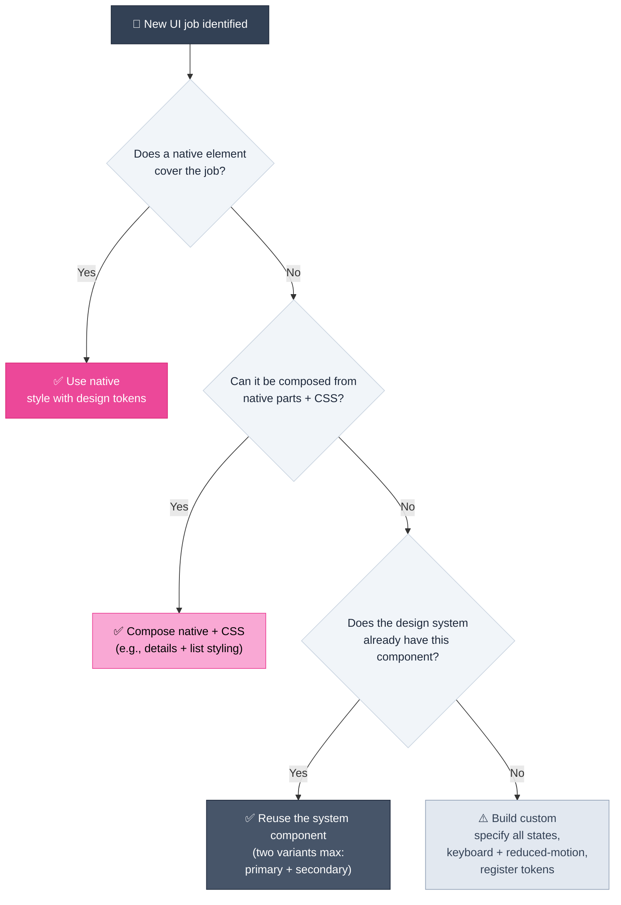

# Platform-Native Elements

> **Every custom component you build is a component you maintain. The platform ships for free.**

---

## Table of Contents

- [The Platform-First Argument](#the-platform-first-argument)
- [The Native Capability Map](#the-native-capability-map)
- [Theming and Color Engineering](#theming-and-color-engineering)
- [Assets and Performance](#assets-and-performance)
- [Native Interactive Elements](#native-interactive-elements)
- [Input and Form UX](#input-and-form-ux)
- [Touch and Pointer Safety](#touch-and-pointer-safety)
- [Editable and Inert Regions](#editable-and-inert-regions)
- [Proportional Media](#proportional-media)
- [When to Go Custom](#when-to-go-custom)
- [What This Means for Product Managers](#what-this-means-for-product-managers)

---

## The Platform-First Argument

Before specifying a bespoke component, a team should know what the web platform already provides. Native elements and CSS features are:

- **Free to build** — one tag or one declaration replaces a component and its state management
- **Accessible by default** — keyboard behavior, focus handling, and screen-reader semantics come built in
- **Performance-optimized** — implemented in the browser engine, not in page JavaScript
- **Maintenance-light** — no version drift, no bug backlog, no upgrade path

| Approach | Build Cost | A11y | Long-Term Maintenance |
| :--- | :--- | :--- | :--- |
| Custom widget (JS component) | High — states, keyboard, focus, edge cases | Depends on discipline | Owns a bug backlog forever |
| **Native element, styled with tokens** | Near zero | Built in | Browser's job, not yours |

> [!NOTE]
> "Use the platform" is not purism — it is an estimation strategy. Every native element adopted is scope that never enters the backlog, and accessibility that never needs a compliance pass.

---

## The Native Capability Map

### Theming and Color Engineering

| Capability | What It Buys the Product |
| :--- | :--- |
| **HSL color values** | Colors defined by position on the color wheel (hue) plus saturation and lightness — so *shades are generated in code*: need a hover shade? raise the lightness. Dark-mode variant? adjust lightness/saturation. No design-tool round-trips. |
| **Token-driven palettes** | Define a base hue once as a CSS variable; derive primary/secondary via saturation+lightness and tertiary/accent by shifting hue ±60°. Change one value — the entire scheme follows. |
| **System color-scheme adaptation** | A single media query adapts foreground/background/accent to the user's preference; HSL makes the dark-mode accent tweak (higher lightness for contrast) a one-line change. |

### Assets and Performance

| Capability | What It Buys the Product |
| :--- | :--- |
| **Modern image formats (e.g., WebP)** | Same visual quality at roughly half the file size — faster loads, no redesign required |
| **Responsive images (`picture` + `source`)** | Small devices receive small crops; large screens get the full image — bandwidth matched to need |
| **Vector graphics (SVG)** | Lightweight icons/illustrations, styleable like any HTML element (color via CSS), theme-aware, and animatable (see [Motion Design](motion-design.md#choosing-a-technique)) |

### Native Interactive Elements

| Element | Job | What You Avoid Building |
| :--- | :--- | :--- |
| **`<dialog>`** + `showModal()` | Modal popup with backdrop; closes on Escape or via `close()` | Focus trapping, Escape handling, backdrop layering |
| **`
` / `
`** | Collapsible sections (FAQs, hidden content) — no JS | Toggle state, ARIA wiring, animation triggers |
| **`<progress>` / `<meter>`** | Progress bar / scalar gauge | Custom bar math, fill states, ARIA progress semantics |
| **`<datalist>`** | Input autocomplete suggestions | Dropdown component + keyboard navigation |
| **`title` attribute** | Native tooltip on any element | A tooltip component (use sparingly — never the only signifier, see [Affordances & Signifiers](ui-design-foundations.md#affordances--signifiers)) |

### Input and Form UX

| Capability | What It Buys the Product |
| :--- | :--- |
| **`inputmode`** | Brings up the *right virtual keyboard* on mobile (numeric, email, tel…) — fewer input errors, no custom keyboard work |
| **Native autocomplete** | Suggestion dropdown on ordinary inputs via a paired list — discoverable, zero CSS/JS |
| **`text-underline-offset`** | Positions underlines so links stay readable — small detail, large legibility payoff |

### Touch and Pointer Safety

Hover effects are unreliable on touch screens — there is no cursor. The fix is scoping hover styling to devices that can hover:

> [!IMPORTANT]
> Wrap hover-dependent behavior in a **hover-capable media query** and ship a separate tap-friendly version. Without it, touch users get stuck states or dead-feeling controls — a defect that survives every desktop review.

### Editable and Inert Regions

| Attribute | Behavior | Product Use |
| :--- | :--- | :--- |
| **`contenteditable`** | Makes any element user-editable | Let users suggest/edit content inline (e.g., propose answers in a FAQ) |
| **`inert`** | Element and its subtree remain **visible but fully non-interactive** — buttons dead, inputs disabled, assistive tech ignores it | Disable a whole region during loading or multi-step flows without dimming/hiding it |

### Proportional Media

**`aspect-ratio`** locks an element to a proportion (e.g., 16/9) that stays responsive at any width — thumbnails, galleries, and video placeholders keep their shape with zero JavaScript.

---

## When to Go Custom

Native-first does not mean never build. It means *check the platform, then the design system, then build*:

> [!WARNING]
> The native/custom boundary is a *scope decision*, not an aesthetic one. Teams that skip the platform check systematically over-build — then carry custom focus traps, Escape handlers, and keyboard nav for the life of the product.

---

## What This Means for Product Managers

- **Estimation**: native-first tickets are smaller — "use `<dialog>`" is a styling task; "build a modal" is a component with states, focus management, and an a11y review.
- **Specification**: when you do require custom work, specify the *full state contract* (default/hover/focus/error/disabled/loading) — the states native elements give you for free.
- **Acceptance criteria**: reference platform behavior — "modal closes on Escape", "numeric keyboard on amount field", "no hover-dependent actions" — all testable, all native by default.
- **Accessibility posture**: every native adoption is an a11y win adopted at zero cost; every custom component is an a11y liability unless engineered otherwise.
- **Design-system leverage**: tokens (colors as HSL variables, spacing as multiples of 4 — see [4-Point Grid System](ui-design-foundations.md#4-point-grid-system)) make native elements instantly on-brand; understanding the basic principles behind systems means you may not need a CSS framework at all.

---

## Related Pages

- ← [UI Design Foundations](ui-design-foundations.md) — The color, spacing, and dark-mode systems these primitives plug into
- → [Motion Design](motion-design.md) — The animation primitives available natively (hover queries, SVG, media elements)
- → [Landing Page Design](landing-page-design.md) — Asset performance and theming decisions on marketing surfaces
- → [Mobile UI Design Foundations](mobile-ui-design-foundations.md) — Input UX and touch behavior on constrained devices

---

## Sources & References

- Video Source: *23 Hacks about Building Websites* — Sajid ([YouTube](https://www.youtube.com/watch?v=AmY3db_Qs94), 2024) — platform-native HTML/CSS capabilities demonstrated in code

---

* [← Back to Section Index](index.md) · [← Back to Wiki Home](../index.md) *
