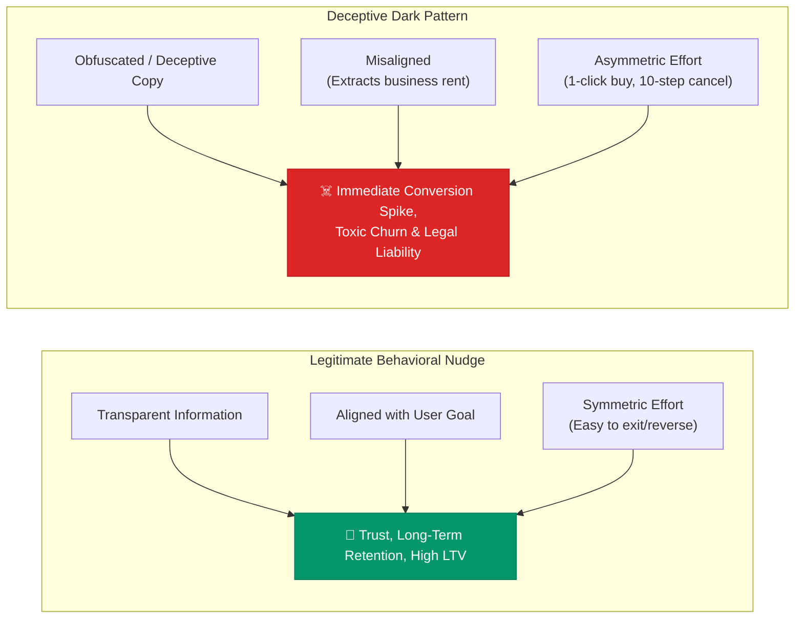

# Anti-Patterns

> **An anti-pattern is a commonly occurring situation in a project that comes with negative consequences.**

---

## Table of Contents

- [What Are Anti-Patterns?](#what-are-anti-patterns)
- [The 10 Process & Management Anti-Patterns](#the-10-process--management-anti-patterns)
- [Behavioral & UX Anti-Patterns (Dark Patterns)](#behavioral--ux-anti-patterns-dark-patterns)
- [Anti-Pattern Detection](#anti-pattern-detection)
- [Related Pages](#related-pages)
- [Sources & References](#sources--references)

---

## What Are Anti-Patterns?

Anti-patterns are **familiar, recurring traps** that product teams fall into. Unlike bugs or errors, anti-patterns often feel productive in the moment but produce negative long-term outcomes.

```mermaid
graph TD
    AP["⚠️ Anti-Patterns"] --> PROC["Process Anti-Patterns"]
    AP --> DEC["Decision Anti-Patterns"]
    AP --> MET["Metric Anti-Patterns"]
    AP --> CULT["Culture Anti-Patterns"]
    AP --> BEH["Behavioral Dark Patterns"]

    PROC --> FF["Feature Factory"]
    PROC --> SC["Scope Creep"]
    PROC --> FI["Firefighting Mode"]

    DEC --> HIPPO["HIPPO"]
    DEC --> NIH["Not Invented Here"]
    DEC --> PARA["Analysis Paralysis"]
    DEC --> SOS["Shiny Object Syndrome"]

    MET --> VM["Vanity Metrics"]
    MET --> LCV["Lack of Customer Validation"]

    CULT --> HC["Hero Culture"]

    BEH --> CS["Confirmshaming & Manipulative Loss Framing"]
    BEH --> HD["Hostile Defaults & Sneak into Basket"]
    BEH --> FS["Deceptive Scarcity & Fake Urgency"]
    BEH --> FP["Expectation Debt & Fake Progress"]
    BEH --> RM["Roach Motel & Asymmetric Cancellation"]

    style AP fill:#ea580c,stroke:#c2410c,color:#fff
    style PROC fill:#fb923c,stroke:#ea580c,color:#000
    style DEC fill:#fb923c,stroke:#ea580c,color:#000
    style MET fill:#fb923c,stroke:#ea580c,color:#000
    style CULT fill:#fb923c,stroke:#ea580c,color:#000
    style BEH fill:#dc2626,stroke:#b91c1c,color:#fff
    style CS fill:#fee2e2,stroke:#ef4444,color:#991b1b
    style HD fill:#fee2e2,stroke:#ef4444,color:#991b1b
    style FS fill:#fee2e2,stroke:#ef4444,color:#991b1b
    style FP fill:#fee2e2,stroke:#ef4444,color:#991b1b
    style RM fill:#fee2e2,stroke:#ef4444,color:#991b1b
```

---

## The 10 Process & Management Anti-Patterns

### 1. 🏭 Feature Factory
**Prioritizing quantity over quality** — focusing solely on pushing out features without considering their true value or impact.

> *Symptom*: Team celebrates shipping velocity but can't point to user outcome improvements.

### 2. ✨ Shiny Object Syndrome
**Constantly chasing new trends or technologies** without a strategic rationale, leading to scattered efforts and lack of focus.

> *Symptom*: Roadmap changes every quarter based on the latest industry buzzword.

### 3. 🦛 HIPPO (Highest Paid Person's Opinion)
**All decisions made based on the most senior person's opinions**, stifling creativity and innovation.

> *Symptom*: Data and user research are gathered but overridden in meetings by executive preference.

### 4. 🚫 Not Invented Here (NIH)
**Dismissing external solutions** in favor of internally developed ones, leading to reinventing the wheel and wasting resources.

> *Symptom*: Building custom tools for problems that have mature open-source or SaaS solutions.

### 5. 🔄 Analysis Paralysis
**Getting stuck in an endless cycle of data analysis** and overthinking without making decisions or taking action.

> *Symptom*: Multiple rounds of research with no shipped outcome.

### 6. 🤷 Lack of Customer Validation
**Building products based on assumptions** rather than actual customer needs or feedback, resulting in products that miss the mark.

> *Symptom*: "We know what our users want" without interview or survey data to back it up.

### 7. 📈 Scope Creep
**Allowing the product scope to continuously expand** beyond the original vision, leading to delays and inefficiencies.

> *Symptom*: Original PRD had 5 features; shipped version has 15 with none fully polished.

### 8. 🦸 Hero Culture
**Relying too heavily on individual heroics** to solve problems rather than building sustainable processes and teams.

> *Symptom*: One developer always saves the sprint at the last minute.

### 9. 📊 Vanity Metrics
**Focusing on metrics that look impressive** but don't measure meaningful progress or impact on business goals.

> *Symptom*: Celebrating "10K downloads" while daily active users remain at 200.

### 10. 🔥 Firefighting Mode
**Constantly reacting to immediate crises**, neglecting long-term strategic planning and product vision.

> *Symptom*: Sprint goals are regularly abandoned to handle urgent bugs or executive requests.

---

## Behavioral & UX Anti-Patterns (Dark Patterns)

Behavioral psychology principles (smart defaults, loss framing, progress acceleration, price anchoring) are powerful tools for reducing cognitive load and creating fluency. However, when these principles are inverted to manipulate, trap, or deceive users for short-term conversion extraction, they become **Dark Patterns** (*Brignull, 2010*).

Dark patterns damage brand equity, spike customer churn, and expose organizations to legal liability (e.g., FTC "Click-to-Cancel" enforcement, EU Digital Services Act and GDPR penalties).

### 1. 🎭 Confirmshaming & Manipulative Loss Framing
**Emotionally coercing the user into an action by framing the decline option with guilt, shame, or manufactured fear.**
* *Mechanism Abused*: Loss Aversion (*Prospect Theory*).
* *Symptom*: Opt-out buttons reading *"No thanks, I don't care about saving money"* or *"No, I prefer losing my data."*
* *Business Cost*: Degrades brand perception; users feel insulted and develop active brand resentment.

### 2. 🛒 Sneak into Basket & Hostile Defaults
**Pre-checking optional paid services, recurring subscriptions, or invasive data collection under the guise of "smart defaults."**
* *Mechanism Abused*: The Default Effect & Status Quo Bias.
* *Symptom*: Pre-checked checkboxes for warranty add-ons, newsletter spam, or recurring billing when the user intended a one-time purchase.
* *Business Cost*: Spikes chargebacks, refund disputes, and severe regulatory fines under consumer protection laws.

### 3. ⏳ Deceptive Scarcity & Fabricated Urgency
**Manufacturing fake time pressure or social proof to force hasty purchasing decisions.**
* *Mechanism Abused*: Loss Aversion & Scarcity Heuristic.
* *Symptom*: Countdown timers that reset upon page refresh, fake live stock counters (*"Only 2 rooms left!"* when 50 are available), or simulated purchase toasts (*"Mark from Seattle just bought this"* generated by client script).
* *Business Cost*: Users easily detect reset timers; once exposed, all platform claims lose credibility.

### 4. 🕳️ The Expectation Debt Trap (False Progress)
**Fabricating early completion metrics to trick users into high-friction flows, only to trap them in exhaustive data entry.**
* *Mechanism Abused*: Goal Gradient & Endowed Progress Effect.
* *Symptom*: An onboarding meter jumps to "90% complete" after selecting one option, followed by an unannounced 20-screen questionnaire or surprise paywall before output is unlocked.
* *Business Cost*: Spikes rage-quits; destroys the perceived momentum that honest endowed progress creates.

### 5. 🪤 Roach Motel & Asymmetric Cancellation
**Making it effortless to enter or subscribe, but extraordinarily difficult to cancel or exit.**
* *Mechanism Abused*: Friction & Cognitive Inertia.
* *Symptom*: 1-click credit card subscription, but cancellation requires calling customer support during limited business hours, mailing physical letters, or clicking through five sequential retention guilt screens.
* *Business Cost*: Targeted by regulatory enforcement (FTC Click-to-Cancel Rule); creates vocal detractors on social review platforms.

---

## Anti-Pattern Detection

### Process & Management Audit
Use this checklist to audit your team for operational anti-patterns:

|   ✅   | Check                                                             | Related Anti-Pattern            |
| :---: | :---------------------------------------------------------------- | :------------------------------ |
|   ☐   | Do we validate features with user data before building?           | Lack of Customer Validation     |
|   ☐   | Can anyone on the team push back on executive opinions with data? | HIPPO                           |
|   ☐   | Is our roadmap stable for at least one quarter?                   | Shiny Object Syndrome           |
|   ☐   | Do we measure outcomes, not just outputs?                         | Feature Factory, Vanity Metrics |
|   ☐   | Can more than one person handle critical tasks?                   | Hero Culture                    |
|   ☐   | Do we have clear scope boundaries with a change request process?  | Scope Creep                     |
|   ☐   | Can we make decisions within a time-boxed window?                 | Analysis Paralysis              |
|   ☐   | Do we evaluate build-vs-buy options fairly?                       | Not Invented Here               |
|   ☐   | Do we allocate time for strategic work alongside reactive work?   | Firefighting Mode               |

### Behavioral & UX Dark Pattern Audit
Use this checklist to audit your customer-facing flows for deceptive psychology traps:

|   ✅   | Check                                                                                         | Related Dark Pattern                |
| :---: | :-------------------------------------------------------------------------------------------- | :---------------------------------- |
|   ☐   | Can a user cancel their subscription in the exact same number of clicks it took to subscribe? | Roach Motel                         |
|   ☐   | Are all loss-framed warnings (countdowns, expiry, stock limits) strictly factual?             | Deceptive Scarcity / Confirmshaming |
|   ☐   | Do pre-selected defaults strictly protect user interests (security, baseline utility)?        | Hostile Defaults                    |
|   ☐   | Does the progress bar advance proportionally and monotonically without sudden stalls?         | Expectation Debt Trap               |
|   ☐   | Does the decline/close option use neutral, respectful copy without emotional coercion?        | Confirmshaming                      |

---

## Related Pages

- ← [Risk Management](risk-management.md) — Anti-patterns as risk categories
- ← [Design Psychology](../05-design/design-psychology.md) — Decision architecture, smart defaults, and ethical boundaries
- ← [Onboarding Patterns](../05-design/onboarding-patterns.md) — Endowed progress, reciprocal value, and avoiding expectation debt
- → [Feature Prioritization](../03-strategy/feature-prioritization.md) — Avoiding prioritization anti-patterns
- → [Success Metrics](../06-metrics/success-metrics.md) — Vanity metrics vs. meaningful metrics
- → [Retrospectives & Feedback](../08-retrospectives/retrospectives-feedback.md) — Catching anti-patterns in retros

---

## Sources & References

- Legacy notes: `docs/legacy_notion_files/Risk Management & Anti-Patterns`
- [Design Patterns and Refactoring — Anti-Patterns](https://sourcemaking.com/antipatterns/software-project-management-antipatterns)
- Video: *The UX Psychology Behind Apps People Can't Stop Using* — uxpeak ([YouTube](https://www.youtube.com/watch?v=2TlIg3VokY8), 2026) — identifying and avoiding manipulative UX dark patterns
- Article & Taxonomy: *Dark Patterns: Deception by Design* — Harry Brignull (2010, darkpatterns.org)
- Policy: *Enforcement Policy Statement Regarding Negative Option Marketing & Dark Patterns* — Federal Trade Commission (FTC, 2021)

---

*[← Back to Section Index](index.md) · [← Back to Wiki Home](../index.md)*
